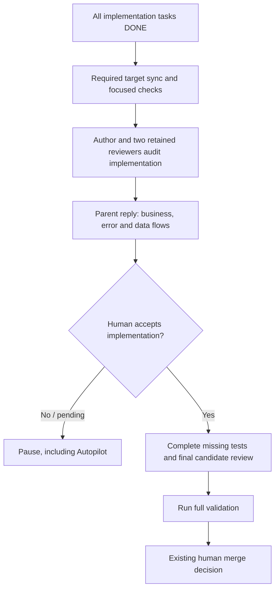

# Delivery archive — Human implementation review before final validation

<!-- sdd: delivery-archive -->

| Field | Value |
| --- | --- |
| Issues | [#179](https://github.com/hhhhhusky777/spec-driven-delivery-playbook/issues/179) |
| Closing pull request | [#180](https://github.com/hhhhhusky777/spec-driven-delivery-playbook/pull/180) |
| Accepted implementation | `4e221b892ffa9c721a35c1b730e81aaac9476067` |

The owner accepted implementation and explicitly authorized this combined
archive, live-plan removal and working-whiteboard reset before final validation.
This candidate describes the state that will result if it merges; it does not
claim pending checks, merge or target verification already passed. GitHub owns
those exact-candidate facts. Complete sources follow with only embedding
headings/links and final plan state adapted. Whiteboard candidate-stage wording
is preserved as historical design context, not current delivery status.

<!-- sdd: archived-whiteboard -->

## Solution Whiteboard — Human implementation review before final validation

<!-- sdd: whiteboard -->

| Field | Value |
| --- | --- |
| State | `CONCLUDED` |
| Need / issue | [#179](https://github.com/hhhhhusky777/spec-driven-delivery-playbook/issues/179) |
| Owner | Repository owner |
| Concluded design revision | `55f8968cb2e8ee795a38d92f5bd0e00e6be6a4ce` |
| Open owner decisions | `None` |

This is the conclusion candidate for owner review. Design freeze and dependent
implementation await the existing reviewer and human acceptance boundaries.

### Discussion draft

| ID | Agreed item, alternative, constraint, or gap | State / resolution |
| --- | --- | --- |
| DR01 | The owner requires a human pause after all development is complete and before validation, including Autopilot deliveries | accepted |
| DR02 | The parent response must show code-level business and error-handling flows | accepted |
| DR03 | The owner asked whether a data flow diagram exists | accepted |
| DR04 | Existing policy already places author and two-reviewer implementation audit before missing final tests and final-test runs | accepted |
| DR05 | Diagrams must help inspect the actual change without becoming a second design or documentation system | accepted |
| DR06 | Approval must remain tied to the implementation that was inspected | accepted |
| DR07 | New deliveries check playbook currentness before work | accepted |

### Current understanding and scope

The current workflow has an implementation audit by the author and retained
reviewers, followed by missing-test work and full validation. It lacks the
owner's requested human pause and concrete implementation-flow presentation.

This change covers that existing transition, the portable workflow/review
skills, this repository's policy, plan guidance, README and diagrams. It does
not change project runtime behavior, task-focused test requirements, branch
policy, review independence or final protected-target merge authority. It adds
no delivery document, diagram service, state engine or new tool dependency.

### Authority, facts and research

| Source | Authority or evidence | Verification / application |
| --- | --- | --- |
| Owner request in this discussion | Human review before validation even with Autopilot, with implementation flow diagrams | Governs D01–D03 |
| [Contributing](../../../CONTRIBUTING.md#branches-review-and-merge) and [quality policy](../../../docs/documentation-quality-policy.md#review-and-human-brief) | Existing implementation audit, focused/final test split, independent review and merge authority | Read against base `814cdf768d72d57d962c51d9e5ad1cae8aa0246f` |
| [Workflow skill](../../../skills/sdd-project-workflow/SKILL.md#autopilot-mode) | Portable authorization and completion behavior | Current Autopilot reaches final readiness without this human implementation pause |
| [Plan template](../../../templates/delivery/implementation-plan.md#test-and-acceptance-contracts) | One test inventory and existing implementation approval boundary | Reuse its plan/PR ownership rather than create another tracker |
| [C4 dynamic diagrams](https://c4model.com/diagrams/dynamic) | Runtime collaboration for a bounded feature or use case | Supports concrete interactions and proportional scope; does not itself mandate this human gate |
| [OWASP system modeling](https://cheatsheetseries.owasp.org/cheatsheets/Threat_Modeling_Cheat_Sheet.html#system-modeling) | DFDs depict processes, stores, external entities and data movement | Use that distinction for the data view; no threat-modeling process is introduced |

Material assumptions: `None`. The timing and diagram-applicability details below
are explicit proposals for owner disposition, not inferred project facts.

### Options and tradeoffs

| Option | Benefit | Cost / limitation | Disposition |
| --- | --- | --- | --- |
| Extend the existing pre-final implementation audit with a human pause and implementation-flow brief | Gives the owner visibility before final-test work while reusing one boundary | Adds one deliberate human wait and preparation of useful diagrams | Proposed |
| Rely only on the existing two-agent audit or final merge review | Lower waiting cost | Does not provide the requested human review before validation | Rejected against the owner requirement |
| Add a second tracker, automatic diagram generator or universal diagram notation | Potential automation | Extra maintenance without evidence it is needed for this outcome | Out of scope |

### Concluded design candidate

| Design point | Accepted outcome | Boundary or rationale | Validation signal |
| --- | --- | --- | --- |
| D01 | After all implementation tasks are DONE, use the existing author/two-reviewer audit, then pause for explicit human acceptance before adding missing final tests or running final-gate tests | Perform any required target sync and affected focused checks first. Existing task-focused tests continue at their current boundaries. A single-unit or Fast Fix delivery reaches the same transition when implementation is complete | Scenario walkthrough cannot proceed into final-test work without acceptance of the implementation candidate |
| D02 | Autopilot also stops at this human implementation review | Autopilot authorization does not satisfy this acceptance. After acceptance, continue only within existing authorization and preserve the final human merge decision | Autopilot scenario stops before final-test work and resumes within recorded authority |
| D03 | After both reviewers approve, the parent reply presents business-flow, error-handling-flow and data-flow diagrams derived from the actual implementation | Business view shows relevant entry points, calls, decisions and outcomes. Error view shows implemented failure propagation, handling, recovery and outcomes. Data view shows producers, relevant transformations, stores and consumers with labeled data movement | Owner can compare all three views with the same candidate and its code references |
| D04 | Keep diagram scope proportional and traceable to this delivery | Use actual code paths/symbols and the accepted changed outcomes; include existing surrounding interactions only as needed. Render the views in the reply and retain review evidence in the PR. Reuse accurate existing diagrams. For an inapplicable view, explicitly state N/A with the concrete reason for human review; do not fabricate a flow | Reviewers verify code agreement, useful scope and any N/A explanation; no new diagram document is created |
| D05 | Human acceptance binds to the audited implementation content | A later implementation-content change, including required target sync, repeats the existing audit, refreshes affected diagrams and requires human acceptance again before dependent final-test work. Test-only additions that preserve that implementation do not by themselves repeat this acceptance | Changed-code scenario invalidates the prior acceptance; test-only scenario preserves it |
| D06 | Put the portable gate contract in the workflow skill and route consumers to it | Review skill verifies evidence and the human boundary. Policy, CONTRIBUTING, plan guidance and README summarize their local consequence and link to the contract. Update affected README diagrams and Autopilot claims together | Installed skills alone expose the requirement; links, terminology and diagrams agree without a duplicate rule owner |
| D07 | Include the prepared in-place upgrade from accepted pin e7934be to immutable main 814cdf7 | Manifest remains at the accepted full SHA while candidate is assessed. Preserve canonical policies, Experience and current project content. After owner acceptance, use the installer for accepted cutover and KB/skill parity | Incremental discovery has no new authority gap; candidate runtime reports UPGRADE_CURRENT; accepted runtime must later report CURRENT |

#### Proposed review position

### Draft-to-conclusion reconciliation

| Draft item | Concluded design point | Disposition | Rationale / evidence |
| --- | --- | --- | --- |
| DR01 | D01, D02 | accepted | Explicit human stop precedes final-test work in either execution mode |
| DR02 | D03 | accepted | Both requested code-level flow views appear in the parent response |
| DR03 | D03 | accepted | DFD supplies the distinct data-movement view; owner disposition pending |
| DR04 | D01 | accepted | Extends the existing audit rather than create another phase tracker |
| DR05 | D04, D06 | accepted | Scope, applicability and canonical ownership keep the presentation useful |
| DR06 | D05 | accepted | Reuses implementation-content invalidation and preserves test-only distinction |
| DR07 | D07 | accepted | Currentness work is prepared in the delivery worktree with the old pin authoritative |

### Newly introduced validations

| ID | Validation, owning authority, and execution boundary | Protected outcome / risk and marginal value beyond existing controls | Concrete invalid case | Failure effect / recovery | Cost / risk reduction | Existing/reusable or cheaper mechanism, its coverage, and why insufficient | Fail-close / test reference | Owner disposition |
| --- | --- | --- | --- | --- | --- | --- | --- | --- |
| V01 | Explicit human implementation acceptance, owned by workflow skill at the existing pre-final-test transition after author/two-reviewer audit | Gives the owner a code-grounded view and decision before final-test effort; current agent review alone supplies no human acceptance | All tasks and agent reviews pass under Autopilot, but the parent starts full validation without presenting flows or receiving acceptance | Pause final-test work; parent presents the current implementation/views and owner accepts or requests correction; repeat the affected audit after code changes | One intentional wait plus proportionate diagram preparation; no additional document, runtime checker or new review cohort | Reuse the existing implementation audit and PR evidence. Agent approval or final merge review alone occurs without the requested human decision before validation | FC01; walkthroughs for Autopilot, ordinary mode, code-change invalidation, test-only continuation and N/A views | Approved by owner in conversation, 2026-10-23 |

All five existing validation criteria apply to V01: traceability to the owner's
requested outcome, correct workflow/human boundary, marginal value beyond agent
review, proportionate human/diagram cost, and reuse of the simplest sufficient
existing audit mechanism.

### Newly introduced fail-closed behaviors

| ID | Trigger | Required fail-closed response | Concrete example | Impact | Recovery / best next action | Owner disposition |
| --- | --- | --- | --- | --- | --- | --- |
| FC01 | Implementation is complete but explicit human acceptance of the current audited implementation is absent or was invalidated by a code change | Stop before adding missing final tests or running final-gate tests, including when Autopilot is enabled | Two task PRs have merged into the feature branch and both reviewers approve, but the owner has not reviewed the three implementation-flow views; the author waits instead of starting the final system tests | Final-validation progress waits for the owner; completed implementation and prior valid evidence are preserved | Parent presents or refreshes the code-grounded brief and resolves findings within authority; owner explicitly accepts that implementation; resume final-test work only after acceptance and required agent audit are current | Approved by owner in conversation, 2026-10-23 |

### Implementation and verification outline

After design acceptance, plan a coherent implementation unit covering the
portable workflow/review contract and its policy, plan and README consumers.
Use existing Markdown/link/lifecycle/Mermaid checks and installed profile
regressions where relevant; add only meaningful missing behavioral evidence,
not prose-locking tests or a new lifecycle engine.

Reviewers walk through ordinary and Autopilot completion, absent acceptance,
implementation changes, test-only additions, single-unit/Fast Fix delivery and
an inapplicable diagram view. Final source validation remains subject to the
existing current quality policy and the owner's accepted design.

### Human brief

| Attention | Summary | Handling |
| --- | --- | --- |
| Requested behavior | Add one human implementation pause before final-test work, including Autopilot, and three implementation-flow views in the reply | HUMAN_DECISION |
| Diagram scope | Affected actual implementation; explicitly justified N/A for an inapplicable view | HUMAN_DECISION |
| New control | Review and accept V01 / FC01 as the one new checkpoint and its safe continuation | HUMAN_DECISION |
| Upgrade | Candidate 814cdf7 prepared; accepted e7934be and project authorities remain intact until acceptance | HUMAN_DECISION |
| Implementation state | No plan or policy implementation yet; this OPEN whiteboard is the review candidate | DISCLOSE |

<!-- sdd: archived-implementation-plan -->

## Implementation Plan — Human implementation review before final validation

<!-- sdd: implementation-plan -->

This is the only active-delivery state authority. The PR owns review, approval
and run evidence; task states describe the candidate's resulting repository state.

### Delivery status

| Field | Value |
| --- | --- |
| State | `COMPLETE` |
| Active tasks | `None` |
| Next ready task | `None` |
| Active blocker | `None` |
| Implementation mode | Human-review-before-merge; Autopilot not enabled |
| Authorized scope / feature branch / protected target | No automatic merge authority; single-unit delivery; main |
| Delivery branch / target | codex/pre-validation-human-review / main |
| Owner | Repository owner |
| Primary issue / need | [#179](https://github.com/hhhhhusky777/spec-driven-delivery-playbook/issues/179) |
| Concluded whiteboard | [Accepted design](#solution-whiteboard--human-implementation-review-before-final-validation), conclusion commit 3fae987091f0f4781c0193cc56cf5ea87a68f043 |
| Required reviewers | The same two isolated issue179 reviewer sessions |
| Last verified | 2026-10-23: owner accepted implementation 4e221b8 and authorized the named archive/reset transition; closing-candidate review, exact-head full validation, merge authority and target evidence remain PR facts; Autopilot remains disabled |

### Governing inputs and delivery boundaries

The [whiteboard](#solution-whiteboard--human-implementation-review-before-final-validation) owns D01–D07 and approved V01 / FC01.
[Contributing](../../../CONTRIBUTING.md) owns branching and merge authority;
the [quality policy](../../../docs/documentation-quality-policy.md) owns project
checks; [template governance](../../../docs/template-governance.md) owns template
consistency. The owner confirmed the implementation-level review and requested
a concise response table supporting a decision to change code or start final
tests. This refines D03 / D04 and the existing human-brief authority.

One implementation unit is sufficient: one portable contract and its existing
consumers change together. No new tool, template, tracker, diagram generator,
runtime state engine, business behavior or unrelated policy is introduced.
Material assumptions and unresolved scope gaps: `None`.

### Design-to-task mapping

| Design point | Task and brief work | Validation | Consistency or gap |
| --- | --- | --- | --- |
| D01 / D02 | T01: extend the existing audit with human acceptance before final-test work, including Autopilot and Fast Fix | Walk ordinary, Autopilot and single-unit routes | Aligned; task-focused tests unchanged |
| D03 / D04 | T01: require a concise decision table and three actual code-level flow views in the reply | Review complete briefs, code references, notation and justified N/A | Aligned; no separate diagram document |
| D05 | T01: preserve acceptance only while the audited implementation content is unchanged | Walk implementation-change and test-only cases | Aligned; existing invalidation boundary reused |
| D06 | T01: keep the detailed contract in workflow skill; reconcile reviewer guidance, policy, CONTRIBUTING, plan and README diagrams | Semantic cross-document review, links, focused checks and Mermaid | Aligned; no duplicate contract owner |
| D07 | T01: complete the accepted in-place upgrade to 814cdf768d72d57d962c51d9e5ad1cae8aa0246f using the installer | Accepted runtime CURRENT and managed skill/KB parity | Cutover complete; accepted runtime validates CURRENT |

### Tasks

| ID | State | Depends on | Outcome | Boundaries | Validation | Branch / PR / required target |
| --- | --- | --- | --- | --- | --- | --- |
| T01 | DONE | None | Portable, concise human implementation-review contract with consistent consumers and installed runtime | D01–D07; human decisions and main merge remain separate | Focused changed-file checks and existing installer regression; implementation review and human acceptance recorded in the PR; exact-head full validation remains required before merge | codex/pre-validation-human-review; [PR #180](https://github.com/hhhhhusky777/spec-driven-delivery-playbook/pull/180); main |

### Task specifications and context receipts

#### T01 — Code-grounded human decision before final tests

| Concern | Value |
| --- | --- |
| Source boundary | skills/sdd-project-workflow/SKILL.md; skills/sdd-feature-review/SKILL.md; docs/documentation-quality-policy.md; CONTRIBUTING.md; templates/delivery/implementation-plan.md; README.md; affected existing tests/document-model.test.mjs diagram assertion; installer-managed accepted runtime material and manifest |
| Consumed dependencies | Accepted D01–D07; project authorities; immutable upgrade candidate 814cdf768d72d57d962c51d9e5ad1cae8aa0246f |
| Critical obligations | Keep focused checks, retained review independence, design scope, final human merge authority and content-bound acceptance intact |
| Context receipt | Authorities, skills, template and README audit/Autopilot paths inspected; existing audit is the sufficient shared boundary; no future implementation output is a readiness prerequisite |
| Required evidence | Focused Markdown/link/lifecycle/Mermaid checks; skill frontmatter validation; applicable existing installed-profile regression; independent semantic walkthroughs; full applicable source checks only at the final gate |
| Actual result | Portable human implementation-review section, existing consumer links and README flow diagrams implemented; affected existing contract-routing/topology assertions updated; accepted runtime cutover complete |

The workflow skill owns the response requirements. Keep its wording short and
normative. Require a concise parent-response table containing these fields:

| Information | Required content |
| --- | --- |
| Implementation / design conformance | What changed and whether the actual implementation matches the accepted design; identify deviations |
| Code-level flows | Render business, error-handling and data-flow diagrams in the reply using suitable established notation; reference actual code and explain any N/A |
| Review findings | Concrete examples, author solutions/dispositions and unresolved findings, or None; reuse the existing findings table |
| Risks / limits / unknowns | Material tradeoffs, accepted limitations and unresolved items, or None; preserve the existing separate material-assumptions table |
| Validation | Focused results and remaining tests to add/run; do not imply full validation passed |
| Recommendation / decision | Author recommendation, both reviewer conclusions, and explicit choice: change implementation or accept it and begin final-test work |

Acceptance here is not full-validation evidence or final merge authority.
Existing generic tables need not be duplicated: include or link their rows in
the same reply while keeping the three actual flows directly visible.

### Test and acceptance contracts

| Owning task | Contract, changed outcome, or risk | Test or scenario | Coverage | Work boundary |
| --- | --- | --- | --- | --- |
| T01 | Portable contract and installation routing | Existing workflow/review profile round-trip regression; skill validators | Existing; no new installer mechanism required | Focused task checks |
| T01 | Consistent documentation and rendered flow positions | Changed-file lint/structure/lifecycle checks and affected Mermaid blocks | Existing tooling | Focused task checks |
| T01 | Human acceptance, code-grounded brief and invalidation | Independent ordinary/Autopilot/Fast Fix, missing acceptance, code-change, test-only and N/A walkthroughs | Reviewer evidence required | Task review and pre-final implementation audit |
| T01 | Source-wide compatibility | npm run docs:all on the exact final reviewed candidate | Existing full suite; exact-head results owned by PR #180 | Final gate, after human implementation acceptance |

Record any genuinely missing tests here with their owner and final-gate
obligation; do not add prose-matching tests merely to lock the new wording.

### Recovery, decisions, and change control

Use the [canonical error-handling framework](../../../docs/error-handling.md).
Known bounded agent mistakes are corrected within authority; material scope
changes require the existing owner-authorized amendment process.
V01 / FC01 are already accepted; this plan adds no validation or fail-close
behavior beyond them. Detailed findings and dispositions remain in PR #180.

### Plan validation and completion

#### Delivery Definition of Done

| Outcome | Required evidence | Result / link |
| --- | --- | --- |
| Accepted design delivered | Complete D01–D07 mapping and no unexplained additions | T01 implementation complete; exact-candidate review evidence belongs in PR #180 |
| Implementation reviewed | Author and both retained reviewers approve the same content; human accepts the code-grounded brief before final-test work | Author and both reviewers APPROVE 4e221b8; owner accepted before final-test work |
| Applicable validation passed | Focused evidence, complete required test coverage and full applicable final source gate | Focused checks passed; PR #180 owns full exact-head evidence required before merge; no unrun gate is claimed passed |
| Current reusable installation | Accepted immutable pin, runtime CURRENT and complete installed KB/skill parity | Complete at 814cdf768d72d57d962c51d9e5ad1cae8aa0246f; new source guidance is a separate unmerged candidate |
| PR-owned delivery | Exact-head review, owner merge authority and target verification | [PR #180](https://github.com/hhhhhusky777/spec-driven-delivery-playbook/pull/180) owns live evidence |
| Merge-ready state and cleanup | Converged tracked state, complete combined archive, live plan removal and whiteboard reset only after named owner authorization | Owner authorized the named archive/reset transition; this candidate preserves complete sources, removes the live plan and resets the working whiteboard |

#### Planned versus actual outcome

| Design / task | Planned result | Actual evidence or deviation | Remaining obligation / owner |
| --- | --- | --- | --- |
| D01–D07 / T01 | One coherent portable gate and consistent consumers | Implemented with focused evidence; no design deviation | Closing-candidate review, full exact-head validation, final human merge decision and post-merge target/local cleanup; PR #180 owns live evidence |

#### Cleanup inventory

| Item | Keep, archive, remove, or reset | Ownership and evidence | Result |
| --- | --- | --- | --- |
| Manifest, reusable guidance and project Experience | Keep | Canonical reusable project sources | Preserved |
| Complete whiteboard and final plan | Combined archive; then remove live plan and reset whiteboard | Normal-delivery completion contract; requires named prior owner authorization | Complete in this merge candidate under the owner-authorized archive/remove/reset transition |
| Delivery worktree and merged branch | Remove only after authorized merge and exact-target verification | Owned worktree recorded in PR #180 and codex/pre-validation-human-review | Pending |
| Installer-owned temporary runtime | Retire superseded checkout through installer ownership checks | Generated ownership markers | Superseded owned checkouts retired during accepted cutover; current runtime remains until worktree cleanup |

### Human review brief

One task, one branch and one PR. Autopilot remains disabled. The owner accepted
the implementation brief and authorized final-test work plus the named
archive/reset transition. Production-code flow views were explicitly N/A for
this guidance-only change; README depicts the actual workflow changes.
Final exact-head review and validation precede a separate human main-merge
decision; neither accepted implementation nor tracked closure authorizes merge.
