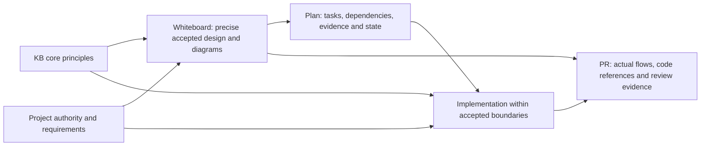
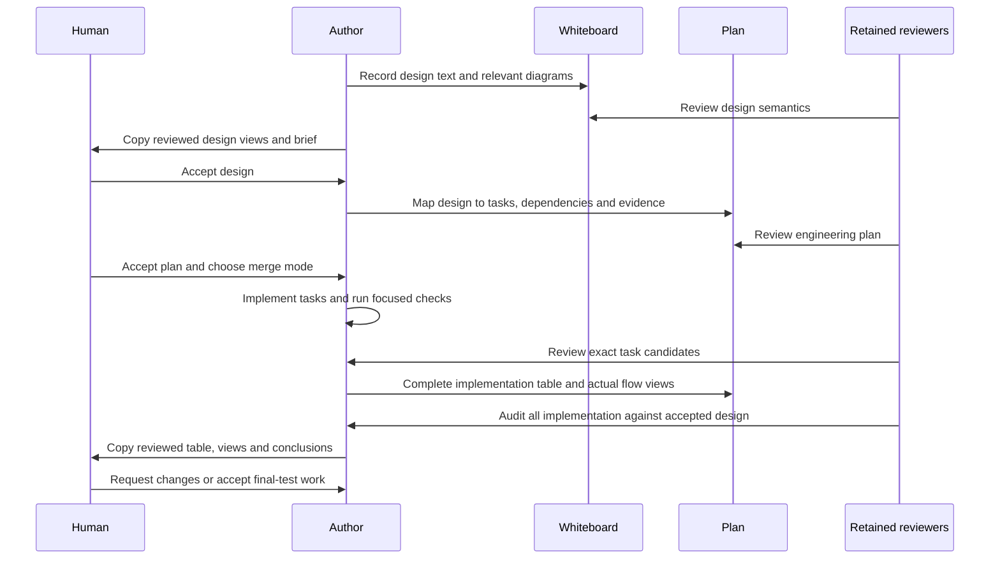
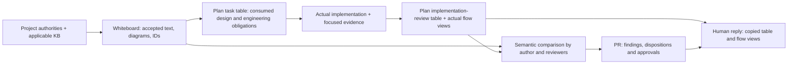
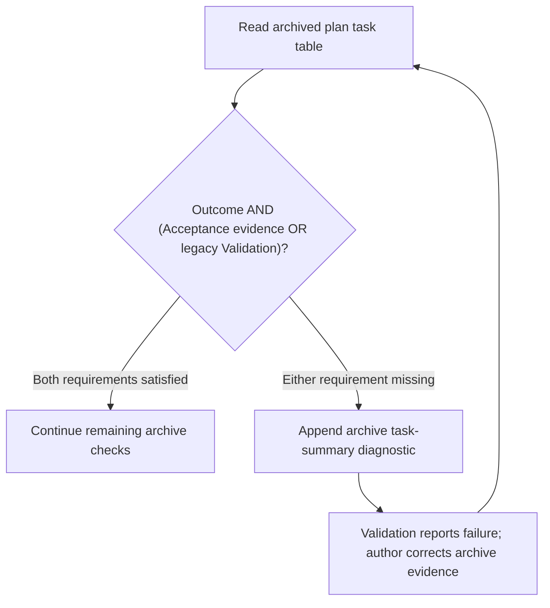

# Delivery archive — Design and Implementation Planning

<!-- sdd: delivery-archive -->

| Field | Value |
| --- | --- |
| Issues | [#187](https://github.com/hhhhhusky777/spec-driven-delivery-playbook/issues/187) |
| Closing pull request | [#188](https://github.com/hhhhhusky777/spec-driven-delivery-playbook/pull/188) |
| Accepted implementation | `9244ccb9b0009368c4a57d85ce722d1087082679` |

The owner accepted implementation, then explicitly authorized this combined
archive, live-plan removal and working-whiteboard reset. Complete sources are
preserved with embedding headings/links and final plan facts adapted. Historical
whiteboard wording remains design context, not current delivery status.
PR #188 owns exact-candidate review, validation, merge and target evidence.

<!-- sdd: archived-whiteboard -->

## Solution Whiteboard — Design and Implementation Planning

<!-- sdd: whiteboard -->

| Field | Value |
| --- | --- |
| State | `CONCLUDED` |
| Need / issue | [#187](https://github.com/hhhhhusky777/spec-driven-delivery-playbook/issues/187) |
| Owner | Repository owner |
| Concluded design revision | `c9855a403c4d04cc1acc08cdbf8953c9205f4395` |
| Open owner decisions | `None` |

This whiteboard records the solution for the owner-accepted G1–G9 change scope.
The fields above identify its conclusion state and revision; the PR owns review
and owner-acceptance evidence. It is not an implementation plan.

### Discussion draft

| ID | Agreed item, alternative, constraint, or gap | State / resolution |
| --- | --- | --- |
| DR01 | All 13 existing KB topics are referenced; strengthen mandatory application within both KB and project boundaries without repeating rules | accepted |
| DR02 | Whiteboard owns architecture and accepted behavior; plan owns engineering delivery, not another design decision | accepted |
| DR03 | Plan tasks follow actual dependencies and focus on one complete, verifiable outcome; task-planning methods belong in one new KB | accepted |
| DR04 | Accurate unambiguous text and corresponding diagrams are both needed; compare design with actual business, data and error-handling flows | accepted |
| DR05 | Keep necessary information, conditional detail, existing task fields and coverage inventory; consolidate generic execution prose | accepted |
| DR06 | No new gate, tracker, fixed task size, diagram quota or permission to change accepted scope; preserve current authority and delivery controls | accepted |
| DR07 | Owner correction: put the brief common KB application boundary in each independently loaded skill's existing global IMPORTANT; Solution Research remains a topic, not the owner of all KB application rules | accepted |

### Authority and context

| Source | Authority or relevant content | Freshness / verification |
| --- | --- | --- |
| [Issue #187](https://github.com/hhhhhusky777/spec-driven-delivery-playbook/issues/187) | Accepted need and G1–G9 scope from owner discussion | Recorded 2026-10-25 Asia/Shanghai |
| [Manifest](../project-adoption-manifest.md) | Accepted pin and canonical project authorities | Design-review snapshot: accepted `1fff88498361cb1d18f62bcaab4b2f6893574bc9`; candidate `c2f83cb8868477a11415a83ea991459546a9f4c3` prepared. The manifest owns the current pin |
| [Contributing](../../../CONTRIBUTING.md), [quality policy](../../../docs/documentation-quality-policy.md), [template governance](../../../docs/template-governance.md) | Branch/review authority, six goals, one responsibility per document | Source baseline `c2f83cb`; unchanged by this design candidate |
| [Error handling](../../../docs/error-handling.md), [Experience](../../../docs/experience.md) | Recovery, scope escalation and verified lessons | Preserve existing owners and controls |

### Current system and gaps

The source and installed workflow skills match. Topic-level read triggers exist,
and the global IMPORTANT requires reading, but the complete dual-boundary
application statement lives in the non-mandatory KB README. The plan contains
`Proposed design`, architecture decisions and an invitation to add feature
behavior; the whiteboard has no explicit architecture-view prompt. Task fields
already exist, but reusable decomposition guidance and design/code-view
traceability need clarification. These are the accepted gaps, not evidence
that all current delivery is invalid.

### Concluded design

The text below defines the design's semantics. Diagrams expose structure and
flows; they MUST NOT substitute for precise conditions or invite agents to
infer missing behavior. Implementation wording may be refined without changing
these semantics. Once concluded, existing amendment authority applies.

| Design point | Accepted outcome | Boundary or rationale | Validation signal |
| --- | --- | --- | --- |
| D01 | Each independently loaded workflow, review and triage skill states a brief mandatory KB application boundary in its existing global IMPORTANT: read and apply relevant KB core principles while satisfying approved project scope, requirements, contracts and policies | Retain accepted-pin or matching-revision conditions and all existing topic triggers; summaries or prior knowledge cannot replace reading. Use existing canonical decision/error authority for genuine conflicts. Solution Research owns research, evidence, PoCs and solution selection, not all KB application rules; no new common document or detailed duplicate policy | All three skill-wide blocks express both boundaries; topic routes remain; Solution Research contains no cross-KB application section and the KB index remains an index |
| D02 | Whiteboard owns the accepted solution: behavior, architecture, contracts, boundaries and material tradeoffs | It describes the chosen approach, responsibilities and relevant interactions, not just desired results; task execution/status and contract-equivalent engineering choices remain with the plan/agent | An engineer can implement without inventing architecture or externally visible behavior; plan references the same accepted IDs |
| D03 | Relevant architectural behavior has accurate, unambiguous text plus corresponding diagrams | State material inputs/preconditions, responsibilities, effects/postconditions, invariants, failure meaning and applicable quality/measurement requirements; link contracts already owned elsewhere rather than copy them. Use suitable UML/DFD-style views, combine views when clear, and explain genuine N/A. No universal diagram count or exhaustive case list | Text and diagram semantics agree; neither guesses nor an attractive diagram fill an unresolved contract |
| D04 | Plan translates the approved design into engineering implementation obligations, dependencies, evidence and delivery state | Move architecture ownership out of `Proposed design`/`Key decisions`; preserve useful content in its proper owner or link. Replace permission-like `add feature-specific behavior` with consumed approved contracts. Implementation choices may vary only within accepted boundaries | No duplicate architecture authority, lost necessary information or new business behavior; existing template completeness remains proportional |
| D05 | Add `knowledge-base/task-planning-and-decomposition.md` as the sole reusable task-planning method owner | Cover one coherent verifiable outcome, completeness, appropriate size, real acyclic dependencies, ready inputs, safe independent parallelism and acceptance evidence. No fixed file/line/time quota, mandatory worksheet or speculative prerequisite/framework | Published guidance is distilled with limits; workflow planning/replanning and reviewer plan assessment MUST read/apply the shipped topic |
| D06 | Existing task and detail fields clearly record the result of planning | Outcome names one complete observable result; dependencies name actual consumed prerequisites, not numbering or outputs required before their producing task starts; validation includes acceptance meaning and evidence. Keep existing fields and optional detail | A small plan identifies scope, dependencies and completion without extra status tables; large coherent work can be split without fragmentation |
| D07 | Existing design-to-task mapping connects approved points/diagrams to tasks and final implementation evidence | At the existing human implementation gate, compare actual code-grounded business, data and error-handling views with applicable approved text/diagrams. Compare semantics, not identical graph shapes; internal detail may differ without changing behavior | Missing or unauthorized behavior, ownership and failure changes are visible in the existing brief/findings; no new gate or comparison tracker |
| D08 | Generic execution rules have one owner instead of a second workflow in the plan | Keep task-specific obligations, coverage inventory, authorization and state; replace duplicated general execution sequence with references. Preserve existing branch-policy enforcement, freeze/amendment, reviewers/human gates, focused/final scheduling and per-task 90-minute rule | No mandatory control is weakened or moved into an optional document; no added approval boundary |
| D09 | Affected index, README, skills and tests agree, and adopting projects receive the complete new KB | Use existing installer distribution and manifest-linked resolution. Update affected diagrams/descriptions only; add meaningful structure/packaging evidence rather than exact-prose locks. Historical archives and unrelated #147/#142 work remain untouched | Relevant focused checks pass, later full source gate passes, and installed routing resolves without installing the source suite in adopters |

#### Architecture and information ownership

Project authority and KB principles jointly bound the approved design. The plan
consumes that design; implementation consumes the approved plan and contracts.
The existing PR/human implementation brief compares actual results back to the
design. This describes ownership, not another prescribed execution sequence.

The distinction is decision impact, not whether a document mentions code.
Changing transaction ownership or retry meaning can require a design amendment
even for a tiny diff. Equivalent private helpers, file organization and fixtures
remain engineering choices. Text/diagram conflicts need correction under the
existing authority; neither representation licenses ignoring the other.

### Options, experiments, and tradeoffs

| Option | Disposition | Rationale |
| --- | --- | --- |
| Put planning methods into the plan template | rejected | Repeats reusable guidance in every delivery and mixes method with project facts |
| Diagrams alone or narrative alone | rejected | Neither alone provides the requested explicit contracts plus comparable structural views |
| One new planning KB with short required-read routes and bounded templates | accepted | Reuses existing roles, mapping, installer and review gates |
| Copy vendor templates, time targets, trunk policy or per-task design documents | rejected | Public examples do not override this project's approved boundaries or justify extra ceremony |

### Risks and consequences

| Risk | Handling and residual limit |
| --- | --- |
| Simplification removes a necessary contract/control | Preserve its information and authority; review before/after content ownership and affected regressions, not just deletion count |
| Structural checks are mistaken for proof of agent judgment | Combine structural/packaging checks with semantic author/reviewer checks of concrete situations; report that automated checks cannot guarantee future decisions |
| Readable figures conceal unresolved text or expand implementation scope | Require aligned precise text and diagram semantics; keep existing amendment/decision boundary, not an automatic stop for every harmless implementation detail |
| Source upgrade is confused with activating new feature guidance | Keep old pin until owner acceptance; prepared `c2f83cb` contains #186 testing KB, not this unimplemented planning feature |

### Draft-to-conclusion reconciliation

| Draft item | Concluded design point | Disposition | Rationale / evidence |
| --- | --- | --- | --- |
| DR01 | D01 | accepted | Brief skill-wide application boundaries and retained conditional read triggers |
| DR02 | D02, D04 | accepted | Architecture and engineering delivery have distinct authority |
| DR03 | D05, D06 | accepted | Reusable method is separate from concrete task facts |
| DR04 | D03, D07 | accepted | Accurate text, corresponding figures and code-grounded comparison |
| DR05 | D04, D08, D09 | accepted | Rehome necessary content and remove duplicate execution prose |
| DR06 | D01, D05, D08, D09 | accepted | Existing controls remain; methods and detail stay proportionate |
| DR07 | D01 | accepted | Owner authorized replacing the misplaced Solution Research ownership with brief global skill boundaries; reviewer and human acceptance precede dependent correction |

### Newly introduced validations

No new runtime/contract rejection or acceptance checkpoint is introduced.
Required reading, semantic review and design-conformance checks are clarified
within existing controls, not implemented as a new automated gate.

| ID | Validation, owning authority, and execution boundary | Protected outcome / risk and marginal value beyond existing controls | Concrete invalid case | Failure effect / recovery | Cost / risk reduction | Existing/reusable or cheaper mechanism, its coverage, and why insufficient | Fail-close / test reference | Owner disposition |
| --- | --- | --- | --- | --- | --- | --- | --- | --- |
| None | None | None | None | None | None | None | None | None |

### Newly introduced fail-closed behaviors

No new runtime fail-closed behavior. Material scope/authority conflicts still
use the existing framework; this design does not add new rejection machinery.

| ID | Trigger | Required fail-closed response | Concrete example | Impact | Recovery / best next action | Owner disposition |
| --- | --- | --- | --- | --- | --- | --- |
| None | None | None | None | None | None | None |

### Research basis and applicability

These primary sources were read during the owner discussion. The design is this
project's synthesis, not a vendor-mandated document taxonomy or universal size.

- [Google: Small CLs](https://google.github.io/eng-practices/review/developer/small-cls.html): cohesive self-contained changes, related evidence and meaningful decomposition, not a file/line quota.
- [Microsoft: Feature/story design](https://microsoft.github.io/code-with-engineering-playbook/design/design-reviews/recipes/templates/feature-story-design-review/): solution context, contracts, architecture and real dependency questions; do not copy the design into an execution plan.
- [Microsoft: Architecture specification](https://learn.microsoft.com/en-us/azure/well-architected/architect-role/architecture-design-specification): business-grounded decisions, interfaces, quality and operational requirements, then engineering work items.
- [Microsoft: Task dependencies](https://learn.microsoft.com/en-us/azure/devops/boards/queries/link-type-reference?view=azure-devops#work-link-type): actual directional prerequisites and cycle prevention, not a mandated project tool.
- [DORA: Small batches](https://dora.dev/capabilities/working-in-small-batches/): testable, valuable, appropriately sized work; its trunk/deployment practices do not override this repository's branch or final-validation policy.
- [AWS: Architecture decision records](https://docs.aws.amazon.com/prescriptive-guidance/latest/architectural-decision-records/faq.html): context, decisions and consequences; use existing whiteboard decision records, not new ADR files.

### Human brief

Acceptance of D01–D09 and the prepared upgrade from `1fff884` to `c2f83cb`
permits the metadata-only conclusion transition, reviewer verification and
subsequent implementation planning. It does not approve a later plan, enable
Autopilot, authorize template/skill implementation before readiness, or permit
merge. Review and acceptance evidence belongs in the PR.

The D01 placement correction recorded in DR07 changes only that named scope
and its reconciliation; the previous accepted design remains available in Git.
Review and owner-acceptance evidence belongs in the PR. D02–D09 and both
all-None inventories retain their accepted meaning.

<!-- sdd: archived-implementation-plan -->

## Implementation Plan — Design and Implementation Planning

<!-- sdd: implementation-plan -->

This plan owns this delivery's tasks and state. The
[concluded whiteboard](https://github.com/hhhhhusky777/spec-driven-delivery-playbook/blob/9244ccb9b0009368c4a57d85ce722d1087082679/.github/spec-driven-delivery/solution-whiteboard.md) owns solution decisions;
[PR #188](https://github.com/hhhhhusky777/spec-driven-delivery-playbook/pull/188)
owns reviews, validation results, acceptance and merge evidence.

### Delivery status

| Field | Value |
| --- | --- |
| State | `COMPLETE` |
| Active tasks | `None` |
| Next ready task | `None` |
| Active blocker | `None` |
| Implementation mode | `human-review-before-merge` |
| Authorized scope / feature branch / protected target | Accepted task scope T01–T03; feature `codex/design-planning`; protected target `main`; Autopilot `None` |
| Delivery branch / target | `codex/design-planning` / `main` |
| Owner | Repository owner |
| Primary issue / need | [#187](https://github.com/hhhhhusky777/spec-driven-delivery-playbook/issues/187) |
| Concluded whiteboard | [Frozen file at d99a83e](https://github.com/hhhhhusky777/spec-driven-delivery-playbook/blob/d99a83e17a29a60109ccd3bd276a739ec02c6bb2/.github/spec-driven-delivery/solution-whiteboard.md); accepted D01 amendment revision `c9855a403c4d04cc1acc08cdbf8953c9205f4395` |
| Required reviewers | Same two retained independent feature reviewer sessions |
| Last verified | Closing candidate: T01–T03 integrated; implementation accepted at 9244ccb with full validation passed (84/84). Closing-head checks, final merge acceptance and target verification remain PR facts |

### Governing inputs and delivery boundaries

| Source | Authority / use |
| --- | --- |
| [Manifest](../project-adoption-manifest.md) and its canonical links | Accepted installed pin `c2f83cb8868477a11415a83ea991459546a9f4c3`, project policies and ownership |
| [Concluded whiteboard](https://github.com/hhhhhusky777/spec-driven-delivery-playbook/blob/9244ccb9b0009368c4a57d85ce722d1087082679/.github/spec-driven-delivery/solution-whiteboard.md), D01–D09 | Accepted outcomes, architecture/document ownership, precise text and diagrams, scope and tradeoffs |
| [Contributing](../../../CONTRIBUTING.md) | Branch policy, reviews, merge authority and source validation |
| [Quality policy](../../../docs/documentation-quality-policy.md) and [template governance](../../../docs/template-governance.md) | Quality, human briefs and reusable document responsibilities |
| Verified `.sdd-runtime/agent-guide.md` and its installed workflow skill | Lifecycle, task readiness, review, final-test and cleanup contracts |
| Whiteboard research basis | Already-read primary guidance and its recorded applicability; research is reusable while current and applicable |

| Concern | Accepted boundary |
| --- | --- |
| Required outcome | Brief mandatory skill-wide KB application boundaries, one task-planning KB, and aligned design/engineering templates and consumers implementing D01–D09 |
| Scope | Source KB, affected skill routes, whiteboard and plan templates, affected README/index/diagram descriptions, and meaningful source regression/packaging checks |
| Non-scope | New gates, trackers, document quotas, runtime rejection mechanisms, broad checker rewrites, historical archive rewrites, unrelated #147/#142 work, and installing source tests into adopting projects |
| Assumptions | None requiring owner resolution; topic availability is checked against the accepted pin, not assumed |
| Compatibility | Preserve branch enforcement, frozen-design/amendment authority, reviewer continuity, human gates, focused/final validation timing, the 90-minute task boundary and proportional template completeness |

Existing architecture and contracts are consumed from D01–D09, not redefined
here. Engineering choices may vary within those accepted boundaries. Do not
edit this delivery's frozen whiteboard to demonstrate a template change.

### Delivery strategy and readiness

| Concern | This delivery |
| --- | --- |
| Integration model | Feature integration branch `codex/design-planning`; only final PR #188 targets `main` |
| Baseline | Feature branch created from `c2f83cb8868477a11415a83ea991459546a9f4c3`; accepted preparation/conclusion ends at `25cc9c6` |
| Dependency rationale | T01 establishes skill-wide KB application boundaries; T02 consumes them for the planning method and routes; T03 applies that method and ownership model to template consumers |
| Parallel ownership | No concurrent overlapping implementation tasks; independent research, review and checks may run concurrently under the existing concurrency KB |
| Merge authority | Human review before each task merge by default; Autopilot requires explicit opt-in naming this feature branch and task scope |
| Readiness | Approved plan, consumed prerequisite results and sufficient current context; task-produced KB, templates and test outputs are not prerequisites for starting their producing task |

> [!IMPORTANT]
> Every task PR MUST target `codex/design-planning`. Only the final feature PR
> may target `main`. This plan grants no exception to the canonical branch
> policy. A branch/target mismatch MUST block task readiness, review and merge.

Required environment support is the repository's Node.js dependencies,
installer and managed runtime; no external service or project secret is needed
for this documentation/tooling delivery. The installed workflow and canonical
error-handling authority own environment readiness and recovery.

### Design-to-task mapping

The Tasks table is the single mapping from accepted D01–D09 to engineering
work. All nine points are covered; no unmapped design obligation is known.
Final audit, human acceptance and full validation remain in Plan validation
and completion; task completion does not claim those gates passed.

### Tasks

Design references below resolve to the [concluded design](https://github.com/hhhhhusky777/spec-driven-delivery-playbook/blob/9244ccb9b0009368c4a57d85ce722d1087082679/.github/spec-driven-delivery/solution-whiteboard.md#concluded-design).
The shared preservation boundaries above apply to every row.

| ID | State | Depends on | Consumed design | Implementation work | Outcome | Boundaries | Consumed error handling | Consumed validations | Acceptance evidence | Consumed assumptions | Branch / PR / required target |
| --- | --- | --- | --- | --- | --- | --- | --- | --- | --- | --- | --- |
| T01 | `DONE` | `None` | D01: joint KB/project boundary; D09: consistent consumers | Put the brief boundary in all three skills' existing IMPORTANT blocks; retain version-aware topic triggers; remove cross-KB ownership from Solution Research and its index description | Independently loaded skills require reading and applying relevant KB principles within approved project authority | Existing skills, research topic, index and model regression; no new policy document or template architecture change | Preserve canonical conflict/error authority; no new rejection or recovery behavior | None | All three global blocks and topic routes remain consistent; T01 coverage rows below | None | `codex/design-planning-t01`; [PR #189](https://github.com/hhhhhusky777/spec-driven-delivery-playbook/pull/189); target `codex/design-planning` |
| T02 | `DONE` | `T01` | D05: coherent task method; D09: distribution and routes | Consume T01's global boundary; distill the recorded primary sources into the planning KB; add index and mandatory planning/replanning/review routes; reuse complete-tree installer and existing tests | Adopters receive one evidence-based method for complete outcomes, actual acyclic dependencies, readiness, useful parallelism and acceptance evidence | New topic and affected consumers/tests only; no new installer, worksheet, quota or imported vendor branch policy | Missing material design inputs use existing owner authority; task-produced outputs are not starting prerequisites | None | Topic/route checks and complete 15-document installed-tree agreement; T02 coverage rows below | None | `codex/design-planning-t02`; [PR #190](https://github.com/hhhhhusky777/spec-driven-delivery-playbook/pull/190); target `codex/design-planning` |
| T03 | `DONE` | `T01, T02` | D02–D04: architecture/design ownership and text/views; D06: complete tasks; D07: semantic traceability; D08: canonical workflow; D09: aligned consumers | Consume T01's boundaries and T02's method; move architecture/contract fields to whiteboard; consolidate design consumption and engineering obligations in task rows; route generic execution prose to workflow; align human/reviewer briefs, README diagrams and regressions | Human review can trace accepted design through concrete task work and compare relevant design text/views with actual implementation evidence | Existing templates/consumers only; preserve necessary information, single coverage inventory, genuine diagram N/A and all mandatory controls; no frozen-whiteboard or historical-archive edits | Preserve accepted failure contracts and canonical error handling; rows reference their task-specific application without inventing fail-closed behavior | None | Preserved fields/controls, task-column and lifecycle checks, diagram parsing and representative semantic comparison; T03 coverage rows below | None | `codex/design-planning-t03`; [PR #191](https://github.com/hhhhhusky777/spec-driven-delivery-playbook/pull/191); target `codex/design-planning` |

### Task specifications and context receipts

Task scope and obligations live in the rows above; this table records their
execution context and results without repeating the design mapping.

| Task | Context receipt | Actual result |
| --- | --- | --- |
| T01 | Accepted D01 amendment, manifest authorities and version-aware KB routes | Global boundaries and research-only ownership implemented; affected regression passes. Review and merge evidence: PR #189 |
| T02 | Merged T01; recorded Google, DORA and Microsoft research; own accepted-pin runtime and dependencies | KB and required routes implemented with project-policy applicability limits and examples; existing installer cases verify the complete tree. Review and merge evidence: PR #190 |
| T03 | Merged T01/T02; accepted D02–D09, existing templates/controls and owner-requested task-table presentation | Useful architecture, behavior/state, interface and quality fields retained in whiteboard; task table consumes the design without proposing new behavior. Workflow, reviewer, README and regressions aligned. Frozen design preserved; implementation audit and acceptance complete at 9244ccb; full validation passed there. Closing-head evidence remains in PR #188 |

### Test and acceptance contracts

The table is a coverage/work inventory, not a test-run log. The installed
workflow owns focused/final timing, author/reviewer implementation audit and
human acceptance before final-test work. PRs own actual run evidence. Recorded
missing non-focused test work may be completed at the final gate; it is not a
prerequisite for starting or completing its producing implementation task.

| Owning task | Contract, changed outcome, or risk | Test or scenario | Coverage | Work boundary |
| --- | --- | --- | --- | --- |
| T01 | Skill-wide KB/project boundaries and all existing required-read routes | Inspect each global skill block, retained version conditions, topic routes and research-only ownership | Implemented in `tests/document-model.test.mjs`; structural coverage plus semantic review, not proof of future agent judgment | Focused task work; unchanged installer/full source suite deferred to final gate |
| T02 | Coherent task method with applicability limits and mandatory consumers | Planning/replanning and reviewer route case in `tests/document-model.test.mjs`; semantic assessment of outcome/dependency examples | Implemented; automated routing evidence does not prove planning judgment | Focused task work |
| T02 | Adopters receive new topic and valid installed routes | Existing actual-index and installed-topic cases in `tests/installer.test.mjs` include the new topic | Implemented; complete actual tree and installed content match source, existing installer unchanged | Focused applicable cases; complete source suite at final gate |
| T03 | Required template information retained under correct owner; design diagrams visible in the whiteboard human-review response | Updated document-model cases and representative text/view/plan comparison in the PR | Implemented; model checks cover moved fields and mandatory response/semantic-comparison routes | Focused task work |
| T03 | Readiness does not require future outputs; mapping and controls remain valid | Existing `tests/sdd-three-doc.test.mjs` state-graph and template cases plus affected model assertions | Existing lifecycle cases retained and passing; canonical workflow controls remain checked while plan duplication is removed | Focused affected cases; full source suite at final gate |
| T01–T03 | Changed Markdown, references, diagrams and whitespace | `npm run docs:focused -- TASK_BASE HEAD` and relevant structural/skill checks | Existing tools | Focused task work |
| T01–T03 | Complete source compatibility and installed-tree agreement | `npm run docs:all`, plus required shell/skill validation on the final candidate | Existing full source gate; reconcile any coverage gaps after implementation acceptance | Final gate |

Tests must be grounded in accepted outcomes and real contract risks, not lock
exact prose or invent cases to force new handling. Inspect current assertions
before adding duplicate coverage. Structural checks cannot prove future agent
judgment; semantic author/reviewer assessment remains necessary.

### Plan validation and completion

#### Implementation review

All three tasks are integrated through PRs #189–#191. This table describes the
implemented result; current reviewer decisions and human acceptance belong in
[PR #188](https://github.com/hhhhhusky777/spec-driven-delivery-playbook/pull/188).

| Information | Implementation summary / evidence |
| --- | --- |
| Implementation / design | D01: mandatory joint KB/project boundaries in all three skills. D05: task-planning KB and required-read routes. D02–D04/D06–D09: whiteboard owns architecture; plan task columns consume design, error handling, validations and assumptions, separately from acceptance evidence. Workflow owns human gates; reviewer skill owns semantic comparison. No known design deviation |
| Code-level flows | The three views below follow actual skill instructions, template ownership and the changed archive checker. This delivery mainly changes agent instructions; these are instruction/data flows, not a new executable orchestrator |
| Review findings | Earlier dependency-format finding fixed: use task IDs only, with input descriptions in engineering columns. Latest task review: both retained reviewers approved with no findings; integrated implementation audit conclusions remain in PR #188 |
| Risks / limits / unknowns | Structural checks do not guarantee future agent judgment. Accepted installed runtime remains pinned; source changes are not yet an installed upgrade. Archive checker accepts both new Acceptance evidence and legacy Validation labels |
| Validation | Task-focused model/lifecycle and affected installed-routing checks passed at their recorded candidates. Full validation passed at accepted implementation 9244ccb: 84/84 tests plus documentation checks. No missing test was identified. Closing-head validation remains in PR #188 |
| Recommendation / decision | Author and both retained reviewers approved implementation; the human accepted final-test work and then explicitly authorized this archive, live-plan removal and whiteboard reset. Final main merge remains subject to PR review and owner acceptance |

##### Actual business flow

Sources: [workflow](../../../skills/sdd-project-workflow/SKILL.md),
[reviewer](../../../skills/sdd-feature-review/SKILL.md), and the
[plan template](../../../templates/delivery/implementation-plan.md).
D02–D08: design ownership feeds engineering planning; completed implementation
returns through the existing audit and human decision before final tests.

##### Actual data flow

Sources: [whiteboard template](../../../templates/discovery/solution-whiteboard.md),
[plan template](../../../templates/delivery/implementation-plan.md), and
[workflow](../../../skills/sdd-project-workflow/SKILL.md).
D01/D03/D04/D06/D07: each artifact retains its facts; the reply exposes reviewed
content without creating a second source of authority.

##### Actual error handling

Source: `deliveryArchiveErrors` in
[lifecycle checker](../../../scripts/sdd-lifecycle-three-doc.mjs).
D09 compatibility: the changed check accepts either evidence column label;
`Consumed validations` alone is not test/acceptance evidence. Other archive
checks still apply; this diagram isolates the changed predicate.

The decision means `Outcome AND (Acceptance evidence OR Validation)`.
It preserves the existing rejection of missing acceptance evidence; it does not
introduce a new runtime failure policy or treat design validations as tests.

#### Delivery Definition of Done

| Outcome | Required evidence / owner |
| --- | --- |
| D01–D09 delivered without new scope | Mapping above, task results and PR evidence |
| Each merge unit consistent | Affected source KB, skills, templates, index/README and tests reconciled in that unit |
| Final implementation conforms | Existing author/two-reviewer audit and human implementation brief comparing approved text/diagrams with actual views |
| Final source validation complete | Existing final gate; focused evidence does not substitute for full source tests |
| Canonical state ready on merge | Task completion updates travel with their implementing PR; GitHub retains live review/merge facts |
| Delivery cleanup | Existing combined-archive contract and verified owned cleanup; frozen-whiteboard reset requires its later explicit named human authorization |

Detailed recovery and decision discussion belongs in PR #188. Update this plan
only for actual task/state changes or a material engineering-plan adjustment;
design amendments require the existing prior human authority.

### Human review brief

The remaining human decision is final main merge after closing-candidate review
and validation. The implementation review table and views above preserve the
accepted result; current approvals and check results remain in PR #188.

### Planned versus actual outcome

| Design / task | Planned result | Actual result / deviation | Remaining obligation |
| --- | --- | --- | --- |
| D01 / T01 | Joint KB/project boundaries in independently loaded skills | Delivered through PR #189; no design deviation | None |
| D05 / T02 | Planning KB and required routes | Delivered through PR #190 using existing installer distribution | None |
| D02–D04, D06–D09 / T03 | Architecture in whiteboard; engineering task mapping and aligned consumers | Delivered through PR #191; owner-approved consistency corrections included in PR #188 | Closing-head checks, final acceptance and target verification in PR |

### Cleanup inventory

| Item | Action | Ownership and authority | Result / remaining obligation |
| --- | --- | --- | --- |
| Complete concluded whiteboard and final plan | Preserve in this combined archive | Owner explicitly authorized closing transition | Embedded below archive markers; PR #188 linked |
| Live implementation-plan.md | Remove | This feature's sole live plan; same owner authorization | Removed in closing candidate |
| Working solution-whiteboard.md | Reset to EMPTY | Named owner authorization after implementation acceptance | Reset in closing candidate |
| Manifest, project authorities, KB and reusable source | Keep | Reusable project content | Preserved; accepted pin unchanged |
| Feature/task worktrees and branches | Remove owned worktrees and merged branches after target verification | Git worktrees registered to `codex/design-planning` and `codex/design-planning-t03` | Pending final merge and verification; unrelated worktrees excluded |

`COMPLETE` describes the tracked state produced if this closing candidate merges.
It does not claim pending PR approval, merge, target verification or physical
worktree cleanup has happened. GitHub owns those live facts.
