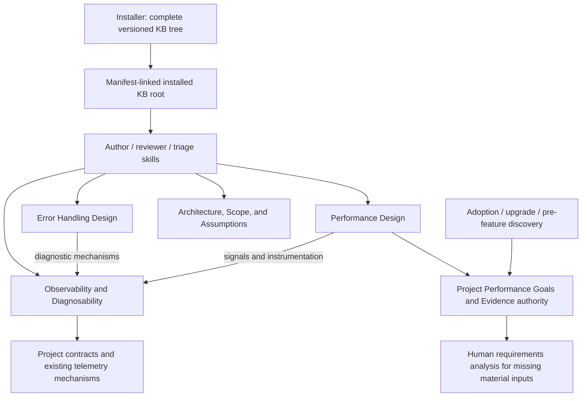
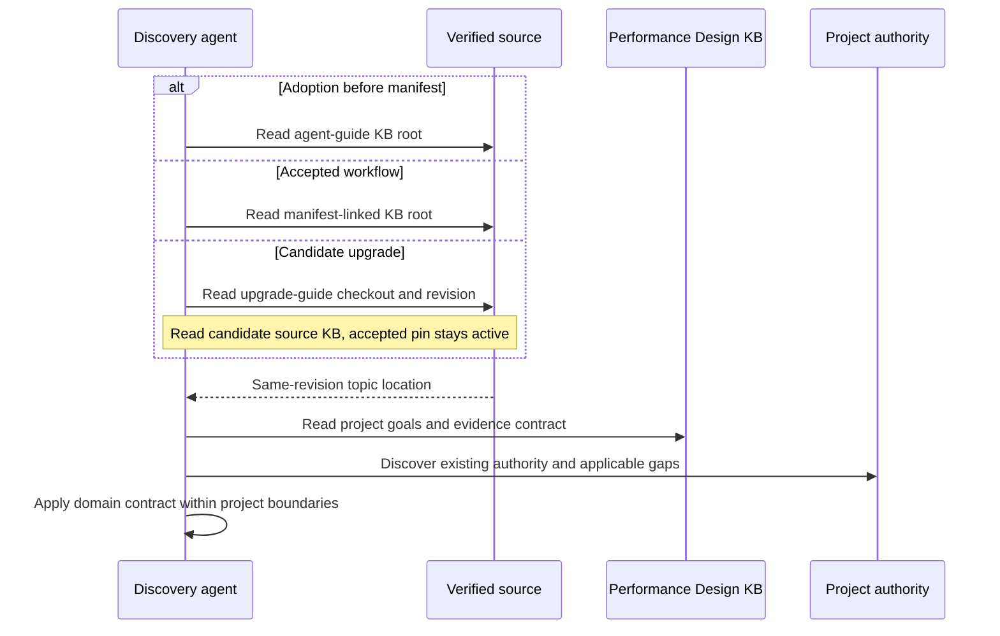
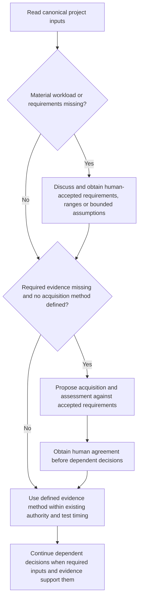
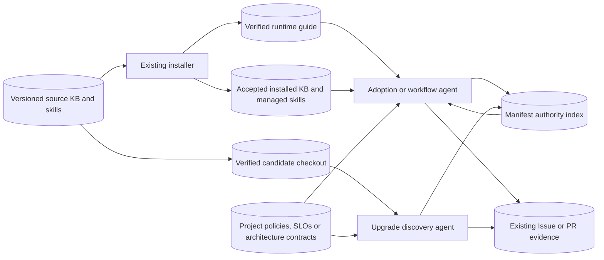

# Delivery archive — Shared Observability and Diagnosability

<!-- sdd: delivery-archive -->

| Field | Value |
| --- | --- |
| Issues | [#215](https://github.com/hhhhhusky777/spec-driven-delivery-playbook/issues/215) |
| Closing pull request | [#216](https://github.com/hhhhhusky777/spec-driven-delivery-playbook/pull/216) |
| Task pull requests | [#217](https://github.com/hhhhhusky777/spec-driven-delivery-playbook/pull/217), [#220](https://github.com/hhhhhusky777/spec-driven-delivery-playbook/pull/220), [#221](https://github.com/hhhhhusky777/spec-driven-delivery-playbook/pull/221) |

The owner authorized complete archive/reset on 2026-11-01 after accepting the
implementation and final-test work. The complete concluded whiteboard below is
preserved from accepted source 34b3532, including authorized record corrections;
only heading levels and relative links are adapted. Historical design-time
pending statements remain part of that snapshot; subsequent acceptance and
completion are recorded by the final plan and PR. The complete final plan
records delivered outcomes, source validation and remaining merge/cleanup
boundaries. Its headings are normalized for existing archive checks without
removing source content. COMPLETE describes delivered work and merge-resulting
canonical state; PR #216 owns exact closing-candidate checks, final human merge
acceptance and post-merge verification/physical cleanup. Current installation
remains at c27ab7e; source delivery does not activate a new project pin.

<!-- sdd: archived-whiteboard -->

## Solution Whiteboard — Shared Observability and Diagnosability

<!-- sdd: whiteboard -->

| Field | Value |
| --- | --- |
| State | `CONCLUDED` |
| Need / issue | [Issue #215](https://github.com/hhhhhusky777/spec-driven-delivery-playbook/issues/215) |
| Owner | Repository owner |
| Concluded design revision | `883b173` |
| Open owner decisions | None |

### Discussion draft

| ID | Agreed item, alternative, constraint, or gap | State / resolution |
| --- | --- | --- |
| DR01 | Preserve the true failure origin through shared handlers without logging every branch | Accepted |
| DR02 | Share suitable instrumentation and operation context for performance and error information | Accepted |
| DR03 | Distinguish required diagnostic evidence from optional detail and explain distributed traces | Accepted |
| DR04 | Keep an authorized triage repair together through relevant verification before review | Accepted |
| DR05 | Remove the standalone export example and performance discussion from the error KB | Accepted |
| DR06 | Give observability and diagnosability a separate KB; error handling and performance link to it | Accepted |
| DR07 | Fast Fix is insufficient; write whiteboard and plan | Accepted |
| DR08 | PR #217 comments request a shared framework when absent, existing framework options and explicit performance evidence | Accepted |
| DR09 | PR #217 comments request filenames that match the narrowed topics and removal of redundant scope introductions | Accepted |
| DR10 | Owner approved moving architectural conformance guidance, its ArchUnit example and supporting references into the existing Architecture, Scope, and Assumptions KB | Accepted |
| DR11 | Owner clarified Performance Design selects high-performance system structure; code-level engineering realizes it and reduces overhead; measurement methods belong to the shared topic | Accepted |
| DR12 | Owner approved a reusable project Performance Goals and Evidence authority, discovery/upgrade checks, human requirements analysis for material missing inputs and evidence acquisition definitions | Accepted |

### Current understanding

| Concern | Current understanding |
| --- | --- |
| Problem / observed need | General signal and diagnostic mechanisms are split between error and performance KBs, obscuring ownership and inviting duplication |
| Required outcome | One installed, directly readable Observability and Diagnosability topic; narrow error/performance topics; consistent skill routing and links |
| Actors and critical journeys | Author, independent reviewers and triage agent read version-matched guidance and select proportionate evidence within project authority |
| In scope | Existing Issue #215 work, shared-topic extraction, Performance Design boundary, reusable project performance-authority discovery contract, KB index, applicable skills/templates/links and existing tests |
| Out of scope / deferred | Runtime telemetry implementation, platform/SDK adoption, project-specific target selection or policy activation, new gates, live model evaluations, historical archive rewrites and unrelated KB cleanup |
| Confidence | Scope and content sources are known; implementation and installation proof remain future work |

### Authority and context

| Source | Authority or relevant content | Freshness / verification |
| --- | --- | --- |
| Owner discussion and [Issue #215](https://github.com/hhhhhusky777/spec-driven-delivery-playbook/issues/215) | Normal-delivery route and separate diagnostic KB | Current direction supersedes Fast Fix route and performance-owned shared guidance |
| [Contributing](../../../CONTRIBUTING.md) | Branches, review, acceptance and final validation | Read; existing PR #216 remains the final integration candidate |
| [Manifest](../project-adoption-manifest.md) | Installed revision and project authorities | Runtime validation reports CURRENT at accepted pin c27ab7e |
| [Error handling](../../../docs/error-handling.md) | Recovery, escalation and issue authority | Unchanged; KB extraction creates no authority override |
| [Quality policy](../../../docs/documentation-quality-policy.md) | Required review and validation boundaries | Unchanged |
| [Current PR](https://github.com/hhhhhusky777/spec-driven-delivery-playbook/pull/216) | Earlier candidates, research, comments and delivery evidence | Existing source candidate 5daaa69; final validation and merge remain pending |

### Facts, assumptions, and unknowns

| ID | Fact | Evidence |
| --- | --- | --- |
| F01 | The installer synchronizes the complete official KB tree | [KB installation contract](../../../knowledge-base/README.md#installation-and-ownership); existing installer tests |
| F02 | Author/reviewer/triage skills currently reference error and performance topics by filename | [Workflow skill](../../../skills/sdd-project-workflow/SKILL.md), [review skill](../../../skills/sdd-feature-review/SKILL.md), [triage skill](../../../skills/sdd-problem-triage/SKILL.md) |
| F03 | Existing routing tests verify installed topic content and supported runtime profiles | [Installer tests](../../../tests/installer.test.mjs) |

#### Assumptions

None. Installation and routing behavior must be verified by existing harnesses,
not assumed from Markdown links.

### Requirements and acceptance

| ID | Requirement | Acceptance signal |
| --- | --- | --- |
| R01 | A single shared KB owns observability/diagnosability | D01 responsibility boundaries match text, links and diagram |
| R02 | Preserve all approved diagnostic safeguards without a telemetry platform mandate | D02 content survives extraction without duplicate rule owners |
| R03 | Error handling and performance retain their distinct guidance | D03 retains recovery/retry and workload-led performance design respectively |
| R04 | All applicable agents can discover and read the new same-revision topic | D04 direct triggers and installed-content/routing tests |
| R05 | Preserve complete triage repair review units | D05 retains the existing scoped rule and escalation limits |
| R06 | Performance Design consumes explicit project goals and evidence authority | D03/D07 define design, code-level realization, measurement and project-authority boundaries; applicable discovery exposes gaps |

### Options and tradeoffs

| Option | Disposition | Rationale / consequence |
| --- | --- | --- |
| Keep shared mechanisms inside Performance | Rejected | General diagnostics would depend on a performance-owned responsibility |
| Repeat shared guidance in both KBs | Rejected | Creates competing owners and drift |
| Add one shared KB and link from both | Selected candidate | One source for reusable mechanisms; one additional packaged topic |
| Rename existing error/performance filenames | Selected by amendment A01 | Owner comments replace the filename-retention decision; update all active consumers atomically |

### Concluded design

While State is OPEN, this section is the conclusion candidate awaiting design
review and owner acceptance. State CONCLUDED records the accepted, frozen
conclusion. No new extraction implementation proceeds before design acceptance.

| Design point | Accepted outcome | Boundary or rationale | Validation signal |
| --- | --- | --- | --- |
| D01 | Add `observability-and-diagnosability.md`, Scope Architecture, Engineering | Own shared signals, framework/context, correlation, failure localization. Architectural conformance evidence belongs to D06, not this shared topic. Require one project-shared instrumentation/context capability for necessary performance and error evidence; reuse a suitable existing mechanism, or establish the missing capability by integrating a mature framework with only necessary glue. Explain performance evidence as well as error evidence and provide applicable OpenTelemetry, .NET and Micrometer reference options. No framework is implemented in this repository; no platform/vendor, every-signal or every-span mandate | Single ownership, complete migration and usable guidance for both performance and error evidence |
| D02 | Preserve required/optional evidence, cause preservation and tracing limits in D01 | Required for compromised data/business correctness or continuity, uncertain effects and existing audit duties; expected rejections or safely recovered transient detail remain optional unless required categories apply; no universal stack/span/alert requirement | Compare against current candidate, including original cause, operation/stage, correlation and privacy |
| D03 | Narrow and rename existing topics to `error-handling-design.md` and `performance-design.md` | Error owns failure semantics/handling, consistency, recovery and retry; Performance Design owns workload/requirements-led system structure, capacity/data/concurrency/resource choices and performance-specific trade-offs. Code-level performance engineering realizes that design and reduces overhead. Measurement mechanisms belong to D01, and project goals/evidence inputs to D07. Keep concise relevant links to D01; remove redundant ownership exclusions and unrelated introductions. Rename all active references together, including existing skill/test filename references; T02 still owns new shared-topic read triggers | Retained core content, accurate scopes/names and no stale active references; no export-example reintroduction |
| D04 | Route relevant author, reviewer and triage work directly to the new KB | Existing mandatory-read framework and same-revision guards apply; update the index and affected active links; installer continues complete-tree synchronization | Installation and skill-route tests prove shipped content resolves across supported profiles; old revisions without the topic stay valid |
| D05 | Keep authorized triage diagnosis, repair and relevant verification together before review | Preserve diagnosis-only authority, human escalation/time limits and deferred full validation; no new review gate | Existing candidate triage rule retained without review at intermediate progress |
| D06 | Move existing architectural conformance evidence into `architecture-scope-and-assumptions.md` | Reuse an existing metric, test or analysis only for an important accepted architecture property; move the ArchUnit example and its two references, without a new section, framework mandate, gate or stronger rule | Guidance and source support have one owner; shared observability topic retains only measurement, tracing and runtime failure diagnosis |
| D07 | Require a reusable project Performance Goals and Evidence authority, indexed by the manifest | Reuse an existing policy/SLO/architecture owner or establish a concise project policy if missing. Define workload, goals, concrete evidence sources/procedures, interpretation/acceptance and owner/update triggers. During adoption, upgrade and pre-feature authority reconciliation, identify missing applicable inputs as gaps. Discuss material missing workload/goal inputs with the human; obtain accepted requirements, ranges or bounded assumptions before dependent performance decisions. When required evidence is missing and no acquisition method is defined, agree its acquisition and assessment method with the human against accepted workload and requirements before dependent decisions. Distinguish observations, estimates and approved goals. A reasoned non-applicability disposition avoids invented targets or empty policy files | Manifest discovery and installed skill routing lead agents to one project authority; response table contains Known information/source, Missing/uncertain input, Design impact, Recommendation/human decision; existing focused/final test timing remains unchanged |

#### Architecture and responsibility boundaries

The arrows express reading dependencies, not runtime service calls. D01 owns
what evidence to preserve and how to correlate it; D03 owns how the application
handles failure or judges performance. D04 makes all three topics reachable
through installed skills. No product business/data/error flow changes occur.

| Component | Owns | Must not own |
| --- | --- | --- |
| Shared KB, D01-D02 | Measurement/signals, shared instrumentation, required evidence, origin/correlation and tracing boundaries | Business recovery permission, performance targets or platform selection for a project |
| Error topic, D03 | Failure semantics, invariants, safe recovery/retry | Duplicate trace or diagnostic framework rules |
| Performance Design topic, D03 | Workload/requirements-led high-performance system design and performance-specific trade-offs; consume project evidence | Measurement/tracing mechanisms, general system trade-off authority or a low-level technique catalog |
| Project performance authority and discovery, D07 | Project-specific workload/goals, evidence acquisition/interpretation, ownership and approved gap dispositions | Per-run logs/results, feature status, invented requirements or duplicate policies |
| Architecture topic, D06 | Evidence of important accepted architecture properties, including the existing dependency-cycle example | Runtime signal collection, error tracing or a mandatory architecture-test framework |
| Skills and index, D04-D05 | Relevant read triggers, routing and concise contextual principles | A second copy of detailed KB guidance or a new gate |
| Installer and existing tests, D04 | Version-matched official-tree installation and verifiable routing | New installer mode or dependency |

### KB coverage

| KB topic | Design decision or work-method application / non-applicability reason | Coverage state / gap |
| --- | --- | --- |
| Solution research | D01-D03 reuse earlier research; A03 additionally uses Microsoft Performance Efficiency principles, AWS performance definition and Google Cloud workload/resource-allocation guidance; external practices do not establish project goals | Covered |
| Simple design and reuse | D01 extracts one shared owner rather than duplicate mechanisms or add a framework | Covered |
| Architecture, scope, and assumptions | D01/D03 separate responsibilities; D06 places existing conformance evidence and source support with architecture boundaries; D04 verifies installed routing | Covered |
| Contracts and compatibility | D03 atomically renames topics and active consumers; D04 retains version-matched routing and tests supported profiles. Older pins keep their own unchanged files and skills | Covered |
| Error handling and diagnosability | D02 preserves origin, consistency and honest failure meaning; D03 separates recovery from evidence; canonical error authority unchanged | Covered |
| Testing and reproduction | R04/D04 use existing installer fixtures to prove installed content and routes, with no live-subject campaign or wording-only assertions added | Covered |
| Security basics | D02 preserves redaction and existing audit obligations; no sensitive data or runtime permission changes | Covered |
| Proportional review | Exact design reviewed by the same retained pair; no repeated review for individual edits; preserve material boundaries without speculative scope | Covered |
| Efficiency and concurrency | Parent integrates coupled content extraction; retained reviewers independently review the candidate in parallel; no overlapping writers or unnecessary worker coordination | Covered |
| Experience and learning | Existing project Experience checked; no new reusable incident lesson is needed for this bounded ownership refactor | Covered |
| Performance and observability | D03 becomes performance design; D07 supplies accepted project goals/workload/evidence contracts; D01 owns measurement/diagnosis methods | Covered |

Engineering-only topics are consumed during planning and implementation, not
invented as architecture decisions. The proposed shared KB becomes an
Architecture-scoped coverage topic when shipped; it is not yet installed.

### Canonical authority updates

| Design ID | Durable decision | Canonical source | Required update and rationale |
| --- | --- | --- | --- |
| D01-D03 | One shared owner for observability/diagnosability | New shared KB; renamed error/performance KBs; KB README and active consumers | Extract content, narrow scopes, rename topics and synchronize active references; include shared capability and performance/error evidence guidance |
| D04 | Relevant agents read the shared topic | Workflow, review and triage skills | Add direct version-matched read routing without duplicating the topic |
| D05 | Complete triage repair units before review | Existing triage skill | Retain current candidate correction |
| D06 | Architectural conformance evidence belongs with architecture boundaries | Existing Architecture, Scope, and Assumptions KB | Move existing guidance, ArchUnit example and references; no new rule or separate section |
| D07 | Discover and maintain one project Performance Goals and Evidence authority | Performance Design KB for the domain contract; manifest template for indexing; adoption/upgrade/workflow skills for applicable reading and discovery | Add explicit authority discovery/indexing and source resolution without copying the domain contract into each skill; preserve existing human approval and test timing |
| D01-D05 | Project recovery, review, merge and installation authority remain unchanged | Manifest, CONTRIBUTING and project policies | No policy or manifest pin update; tests verify installation, not activation in this delivery |

### Risks and handling

| Risk | Prevention / detection | Recovery / boundary |
| --- | --- | --- |
| Lost rule or duplicated ownership during extraction | Compare moved sections, references, scope text and links; retained reviewers inspect the complete candidate | Correct within D01-D04; new behavior requires authorized design amendment |
| New topic omitted from installed agent context | D04 installed-content/routing evidence | Fix existing routes/packaging; do not hide missing evidence or invent a new installer |
| Old pin lacks the new topic | Existing revision-conditional read guards | Preserve supported older pins; do not force an unrelated upgrade |

### Draft-to-conclusion reconciliation

| Draft item | Concluded design point | Disposition | Rationale / evidence |
| --- | --- | --- | --- |
| DR01 | D02 | Accepted | True origin retained through propagation |
| DR02 | D01, D02 | Changed | Shared owner moves from Performance into the new KB |
| DR03 | D02 | Accepted | Required evidence and optional detail remain distinct |
| DR04 | D05 | Accepted | Relevant repair verification precedes review |
| DR05 | D03 | Accepted | Owner comment corrections remain effective |
| DR06 | D01, D03 | Accepted | Separate reusable topic with links from both consumers |
| DR07 | D01, D02, D03, D04, D05 | Accepted | Normal delivery with design acceptance before the implementation plan |
| DR08 | D01, D02 | Changed | Make shared-capability establishment and performance evidence explicit, retaining proportional tracing limits |
| DR09 | D03, D04 | Changed | Rename files and active references together; remove redundant descriptions without removing handling responsibilities |
| DR10 | D01, D06 | Changed | Owner approved the precise relocation; preserve substance and avoid broadening the runtime diagnostic KB |
| DR11 | D01, D03 | Changed | Separate performance design, code-level realization and measurement methods |
| DR12 | D07 | Accepted | Preserve reusable project facts and human-owned requirements without another results tracker |

### Newly introduced validations

| ID | Validation, owning authority, and execution boundary | Protected outcome / risk and marginal value beyond existing controls | Concrete invalid case | Failure effect / recovery | Cost / risk reduction | Existing/reusable or cheaper mechanism, its coverage, and why insufficient | Fail-close / test reference | Owner disposition |
| --- | --- | --- | --- | --- | --- | --- | --- | --- |
| None | None | None | None | None | None | None | None | None |

Existing source/installer tests and mandatory-read boundaries are reused; no
new acceptance checkpoint or runtime rejection is designed.

### Newly introduced fail-closed behaviors

| ID | Trigger | Required fail-closed response | Concrete example | Impact | Recovery / best next action | Owner disposition |
| --- | --- | --- | --- | --- | --- | --- |
| None | None | None | None | None | None | None |

### Human brief

| Attention | Summary | Handling |
| --- | --- | --- |
| Design decision | A03 Performance Design and project goals/evidence authority accepted; A04/A05 clarify naming/routing and missing-evidence acquisition agreement | Accepted owner decisions |
| Compatibility | Design-level topics are performance-design.md and error-handling-design.md; active consumers change atomically while accepted installed revision and older pinned trees remain unchanged | Attention |
| Existing work | D05 and previous PR #216 diagnostic changes are retained; unpublished extraction edits are saved as local drafts | Attention |
| Plan | Owner accepted the T01/T02/T03 mapping; task targets remain the feature branch | Accepted owner decision |
| Remaining gaps | None in the accepted design; implementation and delivery gates are tracked by the plan and PRs | None |

### Design amendments

| Amendment | Changed design points | Reason and impact | Owner decision |
| --- | --- | --- | --- |
| A01 | D01, D03 and affected D04 consumers/coverage | Supersede filename retention with atomic topic/consumer rename; clarify shared capability establishment, mature options and performance/error evidence; trim redundant scope text. Baseline design b3e90bf and metadata-only freeze e760248 remain in Git | Prior edit authorization: owner PR #217 comments [shared framework](https://github.com/hhhhhusky777/spec-driven-delivery-playbook/pull/217#discussion_r4425483582), [performance filename](https://github.com/hhhhhusky777/spec-driven-delivery-playbook/pull/217#discussion_r4425487509), [error filename](https://github.com/hhhhhusky777/spec-driven-delivery-playbook/pull/217#discussion_r4425514292) and wording comments, followed by the request to address comments; reviewed amendment accepted by the owner in conversation |
| A02 | D01, D06 and affected coverage/diagram/plan mappings | Move architectural conformance guidance, its ArchUnit example and supporting references into the existing architecture topic; preserve meaning and add no section or rule | Owner explicitly approved the proposed destination and relocation in conversation after PR #217 comment r4426243796 |
| A03 | D03, D07 and affected naming, discovery, coverage and task mapping | Performance Design and code-level realization are separate from measurement mechanisms; require discoverable project goals/evidence authority with human requirements analysis for material gaps. Reuse existing owner and test gates; no automatic standalone policy or numeric target | Owner accepted exact reviewed design/plan 895f633 in conversation; metadata-only reconclusion 9ee4191 was verified by both retained reviewers |
| A04 | D03 and bounded D04 triage routing | Rename the error topic to Error Handling Design / error-handling-design.md and synchronize active consumers; triage reads the shared topic directly for diagnostics and the error topic for failure handling/recovery/retry safety. Implement this triage correction with T01; T02 retains remaining author/reviewer routing and installation assertions | Owner explicitly requested “fix it with the rename” after PR #217 comment r4435876803 and the proposed routing split; no behavior or new gate |
| A05 | D07 evidence acquisition gap | Explicitly require human agreement on evidence acquisition and assessment when required evidence is missing and no method is defined; base the proposal on accepted workload/performance requirements and pause only dependent decisions. T03 carries this bounded domain-contract correction | Owner requested the exact clarification and instructed “改一下”; no runtime control or new test gate |

<!-- sdd: archived-implementation-plan -->

## Implementation Plan — Shared Observability and Diagnosability

<!-- sdd: implementation-plan -->

This is the only active-delivery state authority. GitHub PRs own live review,
merge and execution evidence. The owner accepted this plan in conversation. Implementation follows its
approved scope with human review before task merges; Autopilot is not enabled.
Owner accepted A03 and the three-task mapping, then authorized A04 naming/routing and A05 evidence-acquisition agreement; both
retained reviewers verified its metadata-only reconclusion before dependent work.

### Delivery status

| Field | Value |
| --- | --- |
| State | `COMPLETE` |
| Active tasks | `None` |
| Next ready task | `None` |
| Active blocker | `None` |
| Implementation mode | Human-review-before-merge; Autopilot not enabled |
| Authorized scope / feature branch / protected target | D01-D07; `codex/error-origin-context`; `main` |
| Delivery branch / target | `codex/error-origin-context` / `main`; final PR #216 |
| Owner | Repository owner |
| Primary issue / need | [Issue #215](https://github.com/hhhhhusky777/spec-driven-delivery-playbook/issues/215) |
| Concluded whiteboard | [Working whiteboard](#concluded-design), accepted amendment A05 `883b173`; metadata-only reconclusion `b41ee7d`; owner approved the reviewed design and revised task mapping in conversation (earlier baselines retained in Git) |
| Required reviewers | The same two retained independent Issue #215 reviewer sessions |
| Last verified | 2026-11-01 Asia/Shanghai: author and both retained reviewers approved exact implementation 34b3532; human accepted implementation and final tests; npm ci and docs:all passed 84/84 with zero skips at that source. Owner then authorized complete archive/reset; closing-candidate checks and final merge evidence belong in PR #216 |

### Governing inputs and delivery boundaries

| Source | Authority / use |
| --- | --- |
| [Contributing](../../../CONTRIBUTING.md) and owner decisions in [PR #216](https://github.com/hhhhhusky777/spec-driven-delivery-playbook/pull/216) | Branches, review, merge, scope and named permissions |
| [Concluded design](#concluded-design) D01-D07 and responsibility diagram | Frozen behavior and content ownership; no unauthorized whiteboard changes |
| [Manifest](../project-adoption-manifest.md) and verified runtime | Installed pin c27ab7e and project authorities; no activation upgrade in this delivery |
| [Error handling](../../../docs/error-handling.md) and [quality policy](../../../docs/documentation-quality-policy.md) | Recovery, focused/final validation, human gates and honest evidence |

| Concern | Accepted boundary |
| --- | --- |
| Outcome | One installed shared diagnostic/observability topic, narrow error/performance consumers and direct version-matched agent routes |
| Included | D01-D07 content extraction, references, titles/scopes, active links/index, applicable skills, manifest template and existing installer tests |
| Excluded | New runtime telemetry system, SDK/platform, dependency, installer mode, project policy/gate, live model evaluations and archive rewrites |
| Assumptions | None; installed content/routes were verified by the existing harness, not assumed starting inputs |
| Existing implementation | Candidate 5daaa69 already contains reviewed diagnostic and triage corrections; the extraction must preserve them |

### Task specifications and context receipts — integration and readiness

| Concern | This delivery |
| --- | --- |
| Integration model | Feature integration branch `codex/error-origin-context`; only final PR #216 targets `main` |
| Increment boundary | T01 establishes and links the shared owner atomically; T02 consumes its real filename/content for installed agent routing; T03 consumes its domain authority contract for discovery |
| Parallel ownership | Parent integrates coupled edits; after T01, T02/T03 have independent inputs but shared workflow/test files, so sequence writes rather than invent a dependency or parallel conflict; independent reviews can overlap |
| Compatibility | A01 requires atomic topic/consumer renaming; preserve same-revision routing and older pinned trees |
| Merge authority | Human review before task merge by default; scoped Autopilot may authorize task merges into this feature branch only |
| Starting readiness | Accepted plan, current source/design inputs and existing documentation environment; outputs/tests produced by a task are not its starting prerequisites |

### Design-to-task mapping

#### Tasks

| ID | State | Depends on | Consumed design | Implementation work | Outcome | Boundaries | Consumed error handling | Consumed validations | Acceptance evidence | Consumed assumptions | Branch / PR / required target |
| --- | --- | --- | --- | --- | --- | --- | --- | --- | --- | --- | --- |
| T01 | DONE | None | D01-D03, D06-D07; whiteboard responsibility diagram and coverage | Add `observability-and-diagnosability.md`; relocate existing architectural conformance guidance/example/references into the architecture topic under owner-approved A02; move shared sections and their relevant references from the existing error/performance topics; narrow titles/scopes, rename topics to error-handling-design.md/performance-design.md and update every active consumer, including existing skill/test filename references; clarify shared capability and measurement evidence; revise Performance Design to consume project requirements and focus on high-performance structure, with code-level realization distinct under A03; apply owner-authorized A04 triage diagnostics/retry routing split; define D07's canonical project-authority content in Performance Design (workload/goals, concrete evidence acquisition, validity/acceptance, owner/update triggers and missing-input response) | Shared observability and Performance Design have distinct owners; one project goals/evidence contract is defined for discovery to consume | Preserve approved diagnostic content, performance/recovery principles; A01 renames filenames and active consumers together; no runtime change, platform mandate or removed export example reintroduction | D02 required/optional evidence, original cause/context, privacy and existing audit duties move intact; recovery authority remains unchanged | None; reuse existing documentation gates | Compare moved obligations against 5daaa69 and D01-D03; focused Markdown/local links; reviewer checks loss/duplication and text/diagram agreement; compare D07's complete domain contract and missing-input response against the KB before T03 consumes it | None | `codex/issue215-kb-extraction`; [PR #217](https://github.com/hhhhhusky777/spec-driven-delivery-playbook/pull/217); target `codex/error-origin-context` |
| T02 | DONE | T01 | D04; D01 topic contract and installed-root boundary | Update remaining workflow/review direct topic-read triggers and narrow existing trigger descriptions; preserve the A04 triage split delivered in T01; extend existing installed-content and cross-profile routing tests to cover the new same-revision topic | Authors, reviewers and triage agents discover the shipped topic directly and receive the correct installed content | Reuse complete-tree installer and revision guards; no new installer mode, extra tracker or generic rule duplication | Existing escalation for unresolved authority or missing evidence; no task-specific failure behavior | None; new assertions stay inside existing test gates | Focused installed-topic/routing tests verify actual content and availability across supported profiles and cleanup; skill validation and documentation checks | None | `codex/issue215-kb-routing`; [PR #220](https://github.com/hhhhhusky777/spec-driven-delivery-playbook/pull/220); target `codex/error-origin-context` |
| T03 | DONE | T01 | D07; Performance Design project-authority contract | Add explicit Performance Goals and Evidence discovery/index entry to the manifest template; route adoption/upgrade/pre-feature reconciliation to the domain contract using verified same-revision source roots; reuse the existing gap response and owner-decision boundaries; apply owner-authorized A05 human agreement for missing evidence with no defined acquisition method | Applicable projects have one discoverable project goals/evidence authority, or an explicit material gap/non-applicability disposition; no invented targets or duplicate policy | No new standalone policy template, runtime, numerical SLO, per-task full test, results tracker or automatic dependency/deployment permission; do not activate a new pin in this source delivery | Existing authority/gap framework; pause only decisions depending on material missing performance inputs; record the existing response table | None; uses existing discovery/owner acceptance and source validation gates | Semantic review of domain-to-manifest-to-skill routing; focused installer/profile checks for affected skills and source references; verify existing policy reuse, missing-input response, A05 human agreement when evidence and acquisition methods are missing, and explicit non-applicability | None | `codex/issue215-performance-authority`; [PR #221](https://github.com/hhhhhusky777/spec-driven-delivery-playbook/pull/221); target `codex/error-origin-context` |

D05 is an existing delivered correction, not a new implementation task. Preserve
it as the explicit non-code obligation below. `Depends on` identifies the real
T01 topic consumed by T02; numbering alone grants no ordering or merge authority.

### Test and acceptance contracts

This is the coverage inventory, not a run log. Add owned missing non-focused
tests here as discovered; they may be implemented at the final gate under the
existing timing contract. Do not claim planned checks have run.

| Owning task | Contract / outcome / risk | Test or scenario | Coverage | Work boundary |
| --- | --- | --- | --- | --- |
| T01 | D01-D03 content ownership and migrated safeguards | Semantic comparison of original/moved sections and references; required/optional evidence and no universal span/stack/alert mandate | Author migration comparison PASS; retained review dispositions remain in PR #217 | Focused task evidence |
| T01 | Both narrow topics and active links reach the new owner | Changed-file Markdown and existing structure/link checks | PASS: 6 changed Markdown files; structure/local-link and whitespace checks | Focused task checks |
| T01 | D03 renamed topic files and active consumers remain usable together | Existing installer topic-routing and cross-profile tests with renamed filename references | PASS: renamed-topic routes and cross-profile cases within 46/46 focused installer tests | Focused T01 tests |
| T01 | D07 canonical project-authority contract | Compare Performance Design content with workload/goals, concrete evidence sources/procedures, validity/acceptance, owner/update triggers, missing-input human-response table and explicit non-applicability handling | Author contract comparison complete; retained semantic review in PR #217; no new gate | Focused T01 acceptance |
| T03 | D07 project authority discovery and source resolution | Existing installer profile/skill-content tests plus semantic review of existing/missing/non-applicable authority scenarios | PASS: existing profile harness resolves the domain topic/section before manifest creation, from accepted workflow KB and from both candidate-upgrade profiles; semantic comparison confirms domain-to-manifest routes | Focused T03 validation |
| T02 | D04 installed content matches the source revision and skill routing | `knowledge base topic routing resolves for installed author, reviewer and triage skills` in `tests/installer.test.mjs`; include new topic for all three skills | PASS: all three installed skills route to source-matching shared content | Focused task test |
| T02 | D04 supported profiles, old revisions and cleanup preserve valid routing | `installed skill routing resolves same-revision KB topics across profiles and cleanup` in `tests/installer.test.mjs`; extend existing topic set | PASS: A04 shared-topic profile coverage retained and rerun with current skills | Focused task test |
| T02 | Installation still synchronizes the complete official tree | Existing complete-tree installation/cleanup tests | PASS: existing complete-tree/cleanup coverage retained in the 84-test source gate | Final-gate full suite |
| Final gate | Entire source remains consistent after integration | `npm ci --ignore-scripts` and `npm run docs:all`, including full installer/source tests and Mermaid | PASS: 84/84 at implementation source 34b3532; closing-candidate result in PR #216 | After implementation audit and explicit human implementation acceptance |

No live model run is needed for this source/packaging refactor. Existing PR
checks and task-focused validation remain applicable; no new acceptance gate.

### Planned versus actual outcome — recovery, decisions, and change control

| Item | Disposition / evidence |
| --- | --- |
| Route promotion | Owner replaced Fast Fix with normal whiteboard/plan delivery; preserve existing branch, candidates and reviewer sessions |
| Prior extraction edits | Earlier unpublished drafts were used as reference only; T01 candidate and current checks, not the draft files, establish delivered content |
| Conclusion schema correction | Draft table enums/headings were aligned before acceptance; actual conclusion changed only three metadata fields and both reviewers verified it |
| T01 fixture count correction | The changed-file installer run exposed three stale expectations of 15 official files after the new topic made 16; update only the expected inventory count, retaining every per-file content and recovery assertion |
| A03 owner direction | Owner accepted reviewed A03 and revised task mapping; dependent corrections follow the verified reconclusion |
| A02 owner decision | Owner approved relocating existing conformance evidence/example/references to the architecture KB; preserve meaning and review the bounded ownership correction |
| A01 owner comments | A01 accepted; reconclusion 47cc272 verified by both reviewers; repeat affected task checks/review on the corrected candidate |
| New material design gap | Follow existing error handling and obtain the required owner amendment; never change the frozen whiteboard without named authorization |
| Agent-correctable mistake | Correct within approved scope and repeat affected checks; no extra progress review gate |

### Plan validation and completion

#### Implementation review

All task candidates are integrated. This table and the views below describe the
implemented guidance and installation behavior; product business/runtime code
is unchanged. Review conclusions and acceptance remain PR facts. Human implementation acceptance and archive/reset authorization are recorded in PR #216; physical cleanup waits for the authorized final merge and target verification.

| Information | Implementation summary / evidence |
| --- | --- |
| Implementation / design | Author audit: D01-D02 shared evidence/framework/correlation guidance; D03 distinct error/performance design; D04 direct same-revision routing; D05 coherent authorized triage repair; D06 architecture conformance guidance; D07 project authority discovery and human-owned missing-input decisions all match the accepted whiteboard |
| Code-level flows | Product runtime business/error/data flows are N/A. The [implemented guidance flow](#implemented-guidance-flow), [missing-input handling](#missing-input-handling) and [document-and-evidence data flow](#document-and-evidence-data-flow) show the actual changed skills/KB/template and reused installer behavior; compare these with the whiteboard responsibility diagram |
| Review findings | Wording audit findings are resolved, including owner-authorized whiteboard reconciliation. Both retained reviewers APPROVE exact integrated implementation 34b3532; no remaining findings. Human accepted implementation before final-test work; full dispositions belong in PR #216 |
| Risks / limits / unknowns | Source validation passed 84/84 at 34b3532; the closing candidate still needs exact-head validation in PR #216. Installation remains c27ab7e; fixtures prove candidate routing, not project pin activation or production telemetry |
| Validation | npm ci --ignore-scripts and npm run docs:all passed at 34b3532: 84 tests, zero failures/skips; Markdown, structure/links, lifecycle and Mermaid pass. Main remains 93b41fd; no target synchronization was required. Final closing-head results belong in PR #216 |
| Recommendation / decision | Human accepted implementation and final-test work. Owner authorized combined archive/reset; obtain final protected-target merge acceptance after closing-candidate review and validation |

#### Implemented guidance flow

The verified skill revision selects the KB root. These are discovery/read
operations, not runtime service calls or an added lifecycle controller.

Workflow/reviewer/triage skills also route measurement and diagnostics directly
to Observability and Diagnosability, and handling/recovery/retry safety to Error
Handling Design. Performance choices consume Performance Design. The domain
rules remain in their KB owners rather than being copied into each skill.

#### Missing-input handling

This activity view applies the existing domain contract; it does not add a
runtime rejection or permission to run deferred tests early.

Pause only affected decisions; independent authorized work continues. Record an
applicable authority gap or reasoned non-applicability in the manifest, and
present material missing inputs in the domain contract's human-response table.

#### Document-and-evidence data flow

The existing installer and profile tests implement/verify these paths. Candidate
reading and accepted installation remain separate; this delivery leaves the
current project's installed pin unchanged.

Manifest updates preserve stable links and gap dispositions; it does not store
run results or feature status. Tests compare installed topic bytes with the
source revision and resolve the domain section for each supported profile.

#### Delivery Definition of Done and non-code obligations

| Outcome | Design / owner | Required evidence | Result / link |
| --- | --- | --- | --- |
| Shared topic and narrow consumers | D01-D03, D06; T01 | Canonical owner, complete migrated content, index and links | [T01 / PR #217](https://github.com/hhhhhusky777/spec-driven-delivery-playbook/pull/217) |
| Project performance authority discovery | D07; T03 | Manifest indexing and applicable discovery routes consume the one domain contract, with explicit gaps and owner decisions | PASS: focused routes/profile checks and author semantic comparison; [PR #221](https://github.com/hhhhhusky777/spec-driven-delivery-playbook/pull/221) |
| Installed direct agent routing | D04; T02 | Actual same-revision installed content and supported-profile proof | PASS: focused installer checks; [PR #220](https://github.com/hhhhhusky777/spec-driven-delivery-playbook/pull/220) |
| Complete triage repair review boundary retained | D05; parent author | Existing triage skill at 16b48f2/5daaa69 retains diagnosis-only authority, escalation, time limits and deferred full-validation timing | PASS: author and both retained reviewers verified D05 at 34b3532; PR #216 |
| Canonical guidance updated | Whiteboard Canonical authority updates; T01-T03 | Live KB/index/skill/manifest-template owners carry accepted obligations; manifest pin and project policies unchanged | PASS: author and both retained reviewers verified live owners at 34b3532; PR #216 |
| Required validation and review | Project quality authority; parent | Honest focused/full results and retained reviewer evidence tied to exact candidates | PR #216 owns current state |
| Merge-ready closure | Parent under named cleanup authorization | Complete concluded whiteboard and final plan preserved in one linked archive; live plan removed and whiteboard reset in closing candidate | Owner authorized this exact closing transition; complete archive/reset included in this candidate |
| Protected target verification and physical cleanup | Parent | Authorized final merge, verified target, ownership-safe cleanup | Pending; PR evidence |

#### Cleanup inventory

| Item | Keep, archive, remove, or reset | Ownership / authorization boundary | Result |
| --- | --- | --- | --- |
| Manifest, reusable KB and installed guidance | Keep | Project authorities; no pin activation in this scope | Retained |
| Working whiteboard and final plan | Archive together, then reset whiteboard/remove live plan | Owner explicitly authorized this transition; archive links Issue #215 and PR #216 in both directions | Complete in closing candidate |
| T01/T02/T03 task branches | Remove after verified task merges and no remaining use | Branch names are recorded in Tasks; all three tasks reuse the delivery worktree below, with no separate task worktrees | Branches exist; all tasks integrated; branch retirement pending |
| Feature branch `codex/error-origin-context` and current worktree | Remove only after final merge and verified ownership/no remaining use | Current checkout may be app-protected; preserve and report a guard rather than force-delete | Pending |
| Local unpublished extraction drafts | Remove when no longer needed | Parent-created temporary files only; never commit them as delivery evidence | Retained for implementation reference |

Detailed review/check/merge history stays in PRs. Task states must reflect the
resulting repository state before each task candidate merges; the final closing
candidate reconciles all canonical state before protected-target review.

### Human review brief

| Attention | Summary | Handling |
| --- | --- | --- |
| Tasks | T01-T03 merged via PR #217/#220/#221; all implementation tasks DONE; accepted implementation and final-test work are complete | Final merge review |
| Design consistency | D01-D04 and D06-D07 map to tasks; D05 maps to the retained triage obligation; no unmapped design point | Review mapping |
| Autopilot | Not enabled. Opt-in permits task merges only into `codex/error-origin-context` after exact-head reviewer approval and required focused checks, then the next dependency-ready task; stop before final-test work for human implementation acceptance and before final `main` merge | Explicit owner decision |
| Foreseeable decisions | A03 naming/domain/discovery and T03 task mapping accepted; no project-specific performance numbers will be invented | None |
| Validation | Full source gate passed 84/84 at 34b3532, zero skips; closing candidate requires exact-head checks in PR #216 | Attention |
