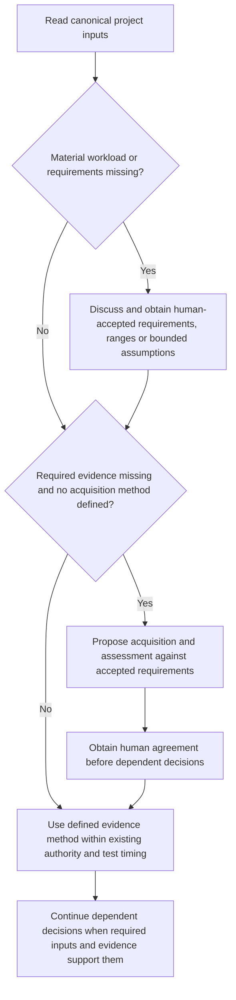
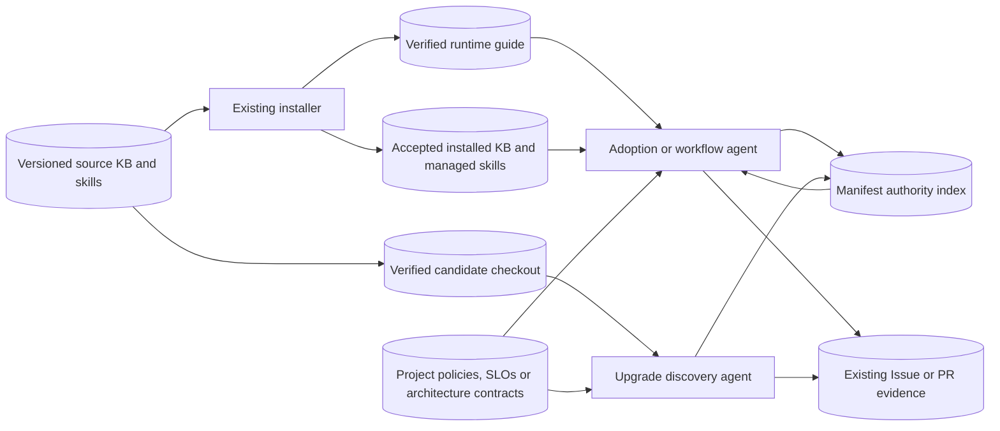

# Implementation Plan — Shared Observability and Diagnosability

<!-- sdd: implementation-plan -->

This is the only active-delivery state authority. GitHub PRs own live review,
merge and execution evidence. The owner accepted this plan in conversation. Implementation follows its
approved scope with human review before task merges; Autopilot is not enabled.
Owner accepted A03 and the three-task mapping, then authorized A04 naming/routing and A05 evidence-acquisition agreement; both
retained reviewers verified its metadata-only reconclusion before dependent work.

## Delivery status

| Field | Value |
| --- | --- |
| State | `VALIDATING` |
| Active tasks | `None` |
| Next ready task | `None` |
| Active blocker | Integrated implementation audit and explicit human implementation acceptance before final-test work |
| Implementation mode | Human-review-before-merge; Autopilot not enabled |
| Authorized scope / feature branch / protected target | D01-D07; `codex/error-origin-context`; `main` |
| Delivery branch / target | `codex/error-origin-context` / `main`; final PR #216 |
| Owner | Repository owner |
| Primary issue / need | [Issue #215](https://github.com/hhhhhusky777/spec-driven-delivery-playbook/issues/215) |
| Concluded whiteboard | [Working whiteboard](solution-whiteboard.md), accepted amendment A05 `883b173`; metadata-only reconclusion `b41ee7d`; owner approved the reviewed design and revised task mapping in conversation (earlier baselines retained in Git) |
| Required reviewers | The same two retained independent Issue #215 reviewer sessions |
| Last verified | 2026-11-01 Asia/Shanghai: all tasks integrated through PR #217/#220/#221 at b6f88d5, matching task candidate 0bad096; main remains 93b41fd with no required synchronization; author implementation audit complete; retained audit and human acceptance evidence belongs in PR #216; final tests UNRUN |

## Governing inputs and delivery boundaries

| Source | Authority / use |
| --- | --- |
| [Contributing](../../CONTRIBUTING.md) and owner decisions in [PR #216](https://github.com/hhhhhusky777/spec-driven-delivery-playbook/pull/216) | Branches, review, merge, scope and named permissions |
| [Concluded design](solution-whiteboard.md#concluded-design) D01-D07 and responsibility diagram | Frozen behavior and content ownership; no unauthorized whiteboard changes |
| [Manifest](project-adoption-manifest.md) and verified runtime | Installed pin c27ab7e and project authorities; no activation upgrade in this delivery |
| [Error handling](../../docs/error-handling.md) and [quality policy](../../docs/documentation-quality-policy.md) | Recovery, focused/final validation, human gates and honest evidence |

| Concern | Accepted boundary |
| --- | --- |
| Outcome | One installed shared diagnostic/observability topic, narrow error/performance consumers and direct version-matched agent routes |
| Included | D01-D07 content extraction, references, titles/scopes, active links/index, applicable skills, manifest template and existing installer tests |
| Excluded | New runtime telemetry system, SDK/platform, dependency, installer mode, project policy/gate, live model evaluations and archive rewrites |
| Assumptions | None; installed content/routes are acceptance evidence to produce, not assumed starting inputs |
| Existing implementation | Candidate 5daaa69 already contains reviewed diagnostic and triage corrections; the extraction must preserve them |

## Integration and readiness

| Concern | This delivery |
| --- | --- |
| Integration model | Feature integration branch `codex/error-origin-context`; only final PR #216 targets `main` |
| Increment boundary | T01 establishes and links the shared owner atomically; T02 consumes its real filename/content for installed agent routing; T03 consumes its domain authority contract for discovery |
| Parallel ownership | Parent integrates coupled edits; after T01, T02/T03 have independent inputs but shared workflow/test files, so sequence writes rather than invent a dependency or parallel conflict; independent reviews can overlap |
| Compatibility | A01 requires atomic topic/consumer renaming; preserve same-revision routing and older pinned trees |
| Merge authority | Human review before task merge by default; scoped Autopilot may authorize task merges into this feature branch only |
| Starting readiness | Accepted plan, current source/design inputs and existing documentation environment; outputs/tests produced by a task are not its starting prerequisites |

## Tasks — design-to-task mapping

| ID | State | Depends on | Consumed design | Implementation work | Outcome | Boundaries | Consumed error handling | Consumed validations | Acceptance evidence | Consumed assumptions | Branch / PR / required target |
| --- | --- | --- | --- | --- | --- | --- | --- | --- | --- | --- | --- |
| T01 | DONE | None | D01-D03, D06-D07; whiteboard responsibility diagram and coverage | Add `observability-and-diagnosability.md`; relocate existing architectural conformance guidance/example/references into the architecture topic under owner-approved A02; move shared sections and their relevant references from the existing error/performance topics; narrow titles/scopes, rename topics to error-handling-design.md/performance-design.md and update every active consumer, including existing skill/test filename references; clarify shared capability and measurement evidence; revise Performance Design to consume project requirements and focus on high-performance structure, with code-level realization distinct under A03; apply owner-authorized A04 triage diagnostics/retry routing split; define D07's canonical project-authority content in Performance Design (workload/goals, concrete evidence acquisition, validity/acceptance, owner/update triggers and missing-input response) | Shared observability and Performance Design have distinct owners; one project goals/evidence contract is defined for discovery to consume | Preserve approved diagnostic content, performance/recovery principles; A01 renames filenames and active consumers together; no runtime change, platform mandate or removed export example reintroduction | D02 required/optional evidence, original cause/context, privacy and existing audit duties move intact; recovery authority remains unchanged | None; reuse existing documentation gates | Compare moved obligations against 5daaa69 and D01-D03; focused Markdown/local links; reviewer checks loss/duplication and text/diagram agreement; compare D07's complete domain contract and missing-input response against the KB before T03 consumes it | None | `codex/issue215-kb-extraction`; [PR #217](https://github.com/hhhhhusky777/spec-driven-delivery-playbook/pull/217); target `codex/error-origin-context` |
| T02 | DONE | T01 | D04; D01 topic contract and installed-root boundary | Update remaining workflow/review direct topic-read triggers and narrow existing trigger descriptions; preserve the A04 triage split delivered in T01; extend existing installed-content and cross-profile routing tests to cover the new same-revision topic | Authors, reviewers and triage agents discover the shipped topic directly and receive the correct installed content | Reuse complete-tree installer and revision guards; no new installer mode, extra tracker or generic rule duplication | Existing escalation for unresolved authority or missing evidence; no task-specific failure behavior | None; new assertions stay inside existing test gates | Focused installed-topic/routing tests verify actual content and availability across supported profiles and cleanup; skill validation and documentation checks | None | `codex/issue215-kb-routing`; [PR #220](https://github.com/hhhhhusky777/spec-driven-delivery-playbook/pull/220); target `codex/error-origin-context` |
| T03 | DONE | T01 | D07; Performance Design project-authority contract | Add explicit Performance Goals and Evidence discovery/index entry to the manifest template; route adoption/upgrade/pre-feature reconciliation to the domain contract using verified same-revision source roots; reuse the existing gap response and owner-decision boundaries; apply owner-authorized A05 human agreement for missing evidence with no defined acquisition method | Applicable projects have one discoverable project goals/evidence authority, or an explicit material gap/non-applicability disposition; no invented targets or duplicate policy | No new standalone policy template, runtime, numerical SLO, per-task full test, results tracker or automatic dependency/deployment permission; do not activate a new pin in this source delivery | Existing authority/gap framework; pause only decisions depending on material missing performance inputs; record the existing response table | None; uses existing discovery/owner acceptance and source validation gates | Semantic review of domain-to-manifest-to-skill routing; focused installer/profile checks for affected skills and source references; verify existing policy reuse, missing-input response, A05 human agreement when evidence and acquisition methods are missing, and explicit non-applicability | None | `codex/issue215-performance-authority`; [PR #221](https://github.com/hhhhhusky777/spec-driven-delivery-playbook/pull/221); target `codex/error-origin-context` |

D05 is an existing delivered correction, not a new implementation task. Preserve
it as the explicit non-code obligation below. `Depends on` identifies the real
T01 topic consumed by T02; numbering alone grants no ordering or merge authority.

## Test and acceptance contracts

This is the coverage inventory, not a run log. Add owned missing non-focused
tests here as discovered; they may be implemented at the final gate under the
existing timing contract. Do not claim planned checks have run.

| Owning task | Contract / outcome / risk | Test or scenario | Coverage | Work boundary |
| --- | --- | --- | --- | --- |
| T01 | D01-D03 content ownership and migrated safeguards | Semantic comparison of original/moved sections and references; required/optional evidence and no universal span/stack/alert mandate | Author migration comparison PASS; retained review dispositions remain in PR #217 | Focused task evidence |
| T01 | Both narrow topics and active links reach the new owner | Changed-file Markdown and existing structure/link checks | PASS: 6 changed Markdown files; structure/local-link and whitespace checks | Focused task checks |
| T01 | D03 renamed topic files and active consumers remain usable together | Existing installer topic-routing and cross-profile tests with renamed filename references | PASS: renamed-topic routes and cross-profile cases within 46/46 focused installer tests | Focused T01 tests |
| T01 | D07 canonical project-authority contract | Compare Performance Design content with workload/goals, concrete evidence sources/procedures, validity/acceptance, owner/update triggers, missing-input human-response table and explicit non-applicability handling | Author contract comparison complete; retained semantic review in PR #217; no new gate | Focused T01 acceptance |
| T03 | D07 project authority discovery and source resolution | Existing installer profile/skill-content tests plus semantic review of existing/missing/non-applicable authority scenarios | PASS: existing profile harness resolves the domain topic/section before manifest creation, from accepted workflow KB and from both candidate-upgrade profiles; semantic comparison confirms domain-to-manifest routes | Focused T03 validation |
| T02 | D04 installed content matches the source revision and skill routing | `knowledge base topic routing resolves for installed author, reviewer and triage skills` in `tests/installer.test.mjs`; include new topic for all three skills | PASS: all three installed skills route to source-matching shared content | Focused task test |
| T02 | D04 supported profiles, old revisions and cleanup preserve valid routing | `installed skill routing resolves same-revision KB topics across profiles and cleanup` in `tests/installer.test.mjs`; extend existing topic set | PASS: A04 shared-topic profile coverage retained and rerun with current skills | Focused task test |
| T02 | Installation still synchronizes the complete official tree | Existing complete-tree installation/cleanup tests | Existing; retain without weakening assertions | Final-gate full suite; focused if packaging changes |
| Final gate | Entire source remains consistent after integration | `npm ci --ignore-scripts` and `npm run docs:all`, including full installer/source tests and Mermaid | Existing; UNRUN for this delivery | After implementation audit and explicit human implementation acceptance |

No live model run is needed for this source/packaging refactor. Existing PR
checks and task-focused validation remain applicable; no new acceptance gate.

## Recovery, decisions, and change control

| Item | Disposition / evidence |
| --- | --- |
| Route promotion | Owner replaced Fast Fix with normal whiteboard/plan delivery; preserve existing branch, candidates and reviewer sessions |
| Prior extraction edits | Earlier unpublished drafts were used as reference only; T01 candidate and current checks, not the draft files, establish delivered content |
| Conclusion schema correction | Draft table enums/headings were aligned before acceptance; actual conclusion changed only three metadata fields and both reviewers verified it |
| T01 fixture count correction | The changed-file installer run exposed three stale expectations of 15 official files after the new topic made 16; update only the expected inventory count, retaining every per-file content and recovery assertion |
| A03 owner direction | Owner accepted reviewed A03 and revised task mapping; dependent corrections follow the verified reconclusion |
| A02 owner decision | Owner approved relocating existing conformance evidence/example/references to the architecture KB; preserve meaning and review the bounded ownership correction |
| A01 owner comments | A01 accepted; reconclusion 47cc272 verified by both reviewers; repeat affected task checks/review on the corrected candidate |
| New material design gap | Follow existing error handling and obtain the required owner amendment; never change the frozen whiteboard without named authorization |
| Agent-correctable mistake | Correct within approved scope and repeat affected checks; no extra progress review gate |

## Plan validation and completion

### Implementation review

All task candidates are integrated. This table and the views below describe the
implemented guidance and installation behavior; product business/runtime code
is unchanged. Review conclusions and acceptance remain PR facts.

| Information | Implementation summary / evidence |
| --- | --- |
| Implementation / design | Author audit: D01-D02 shared evidence/framework/correlation guidance; D03 distinct error/performance design; D04 direct same-revision routing; D05 coherent authorized triage repair; D06 architecture conformance guidance; D07 project authority discovery and human-owned missing-input decisions all match the accepted whiteboard |
| Code-level flows | Product runtime business/error/data flows are N/A. The [implemented guidance flow](#implemented-guidance-flow), [missing-input handling](#missing-input-handling) and [document-and-evidence data flow](#document-and-evidence-data-flow) show the actual changed skills/KB/template and reused installer behavior; compare these with the whiteboard responsibility diagram |
| Review findings | Wording audit findings are resolved, including owner-authorized whiteboard reconciliation. Both retained reviewers' exact integrated audit conclusions and dispositions belong in PR #216 and are copied into the human brief |
| Risks / limits / unknowns | Full integrated validation is UNRUN. Current project installation remains c27ab7e; profile fixtures prove candidate installation and routing, not activation in this project or production telemetry |
| Validation | T03 source d7b0068 focused checks include 46/46 installer tests with zero skips; later documentation-only corrections passed affected checks. Main is still 93b41fd; integration introduces no source-content change requiring synchronization |
| Recommendation / decision | After both retained reviewers approve the exact implementation, ask the human to request changes or accept implementation and authorize final-test work. This is not protected-target merge authority |

### Implemented guidance flow

The verified skill revision selects the KB root. These are discovery/read
operations, not runtime service calls or an added lifecycle controller.

```mermaid
sequenceDiagram
    participant A as Discovery agent
    participant R as Verified source
    participant K as Performance Design KB
    participant P as Project authority
    alt Adoption before manifest
        A->>R: Read agent-guide KB root
    else Accepted workflow
        A->>R: Read manifest-linked KB root
    else Candidate upgrade
        A->>R: Read upgrade-guide checkout and revision
        Note over A,R: Read candidate source KB; accepted pin stays active
    end
    R-->>A: Same-revision topic location
    A->>K: Read project goals and evidence contract
    A->>P: Discover existing authority and applicable gaps
    A->>A: Apply domain contract within project boundaries
```

Workflow/reviewer/triage skills also route measurement and diagnostics directly
to Observability and Diagnosability, and handling/recovery/retry safety to Error
Handling Design. Performance choices consume Performance Design. The domain
rules remain in their KB owners rather than being copied into each skill.

### Missing-input handling

This activity view applies the existing domain contract; it does not add a
runtime rejection or permission to run deferred tests early.



Pause only affected decisions; independent authorized work continues. Record an
applicable authority gap or reasoned non-applicability in the manifest, and
present material missing inputs in the domain contract's human-response table.

### Document-and-evidence data flow

The existing installer and profile tests implement/verify these paths. Candidate
reading and accepted installation remain separate; this delivery leaves the
current project's installed pin unchanged.



Manifest updates preserve stable links and gap dispositions; it does not store
run results or feature status. Tests compare installed topic bytes with the
source revision and resolve the domain section for each supported profile.

### Delivery Definition of Done and non-code obligations

| Outcome | Design / owner | Required evidence | Result / link |
| --- | --- | --- | --- |
| Shared topic and narrow consumers | D01-D03, D06; T01 | Canonical owner, complete migrated content, index and links | [T01 / PR #217](https://github.com/hhhhhusky777/spec-driven-delivery-playbook/pull/217) |
| Project performance authority discovery | D07; T03 | Manifest indexing and applicable discovery routes consume the one domain contract, with explicit gaps and owner decisions | PASS: focused routes/profile checks and author semantic comparison; [PR #221](https://github.com/hhhhhusky777/spec-driven-delivery-playbook/pull/221) |
| Installed direct agent routing | D04; T02 | Actual same-revision installed content and supported-profile proof | PASS: focused installer checks; [PR #220](https://github.com/hhhhhusky777/spec-driven-delivery-playbook/pull/220) |
| Complete triage repair review boundary retained | D05; parent author | Existing triage skill at 16b48f2/5daaa69 retains diagnosis-only authority, escalation, time limits and deferred full-validation timing | Retained and checked by author; exact retained-reviewer audit in PR #216 |
| Canonical guidance updated | Whiteboard Canonical authority updates; T01-T03 | Live KB/index/skill/manifest-template owners carry accepted obligations; manifest pin and project policies unchanged | Implemented through T01-T03; author checked live ownership; retained audit in PR #216 |
| Required validation and review | Project quality authority; parent | Honest focused/full results and retained reviewer evidence tied to exact candidates | PR #216 owns current state |
| Merge-ready closure | Parent under named cleanup authorization | Complete concluded whiteboard and final plan preserved in one linked archive; live plan removed and whiteboard reset in closing candidate | Not authorized or performed yet |
| Protected target verification and physical cleanup | Parent | Authorized final merge, verified target, ownership-safe cleanup | Pending; PR evidence |

### Cleanup inventory

| Item | Keep, archive, remove, or reset | Ownership / authorization boundary | Result |
| --- | --- | --- | --- |
| Manifest, reusable KB and installed guidance | Keep | Project authorities; no pin activation in this scope | Retained |
| Working whiteboard and final plan | Archive together, then reset whiteboard/remove live plan | Named owner permission required before closing-candidate construction; link archive and final PR both ways | Pending |
| T01/T02/T03 task branches | Remove after verified task merges and no remaining use | Branch names are recorded in Tasks; all three tasks reuse the delivery worktree below, with no separate task worktrees | Branches exist; all tasks integrated; branch retirement pending |
| Feature branch `codex/error-origin-context` and current worktree | Remove only after final merge and verified ownership/no remaining use | Current checkout may be app-protected; preserve and report a guard rather than force-delete | Pending |
| Local unpublished extraction drafts | Remove when no longer needed | Parent-created temporary files only; never commit them as delivery evidence | Retained for implementation reference |

Detailed review/check/merge history stays in PRs. Task states must reflect the
resulting repository state before each task candidate merges; the final closing
candidate reconciles all canonical state before protected-target review.

## Human review brief

| Attention | Summary | Handling |
| --- | --- | --- |
| Tasks | T01-T03 merged via PR #217/#220/#221; all implementation tasks DONE; current boundary is human implementation acceptance | Human implementation review |
| Design consistency | D01-D04 and D06-D07 map to tasks; D05 maps to the retained triage obligation; no unmapped design point | Review mapping |
| Autopilot | Not enabled. Opt-in permits task merges only into `codex/error-origin-context` after exact-head reviewer approval and required focused checks, then the next dependency-ready task; stop before final-test work for human implementation acceptance and before final `main` merge | Explicit owner decision |
| Foreseeable decisions | A03 naming/domain/discovery and T03 task mapping accepted; no project-specific performance numbers will be invented | None |
| Validation | T01-T03 focused checks pass, including 46/46 installer tests without skips; full integrated validation remains UNRUN | Attention |
