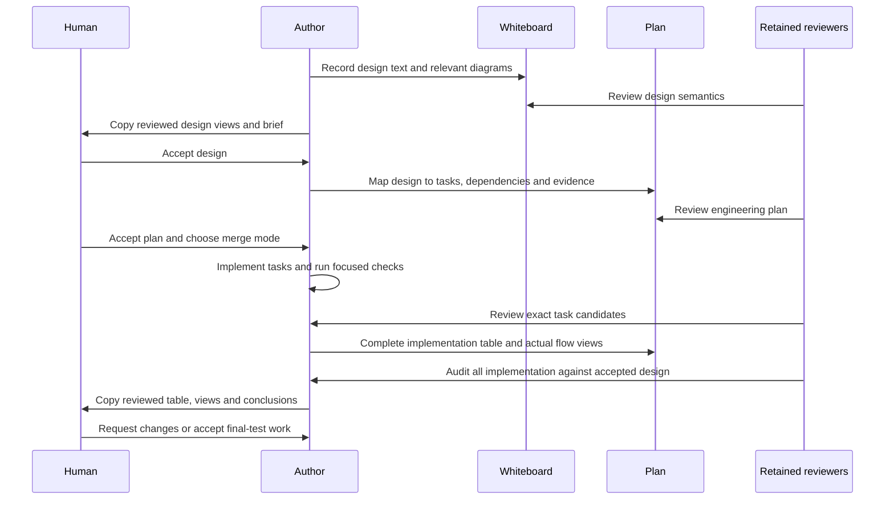
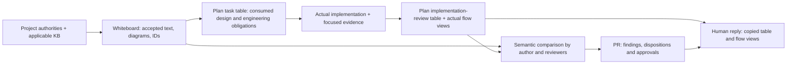
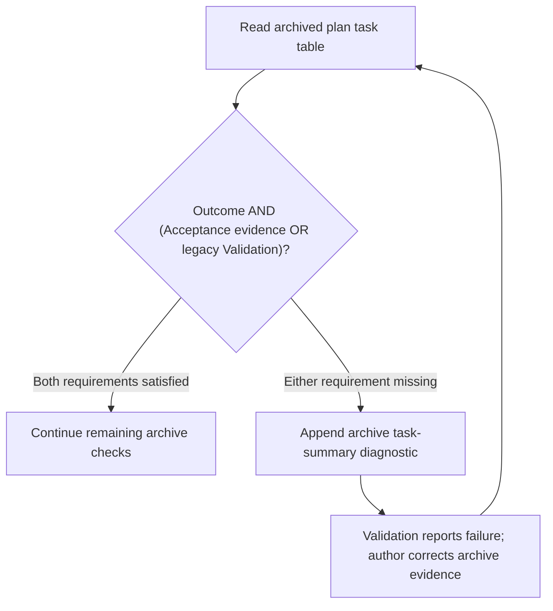

# Implementation Plan — Design and Implementation Planning

<!-- sdd: implementation-plan -->

This plan owns this delivery's tasks and state. The
[concluded whiteboard](solution-whiteboard.md) owns solution decisions;
[PR #188](https://github.com/hhhhhusky777/spec-driven-delivery-playbook/pull/188)
owns reviews, validation results, acceptance and merge evidence.

## Delivery status

| Field | Value |
| --- | --- |
| State | `IMPLEMENTING` |
| Active tasks | `None` |
| Next ready task | `None` |
| Active blocker | `None` |
| Implementation mode | `human-review-before-merge` |
| Authorized scope / feature branch / protected target | Accepted task scope T01–T03; feature `codex/design-planning`; protected target `main`; Autopilot `None` |
| Delivery branch / target | `codex/design-planning` / `main` |
| Owner | Repository owner |
| Primary issue / need | [#187](https://github.com/hhhhhusky777/spec-driven-delivery-playbook/issues/187) |
| Concluded whiteboard | [Frozen file at d99a83e](https://github.com/hhhhhusky777/spec-driven-delivery-playbook/blob/d99a83e17a29a60109ccd3bd276a739ec02c6bb2/.github/spec-driven-delivery/solution-whiteboard.md); accepted D01 amendment revision `c9855a403c4d04cc1acc08cdbf8953c9205f4395` |
| Required reviewers | Same two retained independent feature reviewer sessions |
| Last verified | 2026-10-26 Asia/Shanghai; T01 and T02 merged through PRs #189 and #190 into the feature branch; T03 includes the owner-requested engineering task table and aligned human-response/README contracts; focused model/lifecycle checks pass in its own CURRENT runtime; task review, merge and final implementation acceptance remain PR facts |

## Governing inputs and delivery boundaries

| Source | Authority / use |
| --- | --- |
| [Manifest](project-adoption-manifest.md) and its canonical links | Accepted installed pin `c2f83cb8868477a11415a83ea991459546a9f4c3`, project policies and ownership |
| [Concluded whiteboard](solution-whiteboard.md), D01–D09 | Accepted outcomes, architecture/document ownership, precise text and diagrams, scope and tradeoffs |
| [Contributing](../../CONTRIBUTING.md) | Branch policy, reviews, merge authority and source validation |
| [Quality policy](../../docs/documentation-quality-policy.md) and [template governance](../../docs/template-governance.md) | Quality, human briefs and reusable document responsibilities |
| Verified `.sdd-runtime/agent-guide.md` and its installed workflow skill | Lifecycle, task readiness, review, final-test and cleanup contracts |
| Whiteboard research basis | Already-read primary guidance and its recorded applicability; research is reusable while current and applicable |

| Concern | Accepted boundary |
| --- | --- |
| Required outcome | Brief mandatory skill-wide KB application boundaries, one task-planning KB, and aligned design/engineering templates and consumers implementing D01–D09 |
| Scope | Source KB, affected skill routes, whiteboard and plan templates, affected README/index/diagram descriptions, and meaningful source regression/packaging checks |
| Non-scope | New gates, trackers, document quotas, runtime rejection mechanisms, broad checker rewrites, historical archive rewrites, unrelated #147/#142 work, and installing source tests into adopting projects |
| Assumptions | None requiring owner resolution; topic availability is checked against the accepted pin, not assumed |
| Compatibility | Preserve branch enforcement, frozen-design/amendment authority, reviewer continuity, human gates, focused/final validation timing, the 90-minute task boundary and proportional template completeness |

Existing architecture and contracts are consumed from D01–D09, not redefined
here. Engineering choices may vary within those accepted boundaries. Do not
edit this delivery's frozen whiteboard to demonstrate a template change.

## Delivery strategy and readiness

| Concern | This delivery |
| --- | --- |
| Integration model | Feature integration branch `codex/design-planning`; only final PR #188 targets `main` |
| Baseline | Feature branch created from `c2f83cb8868477a11415a83ea991459546a9f4c3`; accepted preparation/conclusion ends at `25cc9c6` |
| Dependency rationale | T01 establishes skill-wide KB application boundaries; T02 consumes them for the planning method and routes; T03 applies that method and ownership model to template consumers |
| Parallel ownership | No concurrent overlapping implementation tasks; independent research, review and checks may run concurrently under the existing concurrency KB |
| Merge authority | Human review before each task merge by default; Autopilot requires explicit opt-in naming this feature branch and task scope |
| Readiness | Approved plan, consumed prerequisite results and sufficient current context; task-produced KB, templates and test outputs are not prerequisites for starting their producing task |

> [!IMPORTANT]
> Every task PR MUST target `codex/design-planning`. Only the final feature PR
> may target `main`. This plan grants no exception to the canonical branch
> policy. A branch/target mismatch MUST block task readiness, review and merge.

Required environment support is the repository's Node.js dependencies,
installer and managed runtime; no external service or project secret is needed
for this documentation/tooling delivery. The installed workflow and canonical
error-handling authority own environment readiness and recovery.

## Design-to-task mapping

The Tasks table is the single mapping from accepted D01–D09 to engineering
work. All nine points are covered; no unmapped design obligation is known.
Final audit, human acceptance and full validation remain in Plan validation
and completion; task completion does not claim those gates passed.

## Tasks

Design references below resolve to the [concluded design](solution-whiteboard.md#concluded-design).
The shared preservation boundaries above apply to every row.

| ID | State | Depends on | Consumed design | Implementation work | Outcome | Boundaries | Consumed error handling | Consumed validations | Acceptance evidence | Consumed assumptions | Branch / PR / required target |
| --- | --- | --- | --- | --- | --- | --- | --- | --- | --- | --- | --- |
| T01 | `DONE` | `None` | D01: joint KB/project boundary; D09: consistent consumers | Put the brief boundary in all three skills' existing IMPORTANT blocks; retain version-aware topic triggers; remove cross-KB ownership from Solution Research and its index description | Independently loaded skills require reading and applying relevant KB principles within approved project authority | Existing skills, research topic, index and model regression; no new policy document or template architecture change | Preserve canonical conflict/error authority; no new rejection or recovery behavior | None | All three global blocks and topic routes remain consistent; T01 coverage rows below | None | `codex/design-planning-t01`; [PR #189](https://github.com/hhhhhusky777/spec-driven-delivery-playbook/pull/189); target `codex/design-planning` |
| T02 | `DONE` | `T01` | D05: coherent task method; D09: distribution and routes | Consume T01's global boundary; distill the recorded primary sources into the planning KB; add index and mandatory planning/replanning/review routes; reuse complete-tree installer and existing tests | Adopters receive one evidence-based method for complete outcomes, actual acyclic dependencies, readiness, useful parallelism and acceptance evidence | New topic and affected consumers/tests only; no new installer, worksheet, quota or imported vendor branch policy | Missing material design inputs use existing owner authority; task-produced outputs are not starting prerequisites | None | Topic/route checks and complete 15-document installed-tree agreement; T02 coverage rows below | None | `codex/design-planning-t02`; [PR #190](https://github.com/hhhhhusky777/spec-driven-delivery-playbook/pull/190); target `codex/design-planning` |
| T03 | `DONE` | `T01, T02` | D02–D04: architecture/design ownership and text/views; D06: complete tasks; D07: semantic traceability; D08: canonical workflow; D09: aligned consumers | Consume T01's boundaries and T02's method; move architecture/contract fields to whiteboard; consolidate design consumption and engineering obligations in task rows; route generic execution prose to workflow; align human/reviewer briefs, README diagrams and regressions | Human review can trace accepted design through concrete task work and compare relevant design text/views with actual implementation evidence | Existing templates/consumers only; preserve necessary information, single coverage inventory, genuine diagram N/A and all mandatory controls; no frozen-whiteboard or historical-archive edits | Preserve accepted failure contracts and canonical error handling; rows reference their task-specific application without inventing fail-closed behavior | None | Preserved fields/controls, task-column and lifecycle checks, diagram parsing and representative semantic comparison; T03 coverage rows below | None | `codex/design-planning-t03`; [PR #191](https://github.com/hhhhhusky777/spec-driven-delivery-playbook/pull/191); target `codex/design-planning` |

## Task specifications and context receipts

Task scope and obligations live in the rows above; this table records their
execution context and results without repeating the design mapping.

| Task | Context receipt | Actual result |
| --- | --- | --- |
| T01 | Accepted D01 amendment, manifest authorities and version-aware KB routes | Global boundaries and research-only ownership implemented; affected regression passes. Review and merge evidence: PR #189 |
| T02 | Merged T01; recorded Google, DORA and Microsoft research; own accepted-pin runtime and dependencies | KB and required routes implemented with project-policy applicability limits and examples; existing installer cases verify the complete tree. Review and merge evidence: PR #190 |
| T03 | Merged T01/T02; accepted D02–D09, existing templates/controls and owner-requested task-table presentation | Useful architecture, behavior/state, interface and quality fields retained in whiteboard; task table consumes the design without proposing new behavior. Workflow, reviewer, README and regressions aligned. Frozen design unchanged; final audit/acceptance/full validation remain pending |

## Test and acceptance contracts

The table is a coverage/work inventory, not a test-run log. The installed
workflow owns focused/final timing, author/reviewer implementation audit and
human acceptance before final-test work. PRs own actual run evidence. Recorded
missing non-focused test work may be completed at the final gate; it is not a
prerequisite for starting or completing its producing implementation task.

| Owning task | Contract, changed outcome, or risk | Test or scenario | Coverage | Work boundary |
| --- | --- | --- | --- | --- |
| T01 | Skill-wide KB/project boundaries and all existing required-read routes | Inspect each global skill block, retained version conditions, topic routes and research-only ownership | Implemented in `tests/document-model.test.mjs`; structural coverage plus semantic review, not proof of future agent judgment | Focused task work; unchanged installer/full source suite deferred to final gate |
| T02 | Coherent task method with applicability limits and mandatory consumers | Planning/replanning and reviewer route case in `tests/document-model.test.mjs`; semantic assessment of outcome/dependency examples | Implemented; automated routing evidence does not prove planning judgment | Focused task work |
| T02 | Adopters receive new topic and valid installed routes | Existing actual-index and installed-topic cases in `tests/installer.test.mjs` include the new topic | Implemented; complete actual tree and installed content match source, existing installer unchanged | Focused applicable cases; complete source suite at final gate |
| T03 | Required template information retained under correct owner; design diagrams visible in the whiteboard human-review response | Updated document-model cases and representative text/view/plan comparison in the PR | Implemented; model checks cover moved fields and mandatory response/semantic-comparison routes | Focused task work |
| T03 | Readiness does not require future outputs; mapping and controls remain valid | Existing `tests/sdd-three-doc.test.mjs` state-graph and template cases plus affected model assertions | Existing lifecycle cases retained and passing; canonical workflow controls remain checked while plan duplication is removed | Focused affected cases; full source suite at final gate |
| T01–T03 | Changed Markdown, references, diagrams and whitespace | `npm run docs:focused -- TASK_BASE HEAD` and relevant structural/skill checks | Existing tools | Focused task work |
| T01–T03 | Complete source compatibility and installed-tree agreement | `npm run docs:all`, plus required shell/skill validation on the final candidate | Existing full source gate; reconcile any coverage gaps after implementation acceptance | Final gate |

Tests must be grounded in accepted outcomes and real contract risks, not lock
exact prose or invent cases to force new handling. Inspect current assertions
before adding duplicate coverage. Structural checks cannot prove future agent
judgment; semantic author/reviewer assessment remains necessary.

## Plan validation and completion

### Implementation review

All three tasks are integrated through PRs #189–#191. This table describes the
implemented result; current reviewer decisions and human acceptance belong in
[PR #188](https://github.com/hhhhhusky777/spec-driven-delivery-playbook/pull/188).

| Information | Implementation summary / evidence |
| --- | --- |
| Implementation / design | D01: mandatory joint KB/project boundaries in all three skills. D05: task-planning KB and required-read routes. D02–D04/D06–D09: whiteboard owns architecture; plan task columns consume design, error handling, validations and assumptions, separately from acceptance evidence. Workflow owns human gates; reviewer skill owns semantic comparison. No known design deviation |
| Code-level flows | The three views below follow actual skill instructions, template ownership and the changed archive checker. This delivery mainly changes agent instructions; these are instruction/data flows, not a new executable orchestrator |
| Review findings | Earlier dependency-format finding fixed: use task IDs only, with input descriptions in engineering columns. Latest task review: both retained reviewers approved with no findings; integrated implementation audit conclusions remain in PR #188 |
| Risks / limits / unknowns | Structural checks do not guarantee future agent judgment. Accepted installed runtime remains pinned; source changes are not yet an installed upgrade. Archive checker accepts both new Acceptance evidence and legacy Validation labels |
| Validation | Task-focused model/lifecycle and affected installed-routing checks passed at their recorded candidates. Full validation is UNRUN. Existing coverage inventory owns final test reconciliation and complete source validation |
| Recommendation / decision | Author finds implementation within D01–D09 and recommends starting final-test work after both retained reviewers approve this integrated audit and the human accepts. Final main merge and whiteboard reset are not authorized |

#### Actual business flow

Sources: [workflow](../../skills/sdd-project-workflow/SKILL.md),
[reviewer](../../skills/sdd-feature-review/SKILL.md), and the
[plan template](../../templates/delivery/implementation-plan.md).
D02–D08: design ownership feeds engineering planning; completed implementation
returns through the existing audit and human decision before final tests.

#### Actual data flow

Sources: [whiteboard template](../../templates/discovery/solution-whiteboard.md),
[plan template](../../templates/delivery/implementation-plan.md), and
[workflow](../../skills/sdd-project-workflow/SKILL.md).
D01/D03/D04/D06/D07: each artifact retains its facts; the reply exposes reviewed
content without creating a second source of authority.

#### Actual error handling

Source: `deliveryArchiveErrors` in
[lifecycle checker](../../scripts/sdd-lifecycle-three-doc.mjs).
D09 compatibility: the changed check accepts either evidence column label;
`Consumed validations` alone is not test/acceptance evidence. Other archive
checks still apply; this diagram isolates the changed predicate.

The decision means `Outcome AND (Acceptance evidence OR Validation)`.
It preserves the existing rejection of missing acceptance evidence; it does not
introduce a new runtime failure policy or treat design validations as tests.

### Completion obligations

| Outcome | Required evidence / owner |
| --- | --- |
| D01–D09 delivered without new scope | Mapping above, task results and PR evidence |
| Each merge unit consistent | Affected source KB, skills, templates, index/README and tests reconciled in that unit |
| Final implementation conforms | Existing author/two-reviewer audit and human implementation brief comparing approved text/diagrams with actual views |
| Final source validation complete | Existing final gate; focused evidence does not substitute for full source tests |
| Canonical state ready on merge | Task completion updates travel with their implementing PR; GitHub retains live review/merge facts |
| Delivery cleanup | Existing combined-archive contract and verified owned cleanup; frozen-whiteboard reset requires its later explicit named human authorization |

Detailed recovery and decision discussion belongs in PR #188. Update this plan
only for actual task/state changes or a material engineering-plan adjustment;
design amendments require the existing prior human authority.

## Human review brief

The parent response presents the design-to-task mapping and tasks, review
findings/dispositions, assumptions, relevant risks and validation status. Ask
for plan acceptance and the explicit Autopilot choice under the installed
workflow contract. Default remains human review before merge; no plan approval
alone enables Autopilot. Final human implementation acceptance and final `main`
merge acceptance remain separate.
