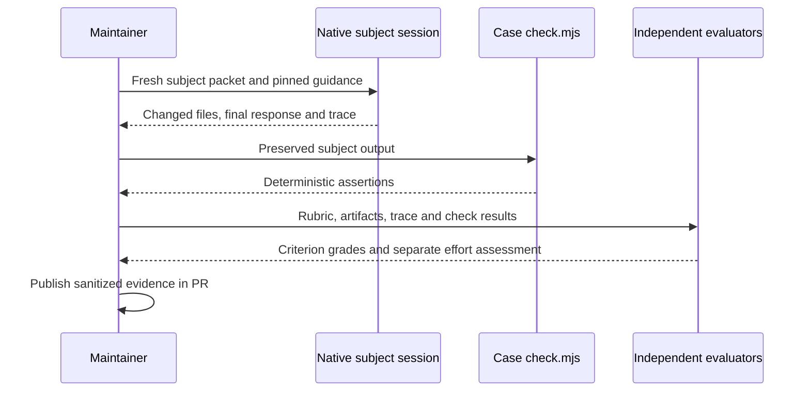
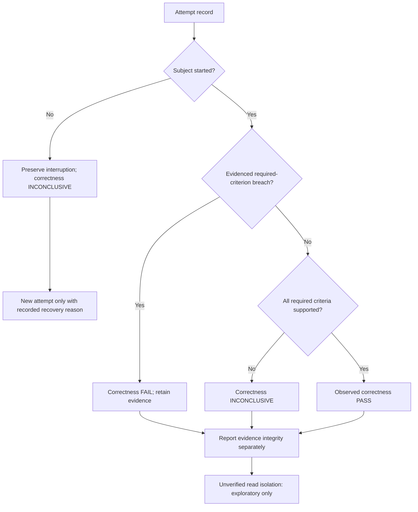
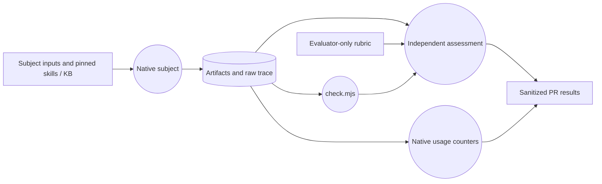

# Implementation Plan — Agent Behavior Evaluation

<!-- sdd: implementation-plan -->

This plan owns active-delivery state. The concluded whiteboard owns the design;
[PR #197](https://github.com/hhhhhusky777/spec-driven-delivery-playbook/pull/197)
owns review, execution evidence and merge authority.

## Delivery status

| Field | Value |
| --- | --- |
| State | `VALIDATING` |
| Active tasks | `None` |
| Next ready task | `None` |
| Active blocker | Human implementation acceptance before final-test work |
| Implementation mode | Human-review-before-merge; Autopilot not enabled |
| Authorized scope / feature branch / protected target | No auto-merge authority; single delivery/task branch `codex/issue-196-agent-evals`; protected target `main` |
| Delivery branch / target | `codex/issue-196-agent-evals` → `main` through PR #197 |
| Owner | Repository owner |
| Primary issue / need | [#196](https://github.com/hhhhhusky777/spec-driven-delivery-playbook/issues/196) |
| Concluded whiteboard | [Whiteboard](solution-whiteboard.md), accepted design `c82aa9e626c1c4bb9494e83e6bff87dd45885401`; frozen file at `e2488eb0e28df2d8230c7230e929372e6062d70e` |
| Required reviewers | Retained `issue196_review1` and `issue196_review2` |
| Last verified | 2026-10-28: T01 complete; four final case outcomes independently assessed; installer CURRENT at 1792194; implementation audit and human acceptance precede final validation |

## Governing inputs and delivery boundaries

| Source | Authority / use |
| --- | --- |
| [Contributing](../../CONTRIBUTING.md) and [quality policy](../../docs/documentation-quality-policy.md) | Single-PR integration, independent review, focused/final validation and human authority |
| [Concluded whiteboard](solution-whiteboard.md#concluded-design) | D01–D06, E01–E04, supported scope, grading, measurement and evidence limits |
| [Error handling](../../docs/error-handling.md) | Preserve evidence and valid work; correct agent mistakes without inventing another gate |
| [Manifest](project-adoption-manifest.md) and verified runtime | Accepted and activated revision `179219484d3bffd8886837c158b5c12be1be7bfc`; runtime validation CURRENT |
| [Exploratory evidence](https://github.com/hhhhhusky777/spec-driven-delivery-playbook/pull/197#issuecomment-6463585443) | Useful fixture calibration and observed overhead; not a clean baseline or efficacy proof |

The outcome is a reusable repository evaluation contract with runnable starter
inputs and independent grading, not a scheduler or a new release gate. No hosted
service, paid API integration, dependency, production access, downstream-project
payload or blanket success-rate claim is authorized. The whiteboard's
Architecture responsibility diagram remains the design reference; this plan
translates it into delivery work rather than choosing another architecture.

## Delivery strategy and readiness

| Concern | This delivery |
| --- | --- |
| Integration model | One coherent task and one PR to `main`, permitted by the canonical branch policy |
| Increment boundary | Guide, reusable formats and starter cases must agree to provide a usable evaluation; one merge unit avoids incomplete interfaces |
| Dependencies | No producing-task dependency. Readiness consumes accepted design, plan acceptance, existing Node tooling and native agent runtime |
| Runtime disposition | Owner accepted `1792194…`; activated through the existing installer and validated CURRENT. Incremental discovery found no new gaps; frozen design unchanged |
| Parallel ownership | Independent disposable case runs may overlap only with separate inputs/artifacts and sufficient resources; author retains integration and review reconciliation |
| Merge authority | Explicit human approval before `main` merge. A single-PR delivery has no intermediate task merge for Autopilot to automate |

Future case files, successful runs, review approvals and final validation are
outputs, not task-start prerequisites. Existing project gates and the per-task
90-minute active-implementation limit remain unchanged.

## Design-to-task mapping and tasks

This table is the single design-to-task mapping. Canonical authority updates
from the whiteboard are included in T01 or the non-code obligations below.

| ID | State | Depends on | Consumed design | Implementation work | Outcome | Boundaries | Consumed error handling | Consumed validations | Acceptance evidence | Consumed assumptions | Branch / PR / required target |
| --- | --- | --- | --- | --- | --- | --- | --- | --- | --- | --- | --- |
| T01 | DONE | None | D01–D06; E01–E04 and the responsibility diagram | Create `evals/README.md` with shared case/rubric/result formats; prepare four versioned subject fixtures and evaluator-only rubrics; reuse native execution and focused deterministic checks where useful; link evaluations from root README and CONTRIBUTING | Another maintainer can prepare, execute and independently assess a case, record separate correctness/efficiency evidence, and add a case without changing execution infrastructure | Repository-only; no new scheduler, wrapper, dependencies, mandatory CI, product policy or imposed universal efficiency threshold | D03–D06: keep failures, interruptions, disputes and insufficient evidence visible; no retry-to-green or scope expansion | None: no newly designed runtime rejection or acceptance gate | Changed-doc checks; calibrated valid/defective outcomes; one attempt for each final starter case with independent artifact/trace assessment; reusable format populated from actual evidence | Whiteboard isolation premise: verify runtime support; otherwise qualify exploratory observations and keep clean-evidence assessment inconclusive | `codex/issue-196-agent-evals`; [#197](https://github.com/hhhhhusky777/spec-driven-delivery-playbook/pull/197); `main` |

### T01 — Engineering detail and context

| Concern | Value |
| --- | --- |
| Reuse | Existing Node built-in test/assert capabilities, native fresh sessions and structured execution traces; migrate only useful sanitized fixture content from the exploratory trial |
| Case ownership | Each case owns supported inputs, contract, completion boundary, valid alternatives and evaluator criteria; common execution/measurement guidance lives once in `evals/README.md` |
| Subject/evaluator boundary | Copy only subject inputs and required project/playbook guidance into disposable workspaces; never provide the rubric or other attempt outputs to the subject. Verify read isolation separately from write restrictions |
| Fixture completeness | Include the prerequisite context needed for the stated task boundary, especially E03's existing plan/authority inputs; avoid making missing fixture context masquerade as a playbook defect |
| Focused run scope | Predeclare E01–E04, one fresh attempt each, using the same recorded model/settings and exact case/playbook revisions; maximum 480 seconds wall time per attempt for this exercise. Preserve interrupted attempts; extra attempts need a stated reason and remain visible |
| Efficiency | Record available native counters and elapsed time; separate subject work from setup/evaluation. Record Unknown where unavailable, and justify any inefficiency judgment using case expectations or comparable evidence |
| Actual result | Guide, shared context and four packs delivered at `9c08808694289d0e756ab0c83a3dd6ec8592a953`; final attempt-2 outputs pass all 14 required criteria under independent assessment. Four initial startup interruptions remain INCONCLUSIVE. All completed observations remain exploratory because host read isolation is unproven |

The run budget above is a bounded delivery exercise, not a new playbook timeout
rule or a model quality threshold. E04's explicit research prompt tests prompted
research; it does not establish automatic trigger recognition. The framework
must retain that limit rather than silently broaden the case's claim.

## Test and acceptance contracts

| Owning task | Contract, changed outcome, or risk | Test or scenario | Coverage | Work boundary |
| --- | --- | --- | --- | --- |
| T01 | D01–D06 documents, links and diagrams agree | Existing Markdown, structure/internal-link, lifecycle and Mermaid checks applicable to changed files | Changed-file Markdown, links, content, lifecycle and diagram checks | Focused task checks; complete source suite at final gate |
| T01 | D02/D03 distinguish sound behavior from genuine defects | Calibrate each rubric/check against a valid outcome and its relevant defective fixture; include semantic judgments for E01/E03/E04 | Four original defective fixtures fail their checks; valid outcomes pass. Both reviewers also classified semantic counterexamples by inspection | Focused task work |
| T01 | E01–E04 final input packets are runnable and gradeable | One fresh native execution per versioned case; retained reviewers inspect actual artifacts/traces and criteria | Four completed outputs pass independent checks and all required rubric criteria; startup interruptions retained | Focused task work; no reliability claim |
| T01 | D04 result format captures correctness and efficiency separately | Populate the shared result format from each actual attempt; reconcile elapsed and available usage/tool counts with the native record | Per-attempt context, criteria, measured effort and interpretation recorded in PR evidence | Focused task work |
| T01 | D05 separation and evidence integrity | Inspect subject packet and runtime permission boundaries; record enforced separation or explicit exploratory limitation | Packets and protected-file diffs inspected; host read isolation still unproven | Focused task work; never promote limited evidence to clean-baseline status |
| T01 | Existing installer and full source behavior remain compatible | Existing `npm run docs:all` and installed runtime validation on final candidate | Existing; final run deferred | Final gate after implementation audit and human acceptance |

Record any additional non-focused test gaps here during T01, with ownership;
add/run them only at the final boundary required by project policy. Deterministic
checks do not establish semantic grading or efficiency by themselves.

## Recovery and decisions

| Item | Classification / state | Handling |
| --- | --- | --- |
| Strict subject read isolation | Disclosed limitation, not an assumed capability | Use verified native isolation if available; otherwise preserve exploratory labeling and inconclusive clean-evidence status; no custom isolation platform |
| Upgrade | Accepted and completed | Pin, managed guidance and runtime synchronized to 1792194; evidence in PR |
| Plan / implementation | T01 complete; human implementation acceptance pending | Final case-pack results assessed separately from the earlier exploratory trial |
| Review disagreement or incomplete trace | Existing error-handling boundary | Preserve evidence, evaluate the affected criterion, and retain an inconclusive result where unresolved |

## Plan validation and completion

### Implementation review

The following views describe the delivered case checks and the documented use
of existing native execution/evaluation capabilities. They do not represent a
new shipped orchestrator. PR #197 owns exact reviewer dispositions and detailed
attempt evidence; this plan records the resulting implementation and next gate.

| Information | Implementation summary / evidence |
| --- | --- |
| Implementation / design | D01–D06 delivered by `evals/README.md`, shared context and E01–E04 subject/rubric/check files. README and CONTRIBUTING link to this contract. No new scheduler, dependency, hosted service, CI gate or installed eval payload |
| Code-level flows | Execution sequence, error disposition and evidence-data flow below; implementation references are the four `check.mjs` files, subject fixtures and `evals/README.md` |
| Review findings | Both retained reviewers independently found no material findings in the implementation or completed case evidence; exact final audit dispositions belong to PR #197 |
| Risks / limits / unknowns | Host read isolation is unproven; all observations are exploratory. One completed run per case cannot establish reliability or comparative efficiency. E04 explicitly prompts research and does not prove automatic trigger recognition |
| Validation | Four independent case checks pass; subject focused tests: 3/3, 6/6, 10/10, 5/5. Valid/defective checks calibrated, semantic counterexamples reviewed by inspection. Changed-file checks pass; full source validation is deferred |
| Recommendation / decision | Accept implementation and begin final validation, or request changes. Full validation, archive/reset authorization and final merge approval remain outstanding |

#### Actual execution sequence

`evals/README.md` defines preparation and evidence formats. Each case's
`check.mjs` checks actual subject output; independent reviewers assess obligations
that assertions cannot prove. The temporary local execution commands used for
this delivery are not a new repository runtime.

#### Error and evidence disposition

This is the existing guide's evaluator disposition, not added product error
handling. The four first attempts failed before subject execution; a documented
host-startup correction enabled four separate second attempts. No failed record
was replaced. Unknown isolation is not converted into a clean-baseline claim.

#### Evidence-data flow

The rubric is not copied into the subject packet. Separate files and ephemeral
sessions were used, but host filesystem read exclusion was not established.
Private raw traces stay local; the PR retains safe excerpts, hashes, grades and
measurements sufficient to challenge the reported conclusions.

### Delivery Definition of Done

| Outcome / design source | Owner and required evidence | Result |
| --- | --- | --- |
| Reusable evaluation contract and four starter packs; D01–D06 | T01; guide, case inputs, rubrics, completed result format and independent assessment | Delivered; exploratory limits disclosed |
| Durable discoverability; D01 | T01; README and CONTRIBUTING point to the one evaluation contract | Delivered |
| Accepted reusable revision; whiteboard authority inventory | Author after owner acceptance; manifest and installer-managed state agree with accepted candidate, validation evidence in PR | CURRENT at accepted 1792194; no new discovery gaps |
| Source compatibility and required gates | Author/reviewers; focused checks, exact implementation audit, human implementation acceptance and final full validation | Pending |
| Merge-ready canonical state | Author; complete whiteboard/plan combined archive linked to closing PR and approved working-whiteboard reset; GitHub owns pending approvals/merge facts | Pending; reset authorization not yet granted |
| Delivery closure | Author after explicit merge approval; exact `main` verification and owned cleanup | Pending |

### Planned versus actual outcome

| Design / task | Planned result | Actual evidence or deviation | Remaining obligation / owner |
| --- | --- | --- | --- |
| D01–D06 / T01 | Reusable correctness/efficiency evaluation foundation | Four observed PASS outcomes; four startup interruptions preserved; read isolation unproven, so no clean-baseline or efficacy claim | Human implementation acceptance, full source validation and closure / author and owner |

### Cleanup inventory

| Item | Keep, archive, remove, or reset | Ownership and authority | Result |
| --- | --- | --- | --- |
| `evals/`, README and CONTRIBUTING updates | Keep | Reusable repository content delivered by T01 | Delivered |
| Working whiteboard and this plan | Combined archive; reset whiteboard and remove live plan | Existing closure policy; request explicit reset authorization before constructing closing candidate | Pending |
| Temporary case workspaces `sdd-196-pilot-20261028`, `sdd196-final-20261028` and `sdd196-final-20261028-r2` (exact roots in local run metadata) | Preserve needed sanitized evidence, then remove owned temporary content | Delivery-created fixtures only; PR owns durable results, never delete another session's work | Pending |
| `codex/issue-196-agent-evals` and this delivery worktree | Remove after approved merge and target verification | Owned single delivery/task branch and worktree only | Pending |
| Manifest and reusable authorities | Keep | Project-owned persistent state | Preserved |

## Human review brief

| Attention | Summary | Handling |
| --- | --- | --- |
| Task and mapping | Accepted one coherent T01 implements D01–D06 and four starter cases | AGENT_ACTION |
| Upgrade | Owner accepted and installer activated immutable `1792194…` | DISCLOSE |
| Autopilot | Owner accepted keeping it off; final-test and final-merge human gates remain | DISCLOSE |
| Evidence limits | Exploratory passes do not prove clean isolation, full lifecycle correctness or causal efficiency improvement | DISCLOSE |
| Next boundary | Accept the audited implementation or request changes before final-test work | HUMAN_DECISION |
