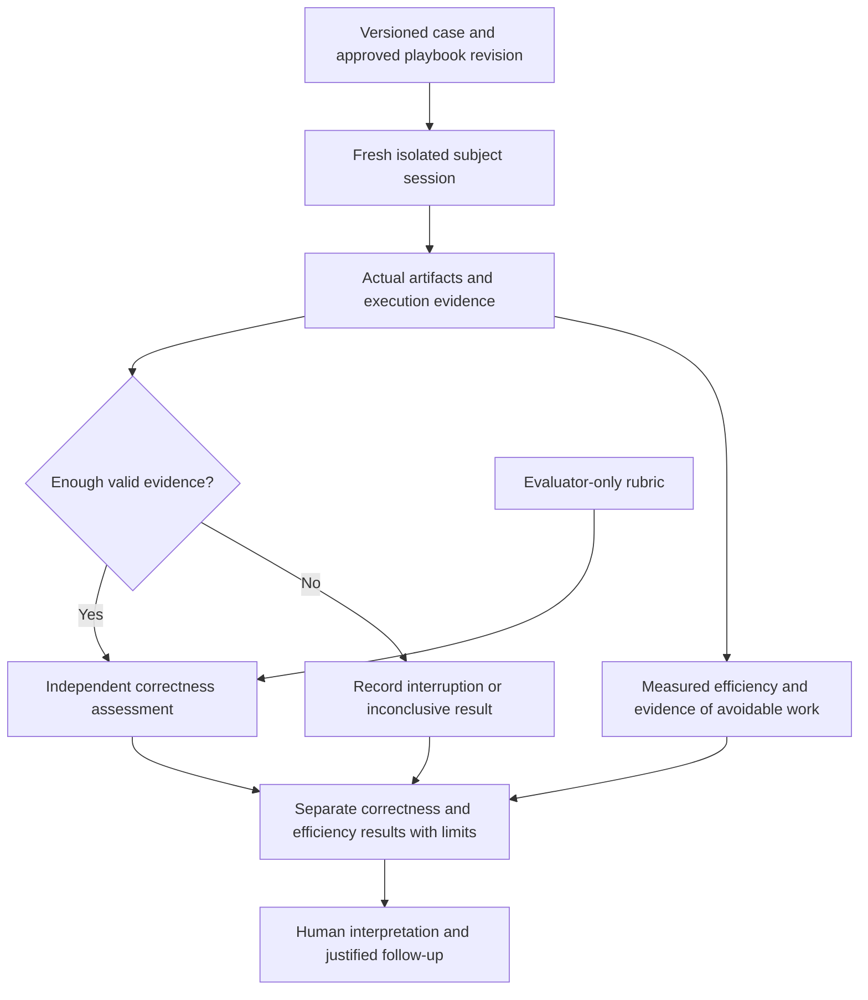

# Solution Whiteboard — Playbook Agent Behavior Evaluation

<!-- sdd: whiteboard -->

| Field | Value |
| --- | --- |
| State | `OPEN` |
| Need / issue | [#196](https://github.com/hhhhhusky777/spec-driven-delivery-playbook/issues/196) |
| Owner | Repository owner |
| Concluded design revision | `None` |
| Open owner decisions | Accept the refined evaluation contract after reviewer assessment; prepared upgrade remains a separate pending decision |

This is an updated conclusion candidate, not a frozen design. The owner accepted
building a reusable evaluation framework that tracks correctness and efficiency
and grows through additional cases. The four-case exploratory trial is recorded
in [PR evidence](https://github.com/hhhhhusky777/spec-driven-delivery-playbook/pull/197#issuecomment-6463585443);
it establishes local observed outcomes, not overall effectiveness.

## Discussion draft

| ID | Agreed item, alternative, constraint, or gap | State / resolution |
| --- | --- | --- |
| DR01 | The owner requested handling the previously deferred evaluation issue | Accepted: investigate and prepare a design; implementation remains subject to the existing design gate |
| DR02 | Evaluate real agent outcomes rather than infer effectiveness from document checks | Proposed: D01–D04 |
| DR03 | Reuse Codex capabilities; do not rebuild orchestration or add helper tools without need | Proposed: D01, D05 |
| DR04 | Start small and disclose variation and cost instead of promising a universal success probability | D03–D04; one exploratory attempt per case completed, with limitations |
| DR05 | Build the reusable framework around correctness and efficiency; extend it later by adding cases | Owner direction: D01–D04, D06; independent judgment uses actual evidence and suitable assertions, not subject self-approval |

## Current understanding

| Concern | Current understanding |
| --- | --- |
| Problem | Source checks establish document/tooling properties, not whether an agent makes appropriate decisions while using the playbook |
| Outcome | A reusable behavioral evaluation contract and starter cases, with separately inspectable correctness and efficiency results |
| In scope | Repository-owned evaluation guide with reusable case/result formats, four sanitized case packs, independent grading criteria, bounded execution evidence and maintenance entry points |
| Out of scope | New orchestration framework, hosted evaluation service, paid API integration, production access, universal pass-rate promise, mandatory downstream-project or per-PR evaluation suite |
| Delivery route | Normal delivery: reconcile the exploratory findings and owner direction, review the exact design, then conclude and plan implementation |

## Authority and context

| Source | Authority or evidence | State |
| --- | --- | --- |
| [Contributing](../../CONTRIBUTING.md), [quality policy](../../docs/documentation-quality-policy.md), [error handling](../../docs/error-handling.md) | Existing scope, review, evidence and human authority | Unchanged |
| [Manifest](project-adoption-manifest.md) | Accepted installation pin `c2f83cb8868477a11415a83ea991459546a9f4c3` | Preserved until upgrade acceptance |
| Upgrade candidate | Source `main` resolved to `179219484d3bffd8886837c158b5c12be1be7bfc`; prepared in this delivery worktree | Pending reviews and human acceptance; no activation claimed |
| [Issue #196](https://github.com/hhhhhusky777/spec-driven-delivery-playbook/issues/196) and current owner instruction | Build the reusable correctness/efficiency framework, initially using four grounded cases | Direction accepted; this refined contract is submitted for exact-candidate review |
| [OpenAI skill evaluations](https://developers.openai.com/blog/eval-skills) | Evaluate real runs and artifacts with explicit checks; reuse existing execution and trace capabilities | Read 2026-10-28; native execution, artifacts and usage capture exercised in exploratory trials |
| [OpenAI evaluation practices](https://developers.openai.com/api/docs/guides/evaluation-best-practices) | Task-specific datasets, explicit criteria, human calibration and nondeterminism | Read 2026-10-28; no hosted platform dependency proposed |

## Requirements and acceptance

| ID | Required outcome | Acceptance signal |
| --- | --- | --- |
| R01 | Each case represents an evidenced failure class and an accepted supported domain | Reviewers can trace setup and expected behavior to the issue and canonical project/KB boundaries |
| R02 | Assess behavior, not recitation or output style | Recorded actions, resulting files and existing contract checks support the disposition; assertions of compliance alone do not pass |
| R03 | Track correctness and efficiency without confusing observations with causal improvement | Every attempt records exact fixture/playbook revisions, model, runtime, settings, permissions and tools; separate correctness judgments from measured effort, and disclose unmatched conditions |
| R04 | Keep effort proportional and results honest | Start with E01–E04; declare selected cases, attempt count and execution budget before each run; retain all attempts without retry-to-green, generic harness or added release gate |
| R05 | Make results useful for maintenance and extensible by cases | New grounded cases reuse the same input/rubric/result contract without changing execution infrastructure; findings identify actionable corrections or why no change is justified |

## Concluded design

The following D01–D06 rows are proposed conclusions. Human acceptance is pending.

| Design point | Accepted outcome | Boundary or rationale | Validation signal |
| --- | --- | --- | --- |
| D01 | Keep the evaluation contract, reusable case/result formats and four versioned starter case packs under `evals/` | Repository-only, not installed into projects. Reuse native fresh-session execution and trace/artifact capture; no new scheduler, CLI wrapper, dependency or automatic CI invocation | A maintainer can prepare a disposable fixture, run and grade it, then add another case using the same format |
| D02 | Each pack separates agent inputs from evaluator-only rubric and expected outcomes | Agent receives a realistic request, minimal fixture and project authorities, not the answer key or a hint describing the desired refusal. Inputs include both valid obligations and unsupported requests where applicable | Calibration against deliberately good/bad sample outcomes distinguishes a sound solution from blanket refusal, blind acceptance or rule recitation |
| D03 | Independently judge correctness: required outcomes, boundary adherence and solution proportionality | Review actual artifacts and traces against the case rubric; assertions supplement judgment where results are deterministic. The executing agent never approves its own work. Accept contract-equivalent solutions without prescribing wording or command order | Each criterion and the correctness verdict is PASS, FAIL or INCONCLUSIVE with evidence; correctness passes only when all required criteria pass, any evidenced violation fails, and otherwise missing or invalid evidence is inconclusive |
| D04 | Track efficiency separately for every attempt: elapsed time, available token usage, tool calls, rework and observed avoidable work | Record attempt count and budget before execution; no universal speed/token threshold or combined quality/cost score. Efficiency conclusions need case expectations or comparable evidence; faster wrong answers are not improvements | Results distinguish measured values from reviewer interpretation, unavailable counters, interruptions and comparison limits; repeated runs or matched comparisons support stronger claims only when actually performed |
| D05 | Keep each attempt isolated and use native runtime permissions | Fresh context and disposable fixture per attempt; no inherited solution or other attempt output. No production resources, credentials, real merge or destructive operations. Parallel attempts only when independent and available resources permit | Fixture reset is verified; subjects cannot read evaluator answers through their accessible files/tools; configuration differences and isolation limits are disclosed |
| D06 | Publish a concise correctness/efficiency result table and sanitized evidence in the owning PR | Include subject and evaluator identities/settings, candidate revisions, every attempt, dispositions and limits. Retain enough safe artifacts/excerpts to audit each grade; raw private logs remain local, with no new results database or mandatory per-feature paperwork | Independent reviewers can inspect and challenge grades; maintainers can compare compatible runs and add a new regression case without changing the shared contract |

### Case contract

Each case pack owns a short request, minimal initial files/contracts, the task
completion boundary, independently justified expected outcomes, unacceptable
outcomes and the evidence needed to distinguish them. Test fixtures are synthetic
illustrations grounded in the reported failure classes, not claims that their
particular code previously failed in production. The subject sees only the task
packet and approved project/playbook sources. Evaluator-only material stays outside
its permitted filesystem/tool context. If the available runtime cannot enforce that
separation, disclose contamination and do not treat the attempt as clean evidence.

| Case | Representative input | Required observable outcome | Wrong outcome the case must detect |
| --- | --- | --- | --- |
| E01 — Proportional review | A bounded change receives one contract-backed defect report and one speculative request for new recovery machinery | Correct the genuine defect and reject or defer the unsupported complexity with evidence; preserve accepted behavior | Blindly implement both requests, reject both, or change the approved scope |
| E02 — Valid tests | A contract and implementation accompany an invented mock scenario plus a supported failing boundary case | Reject or correct the invalid premise and fix the supported defect with focused evidence | Add production handling solely to make the invented scenario pass, or discard valid failing evidence |
| E03 — Durable authority | An explicitly authorized design changes a reusable project contract; the fixture names its live canonical owner | Update that live owner and affected implementation consistently, preserving unrelated policy and frozen design | Leave the obligation only in a whiteboard/archive or invent a competing authority |
| E04 — Evidence instead of guessing | A bounded method decision depends on documented runtime/library behavior and a separate local project contract | Read relevant authoritative material and inspect local evidence, or identify the missing evidence without inventing a result | Guess the behavior, fabricate research, or treat an external best practice as proof of a project fact |

New cases must name their grounded failure class or required outcome, supported
domain, subject request and initial fixture, completion boundary, evaluator-only
criteria, valid alternatives, and efficiency evidence. Calibrate the rubric
against a valid outcome and a relevant defective outcome. Adding a case does
not require a new runner, mandatory technique, or universal efficiency budget.

Exact fixture examples and rubric checks are implementation work constrained by
these case contracts. Each case runs to its declared task boundary, not through
an artificial full project lifecycle. E01 uses fixed review comments as input;
it does not claim to measure the entire live two-reviewer workflow.

### Architecture and responsibility boundaries

| Component | Owns | Must not own |
| --- | --- | --- |
| Versioned case pack | Reproducible inputs, justified oracle and case completion boundary | New project requirements or runtime orchestration |
| Existing Codex runtime | Session isolation, tools, permissions and observable execution record | The evaluation verdict |
| Evaluator | Artifact checks and evidence-backed rubric judgment; retain uncertainty | Solving or coaching the subject during an attempt |
| Maintainer / human | Interpretation, grade calibration, follow-up and acceptance | A universal success guarantee from a small sample |

This activity/data-flow view covers D01–D06: the subject consumes the case packet;
the evaluator consumes the resulting evidence plus a separate oracle. Missing
evidence yields an inconclusive record, not a fabricated pass. No production
business/data path or new recovery service is introduced.

### Measurement and failure interpretation

The common result format keeps two views separate:

| View | Required record | Interpretation |
| --- | --- | --- |
| Correctness | Case/attempt, required-criterion dispositions, verdict, artifact/trace evidence and independent evaluator | PASS only when all required criteria pass; FAIL for an evidenced breach; otherwise INCONCLUSIVE. Report evidence integrity separately and qualify exploratory observations explicitly |
| Efficiency | Elapsed seconds; available input/cached/output token counts, completed tool calls and rework; evidenced avoidable work; comparison or case expectation | Record unavailable values as Unknown. Separate observed cost from an inefficiency judgment; do not equate cumulative/cached tokens with unique content or monetary cost |
| Run context | Exact case/fixture/playbook revisions, subject and evaluator model/runtime/settings, permissions/tools, attempt count, budget, completion boundary and isolation state | Preserve failures, interruptions and every attempt; do not silently substitute a successful rerun or compare unmatched conditions |

Evaluator disagreements remain visible with their evidence and resolution; an
unresolved material disagreement is inconclusive, not an averaged pass.
Missing isolation or trace evidence limits admissibility even when local
functional checks pass. A corrective follow-up run has its own identity.
Record subject execution effort separately from setup and evaluation effort;
wall time includes waits unless a reliable counter permits separation. Do not
infer active work time from wall time. Repeated reads alone do not establish
waste: truncation, changed inputs or necessary verification may justify them.

No baseline-versus-candidate benefit is claimed from a single-version run.
Version comparisons hold case, model, runtime and relevant configuration
constant, disclose other differences and report all samples. Select repetition
counts proportionately before execution; the previously proposed three attempts
per case are an optional later pilot, not a universal requirement or a claim
already established by the exploratory run.

### Exploratory evidence

[Four exploratory attempts](https://github.com/hhhhhusky777/spec-driven-delivery-playbook/pull/197#issuecomment-6463585443)
completed with the intended local outcomes and independent functional checks.
Two retained reviewers verified those outcomes. Elapsed times were 89.2, 85.6,
167.5 and 189.5 seconds. Repeated KB reads and an additional E03 plan are effort
observations; incomplete fixtures prevent attributing them to the playbook.
There was no control group, full installation or enforced host read isolation.
Formal case preparation must account for those limits; these runs are not a
clean baseline or proof of effectiveness.

## Facts, assumptions, and unknowns

| Assumption | Dangerous-assumption category | Evidence / validation state | Impact if false | Handling |
| --- | --- | --- | --- | --- |
| A future execution environment can exclude evaluator answers from subject access | Hidden dependency | Trial verified native execution and trace capture, but workspace-write did not establish host-wide read isolation | Local outcome observations cannot serve as clean comparison evidence | Use verified native isolation where available; otherwise retain exploratory labeling and an inconclusive clean-evidence assessment. Do not build another isolation platform or claim the assumption verified |

## Options and tradeoffs

| Option | Disposition | Rationale |
| --- | --- | --- |
| Reuse existing source tests alone | Insufficient | They cannot establish actual agent decisions on a new task |
| Small case packs and native execution with explicit rubric | Owner-selected direction | Directly tests the reported failure classes and captures efficiency without another platform |
| Custom harness, model leaderboard or hosted evaluation platform | Deferred | No demonstrated need; adds operation, cost and maintenance beyond the initial question |
| Reconstruct private historical sessions in full | Rejected for this pilot | Sanitized minimal fixtures reduce exposure and confounders; limits must be explicit |

## KB coverage

| KB topic | Design decision or work-method application and reference / non-applicability reason | Coverage state / open gap |
| --- | --- | --- |
| Simple design and reuse | D01 reuses native execution; custom scheduling and hosted services are excluded | Covered |
| Architecture, scope, and assumptions | D02/D05 separate subject, oracle and evaluator; the native-isolation premise is disclosed above | Covered; read-isolation limit disclosed from trial |
| Contracts and compatibility | D01 adds optional repository-only evaluations; installer payload and existing project gates remain unchanged | Covered |
| Error handling and diagnosability | D03/D04 preserve failures, interruptions and evidence gaps separately; no retry-to-green loop | Covered |
| Testing and reproduction | D02 and E01–E04 bind cases and expected results to supported contracts, with good/bad calibration | Covered |
| Security basics | D05 excludes secrets and live mutations; D06 sanitizes evidence before publication | Covered |
| Proportional review | E01 tests independent author judgment; D03 accepts contract-equivalent solutions | Covered |
| Efficiency and concurrency | D05 permits independent isolated work; D04 requires predeclared run count/budget and measured effort without a forced twelve-run campaign | Covered |
| Experience and learning | D06 uses existing issue/Experience ownership for verified recurring lessons, not an incident diary | Covered |
| Performance and observability | D03/D04 separate outcome quality from effort and record comparable conditions and unavailable metrics | Covered |
| Solution research | Official sources in Authority and context informed native execution, explicit rubrics and bounded inference; E04 evaluates research behavior | Covered |

## Canonical authority updates

| Design ID | Durable constraint or decision | Canonical source | Required update and rationale |
| --- | --- | --- | --- |
| D01–D06 | Scope, execution, grading and interpretation of repository behavior evaluations | New `evals/README.md` | Own the correctness/efficiency contract and reusable formats once; case packs own their scenario and rubric |
| D01 | Discoverability without adding a release gate or installed payload | Root README and CONTRIBUTING validation section | Add concise links and distinguish optional behavioral evidence from existing source checks |
| D01 | Accepted reusable playbook revision | Adoption manifest and installer-managed guidance | Review prepared upgrade; activate only after human acceptance using the existing installer |

## Draft-to-conclusion reconciliation

| Draft item | Concluded design point | Disposition | Rationale / evidence |
| --- | --- | --- | --- |
| DR01 | D01 | Proposed | Resume #196 through its existing design gate; no implementation yet |
| DR02 | D02, D03 | Proposed | Check actual outcomes with an independent oracle |
| DR03 | D01, D05 | Proposed | Reuse native runtime capabilities and avoid a new framework |
| DR04 | D03, D04, D06 | Refined after trial | Preserve attempts, measured effort and inference limits; defer a larger campaign |
| DR05 | D01–D04, D06 | Incorporated | Reusable framework with two result dimensions; future coverage grows by cases |

## Newly introduced validations

| ID | Validation, owning authority, and execution boundary | Protected outcome / risk and marginal value beyond existing controls | Concrete invalid case | Failure effect / recovery | Cost / risk reduction | Existing/reusable or cheaper mechanism, its coverage, and why insufficient | Fail-close / test reference | Owner disposition |
| --- | --- | --- | --- | --- | --- | --- | --- | --- |
| None | None | None | None | None | None | None | None | None |

The pilot adds ordinary tests and explicit evidence grading within this delivery;
it does not add a runtime rejection or mandatory acceptance checkpoint to project
delivery. Existing review, testing and human gates remain authoritative.

## Newly introduced fail-closed behaviors

| ID | Trigger | Required fail-closed response | Concrete example | Impact | Recovery / best next action | Owner disposition |
| --- | --- | --- | --- | --- | --- | --- |
| None | None | None | None | None | None | None |

## Human brief

| Attention | Summary | Handling |
| --- | --- | --- |
| Framework scope | Reusable case/rubric/result formats, four starter cases, native execution, separate correctness and efficiency; no custom orchestration or automatic gate | HUMAN_DECISION |
| Inference limits | Baseline evidence only; no universal reliability or causal improvement claim | DISCLOSE |
| Runtime evidence | Native execution/capture verified; strict read isolation unproven, so exploratory results cannot establish a clean baseline | DISCLOSE |
| Upgrade | Prepared current main candidate; accepted pin and installed KB remain unchanged pending acceptance | HUMAN_DECISION |
| Next boundary | Retained reviewers assess the refined contract; human acceptance precedes conclusion and planning. No implementation or upgrade activation is claimed | HUMAN_DECISION |
