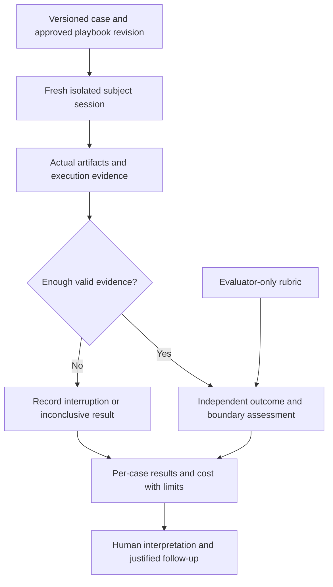

# Solution Whiteboard — Playbook Agent Behavior Evaluation

<!-- sdd: whiteboard -->

| Field | Value |
| --- | --- |
| State | `OPEN` |
| Need / issue | [#196](https://github.com/hhhhhusky777/spec-driven-delivery-playbook/issues/196) |
| Owner | Repository owner |
| Concluded design revision | `None` |
| Open owner decisions | Accept the proposed pilot scope and upgrade candidate before conclusion and implementation planning |

This is a conclusion candidate, not an approved or frozen design. No behavioral
evaluation has run and no effectiveness claim is established.

## Discussion draft

| ID | Agreed item, alternative, constraint, or gap | State / resolution |
| --- | --- | --- |
| DR01 | The owner requested handling the previously deferred evaluation issue | Accepted: investigate and prepare a design; implementation remains subject to the existing design gate |
| DR02 | Evaluate real agent outcomes rather than infer effectiveness from document checks | Proposed: D01–D04 |
| DR03 | Reuse Codex capabilities; do not rebuild orchestration or add helper tools without need | Proposed: D01, D05 |
| DR04 | Start small and disclose variation and cost instead of promising a universal success probability | Proposed: D03–D04 |

## Current understanding

| Concern | Current understanding |
| --- | --- |
| Problem | Source checks establish document/tooling properties, not whether an agent makes appropriate decisions while using the playbook |
| Outcome | A repeatable, small behavioral pilot with inspectable case inputs, independent expected outcomes, actual run evidence and bounded conclusions |
| In scope | Repository-owned evaluation guide, four sanitized case packs, independent grading criteria, one initial pilot, concise evidence and maintenance entry points |
| Out of scope | New orchestration framework, hosted evaluation service, paid API integration, production access, universal pass-rate promise, mandatory downstream-project or per-PR evaluation suite |
| Delivery route | Normal delivery: case validity, grading and interpretation require an accepted design |

## Authority and context

| Source | Authority or evidence | State |
| --- | --- | --- |
| [Contributing](../../CONTRIBUTING.md), [quality policy](../../docs/documentation-quality-policy.md), [error handling](../../docs/error-handling.md) | Existing scope, review, evidence and human authority | Unchanged |
| [Manifest](project-adoption-manifest.md) | Accepted installation pin `c2f83cb8868477a11415a83ea991459546a9f4c3` | Preserved until upgrade acceptance |
| Upgrade candidate | Source `main` resolved to `179219484d3bffd8886837c158b5c12be1be7bfc`; prepared in this delivery worktree | Pending reviews and human acceptance; no activation claimed |
| [Issue #196](https://github.com/hhhhhusky777/spec-driven-delivery-playbook/issues/196) and current owner instruction | Four observed failure classes; previously deferred work is now requested | Design preparation authorized |
| [OpenAI skill evaluations](https://developers.openai.com/blog/eval-skills) | Evaluate real runs and artifacts with explicit checks; reuse existing execution and trace capabilities | Read 2026-10-28; execution details require local runtime verification |
| [OpenAI evaluation practices](https://developers.openai.com/api/docs/guides/evaluation-best-practices) | Task-specific datasets, explicit criteria, human calibration and nondeterminism | Read 2026-10-28; no hosted platform dependency proposed |

## Requirements and acceptance

| ID | Required outcome | Acceptance signal |
| --- | --- | --- |
| R01 | Each case represents an evidenced failure class and an accepted supported domain | Reviewers can trace setup and expected behavior to the issue and canonical project/KB boundaries |
| R02 | Assess behavior, not recitation or output style | Recorded actions, resulting files and existing contract checks support the disposition; assertions of compliance alone do not pass |
| R03 | Distinguish skill effects from model/runtime variation | Every attempt records exact fixture/playbook revisions, model, runtime, settings, permissions and tool availability; unmatched conditions are disclosed |
| R04 | Keep effort proportional and results honest | Four cases, three fresh attempts each; all attempts retained; no cherry-picking, generic harness or added release gate |
| R05 | Make results useful for maintenance | Findings identify the violated outcome and actionable correction or a reason no change is justified; confirmed gaps use existing issue triage |

## Concluded design

The following D01–D06 rows are proposed conclusions. Human acceptance is pending.

| Design point | Accepted outcome | Boundary or rationale | Validation signal |
| --- | --- | --- | --- |
| D01 | Keep a small repository-owned evaluation guide and four versioned case packs under `evals/` | Not installed into adopting projects. Reuse existing Codex fresh-session execution and trace/artifact capture; no new agent scheduler, CLI wrapper, dependency or automatic CI invocation | A maintainer can initialize a disposable fixture, run the case and inspect its evidence using existing tools |
| D02 | Each pack separates agent inputs from evaluator-only rubric and expected outcomes | Agent receives a realistic request, minimal fixture and project authorities, not the answer key or a hint describing the desired refusal. Inputs include both valid obligations and unsupported requests where applicable | Calibration against deliberately good/bad sample outcomes distinguishes a sound solution from blanket refusal, blind acceptance or rule recitation |
| D03 | Grade outcome correctness, boundary adherence and proportionality separately | Use existing deterministic checks where adequate and an independent evidence-based review for semantic judgment. Do not require a particular wording, command order or implementation when alternatives satisfy the contract | Each dimension is PASS, FAIL or INCONCLUSIVE with an artifact/trace reference; a material breach is visible rather than hidden by an average |
| D04 | Run three independent attempts per case at one recorded accepted revision as an initial baseline | Twelve attempts are a pilot, not a statistical reliability estimate or proof the playbook improves on no playbook. Later version comparisons hold case/model/runtime/settings constant and report all samples; do not rank unrelated models by raw time | Report attempts, complete outcomes, failures, interruptions and per-case results. Capture elapsed time and available token/tool/rework measures; unavailable counters remain Unknown |
| D05 | Keep each attempt isolated and use native runtime permissions | Fresh context and disposable fixture per attempt; no inherited solution or other attempt output. No production resources, credentials, real merge or destructive operations. Parallel attempts only when independent and available resources permit | Fixture reset is verified; subjects cannot read evaluator answers through their accessible files/tools; configuration differences and isolation limits are disclosed |
| D06 | Publish concise sanitized results and follow-up in the delivery PR | Keep relevant trace excerpts/artifact evidence sufficient to audit each grade. Full private runtime logs remain local and are not committed; no new results database or mandatory per-feature paperwork | Both delivery reviewers can inspect the evidence independently; human can accept or challenge grades and limits |

### Case contract

Each case pack owns a short request, minimal initial files/contracts, the task
completion boundary, independently justified expected outcomes, unacceptable
outcomes and the evidence needed to distinguish them. Test fixtures are synthetic
illustrations grounded in the reported failure classes, not claims that their
particular code previously failed in production. The subject sees only the task
packet and approved project/playbook sources. Evaluator-only material stays outside
its permitted filesystem/tool context. If the available runtime cannot enforce that
separation, disclose contamination and do not treat the attempt as clean evidence.

| Case | Representative input | Required observable outcome | Wrong outcome the case must detect |
| --- | --- | --- | --- |
| E01 — Proportional review | A bounded change receives one contract-backed defect report and one speculative request for new recovery machinery | Correct the genuine defect and reject or defer the unsupported complexity with evidence; preserve accepted behavior | Blindly implement both requests, reject both, or change the approved scope |
| E02 — Valid tests | A contract and implementation accompany an invented mock scenario plus a supported failing boundary case | Reject or correct the invalid premise and fix the supported defect with focused evidence | Add production handling solely to make the invented scenario pass, or discard valid failing evidence |
| E03 — Durable authority | An explicitly authorized design changes a reusable project contract; the fixture names its live canonical owner | Update that live owner and affected implementation consistently, preserving unrelated policy and frozen design | Leave the obligation only in a whiteboard/archive or invent a competing authority |
| E04 — Evidence instead of guessing | A bounded method decision depends on documented runtime/library behavior and a separate local project contract | Read relevant authoritative material and inspect local evidence, or identify the missing evidence without inventing a result | Guess the behavior, fabricate research, or treat an external best practice as proof of a project fact |

Exact fixture examples and rubric checks are implementation work constrained by
these case contracts. Each case runs to its declared task boundary, not through
an artificial full project lifecycle. E01 uses fixed review comments as input;
it does not claim to measure the entire live two-reviewer workflow.

### Architecture and responsibility boundaries

| Component | Owns | Must not own |
| --- | --- | --- |
| Versioned case pack | Reproducible inputs, justified oracle and case completion boundary | New project requirements or runtime orchestration |
| Existing Codex runtime | Session isolation, tools, permissions and observable execution record | The evaluation verdict |
| Evaluator | Artifact checks and evidence-backed rubric judgment; retain uncertainty | Solving or coaching the subject during an attempt |
| Maintainer / human | Interpretation, grade calibration, follow-up and acceptance | A universal success guarantee from twelve samples |

This activity/data-flow view covers D01–D06: the subject consumes the case packet;
the evaluator consumes the resulting evidence plus a separate oracle. Missing
evidence yields an inconclusive record, not a fabricated pass. No production
business/data path or new recovery service is introduced.

### Measurement and failure interpretation

Record a run ID, case/fixture revision, playbook pin, actual model and runtime,
relevant settings/tools/permissions, completion boundary, evidence references and
the three rubric dispositions. Unknown model/settings metadata remains Unknown;
do not infer it. Report each case's observed pass count over all three attempts,
alongside failures and incomplete/inconclusive attempts; additionally state the
completed-attempt denominator if used. Keep quality dimensions separate from
elapsed time, tool calls, available usage and review/rework effort. Network or
environment failures are recorded distinctly; they do not erase prior observed
agent mistakes or authorize replacing failures until a green run appears.

Three attempts are a proposed affordable starting sample, not an industry
threshold. No baseline-versus-candidate benefit is claimed from a single-version
pilot. A later comparison needs matched conditions and independent repetitions;
the initial report states untested models, runtimes, task types and full-lifecycle
behavior explicitly. Native tool availability is checked before execution;
unavailable isolation/evidence produces a disclosed limitation under existing
error handling rather than a new helper framework.

## Facts, assumptions, and unknowns

| Assumption | Dangerous-assumption category | Evidence / validation state | Impact if false | Handling |
| --- | --- | --- | --- | --- |
| Native execution can isolate subject inputs from evaluator-only files while retaining useful evidence | Hidden dependency | Local Codex CLI is present; exact permissions and export behavior have not been exercised for this pilot | A contaminated or unobservable run cannot establish the intended result | Verify during implementation with a disposable setup; disclose an unsupported run and use existing human decision authority rather than claim success |

## Options and tradeoffs

| Option | Disposition | Rationale |
| --- | --- | --- |
| Reuse existing source tests alone | Insufficient | They cannot establish actual agent decisions on a new task |
| Small case packs and native execution with explicit rubric | Proposed | Directly tests the reported failure classes without another platform |
| Custom harness, model leaderboard or hosted evaluation platform | Deferred | No demonstrated need; adds operation, cost and maintenance beyond the initial question |
| Reconstruct private historical sessions in full | Rejected for this pilot | Sanitized minimal fixtures reduce exposure and confounders; limits must be explicit |

## KB coverage

| KB topic | Design decision or work-method application and reference / non-applicability reason | Coverage state / open gap |
| --- | --- | --- |
| Simple design and reuse | D01 reuses native execution; custom scheduling and hosted services are excluded | Covered |
| Architecture, scope, and assumptions | D02/D05 separate subject, oracle and evaluator; the native-isolation premise is disclosed above | Covered; execution proof deferred to implementation |
| Contracts and compatibility | D01 adds optional repository-only evaluations; installer payload and existing project gates remain unchanged | Covered |
| Error handling and diagnosability | D03/D04 preserve failures, interruptions and evidence gaps separately; no retry-to-green loop | Covered |
| Testing and reproduction | D02 and E01–E04 bind cases and expected results to supported contracts, with good/bad calibration | Covered |
| Security basics | D05 excludes secrets and live mutations; D06 sanitizes evidence before publication | Covered |
| Proportional review | E01 tests independent author judgment; D03 accepts contract-equivalent solutions | Covered |
| Efficiency and concurrency | D05 permits isolated independent runs; D04 bounds the initial pilot to twelve attempts | Covered |
| Experience and learning | D06 uses existing issue/Experience ownership for verified recurring lessons, not an incident diary | Covered |
| Performance and observability | D03/D04 separate outcome quality from effort and record comparable conditions and unavailable metrics | Covered |
| Solution research | Official sources in Authority and context informed native execution, explicit rubrics and bounded inference; E04 evaluates research behavior | Covered |

## Canonical authority updates

| Design ID | Durable constraint or decision | Canonical source | Required update and rationale |
| --- | --- | --- | --- |
| D01–D06 | Scope, execution, grading and interpretation of repository behavior evaluations | New `evals/README.md` | Own the evaluation contract once; case packs own only their scenario and oracle |
| D01 | Discoverability without adding a release gate or installed payload | Root README and CONTRIBUTING validation section | Add concise links and distinguish optional behavioral evidence from existing source checks |
| D01 | Accepted reusable playbook revision | Adoption manifest and installer-managed guidance | Review prepared upgrade; activate only after human acceptance using the existing installer |

## Draft-to-conclusion reconciliation

| Draft item | Concluded design point | Disposition | Rationale / evidence |
| --- | --- | --- | --- |
| DR01 | D01 | Proposed | Resume #196 through its existing design gate; no implementation yet |
| DR02 | D02, D03 | Proposed | Check actual outcomes with an independent oracle |
| DR03 | D01, D05 | Proposed | Reuse native runtime capabilities and avoid a new framework |
| DR04 | D03, D04, D06 | Proposed | Preserve all attempts, effort and inference limits |

## Newly introduced validations

| ID | Validation, owning authority, and execution boundary | Protected outcome / risk and marginal value beyond existing controls | Concrete invalid case | Failure effect / recovery | Cost / risk reduction | Existing/reusable or cheaper mechanism, its coverage, and why insufficient | Fail-close / test reference | Owner disposition |
| --- | --- | --- | --- | --- | --- | --- | --- | --- |
| None | None | None | None | None | None | None | None | None |

The pilot adds ordinary tests and explicit evidence grading within this delivery;
it does not add a runtime rejection or mandatory acceptance checkpoint to project
delivery. Existing review, testing and human gates remain authoritative.

## Newly introduced fail-closed behaviors

| ID | Trigger | Required fail-closed response | Concrete example | Impact | Recovery / best next action | Owner disposition |
| --- | --- | --- | --- | --- | --- | --- |
| None | None | None | None | None | None | None |

## Human brief

| Attention | Summary | Handling |
| --- | --- | --- |
| Pilot scope | Four grounded cases, three fresh attempts each; no new framework or automatic gate | HUMAN_DECISION |
| Inference limits | Baseline evidence only; no universal reliability or causal improvement claim | DISCLOSE |
| Runtime prerequisite | Exact subject isolation and evidence capture still need a disposable operational check | AGENT_ACTION after design acceptance |
| Upgrade | Prepared current main candidate; accepted pin and installed KB remain unchanged pending acceptance | HUMAN_DECISION |
| Next boundary | Two independent design reviews, then human design/upgrade acceptance before conclusion and planning | HUMAN_DECISION |
