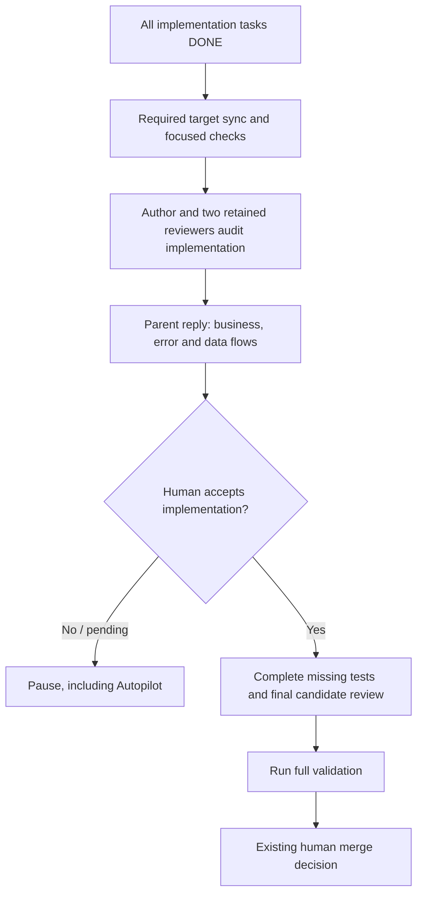

# Solution Whiteboard — Human implementation review before final validation

<!-- sdd: whiteboard -->

| Field | Value |
| --- | --- |
| State | `CONCLUDED` |
| Need / issue | [#179](https://github.com/hhhhhusky777/spec-driven-delivery-playbook/issues/179) |
| Owner | Repository owner |
| Concluded design revision | `55f8968cb2e8ee795a38d92f5bd0e00e6be6a4ce` |
| Open owner decisions | `None` |

This is the conclusion candidate for owner review. Design freeze and dependent
implementation await the existing reviewer and human acceptance boundaries.

## Discussion draft

| ID | Agreed item, alternative, constraint, or gap | State / resolution |
| --- | --- | --- |
| DR01 | The owner requires a human pause after all development is complete and before validation, including Autopilot deliveries | accepted |
| DR02 | The parent response must show code-level business and error-handling flows | accepted |
| DR03 | The owner asked whether a data flow diagram exists | accepted |
| DR04 | Existing policy already places author and two-reviewer implementation audit before missing final tests and final-test runs | accepted |
| DR05 | Diagrams must help inspect the actual change without becoming a second design or documentation system | accepted |
| DR06 | Approval must remain tied to the implementation that was inspected | accepted |
| DR07 | New deliveries check playbook currentness before work | accepted |

## Current understanding and scope

The current workflow has an implementation audit by the author and retained
reviewers, followed by missing-test work and full validation. It lacks the
owner's requested human pause and concrete implementation-flow presentation.

This change covers that existing transition, the portable workflow/review
skills, this repository's policy, plan guidance, README and diagrams. It does
not change project runtime behavior, task-focused test requirements, branch
policy, review independence or final protected-target merge authority. It adds
no delivery document, diagram service, state engine or new tool dependency.

## Authority, facts and research

| Source | Authority or evidence | Verification / application |
| --- | --- | --- |
| Owner request in this discussion | Human review before validation even with Autopilot, with implementation flow diagrams | Governs D01–D03 |
| [Contributing](../../CONTRIBUTING.md#branches-review-and-merge) and [quality policy](../../docs/documentation-quality-policy.md#review-and-human-brief) | Existing implementation audit, focused/final test split, independent review and merge authority | Read against base `814cdf768d72d57d962c51d9e5ad1cae8aa0246f` |
| [Workflow skill](../../skills/sdd-project-workflow/SKILL.md#autopilot-mode) | Portable authorization and completion behavior | Current Autopilot reaches final readiness without this human implementation pause |
| [Plan template](../../templates/delivery/implementation-plan.md#test-and-acceptance-contracts) | One test inventory and existing implementation approval boundary | Reuse its plan/PR ownership rather than create another tracker |
| [C4 dynamic diagrams](https://c4model.com/diagrams/dynamic) | Runtime collaboration for a bounded feature or use case | Supports concrete interactions and proportional scope; does not itself mandate this human gate |
| [OWASP system modeling](https://cheatsheetseries.owasp.org/cheatsheets/Threat_Modeling_Cheat_Sheet.html#system-modeling) | DFDs depict processes, stores, external entities and data movement | Use that distinction for the data view; no threat-modeling process is introduced |

Material assumptions: `None`. The timing and diagram-applicability details below
are explicit proposals for owner disposition, not inferred project facts.

## Options and tradeoffs

| Option | Benefit | Cost / limitation | Disposition |
| --- | --- | --- | --- |
| Extend the existing pre-final implementation audit with a human pause and implementation-flow brief | Gives the owner visibility before final-test work while reusing one boundary | Adds one deliberate human wait and preparation of useful diagrams | Proposed |
| Rely only on the existing two-agent audit or final merge review | Lower waiting cost | Does not provide the requested human review before validation | Rejected against the owner requirement |
| Add a second tracker, automatic diagram generator or universal diagram notation | Potential automation | Extra maintenance without evidence it is needed for this outcome | Out of scope |

## Concluded design candidate

| Design point | Accepted outcome | Boundary or rationale | Validation signal |
| --- | --- | --- | --- |
| D01 | After all implementation tasks are DONE, use the existing author/two-reviewer audit, then pause for explicit human acceptance before adding missing final tests or running final-gate tests | Perform any required target sync and affected focused checks first. Existing task-focused tests continue at their current boundaries. A single-unit or Fast Fix delivery reaches the same transition when implementation is complete | Scenario walkthrough cannot proceed into final-test work without acceptance of the implementation candidate |
| D02 | Autopilot also stops at this human implementation review | Autopilot authorization does not satisfy this acceptance. After acceptance, continue only within existing authorization and preserve the final human merge decision | Autopilot scenario stops before final-test work and resumes within recorded authority |
| D03 | After both reviewers approve, the parent reply presents business-flow, error-handling-flow and data-flow diagrams derived from the actual implementation | Business view shows relevant entry points, calls, decisions and outcomes. Error view shows implemented failure propagation, handling, recovery and outcomes. Data view shows producers, relevant transformations, stores and consumers with labeled data movement | Owner can compare all three views with the same candidate and its code references |
| D04 | Keep diagram scope proportional and traceable to this delivery | Use actual code paths/symbols and the accepted changed outcomes; include existing surrounding interactions only as needed. Render the views in the reply and retain review evidence in the PR. Reuse accurate existing diagrams. For an inapplicable view, explicitly state N/A with the concrete reason for human review; do not fabricate a flow | Reviewers verify code agreement, useful scope and any N/A explanation; no new diagram document is created |
| D05 | Human acceptance binds to the audited implementation content | A later implementation-content change, including required target sync, repeats the existing audit, refreshes affected diagrams and requires human acceptance again before dependent final-test work. Test-only additions that preserve that implementation do not by themselves repeat this acceptance | Changed-code scenario invalidates the prior acceptance; test-only scenario preserves it |
| D06 | Put the portable gate contract in the workflow skill and route consumers to it | Review skill verifies evidence and the human boundary. Policy, CONTRIBUTING, plan guidance and README summarize their local consequence and link to the contract. Update affected README diagrams and Autopilot claims together | Installed skills alone expose the requirement; links, terminology and diagrams agree without a duplicate rule owner |
| D07 | Include the prepared in-place upgrade from accepted pin e7934be to immutable main 814cdf7 | Manifest remains at the accepted full SHA while candidate is assessed. Preserve canonical policies, Experience and current project content. After owner acceptance, use the installer for accepted cutover and KB/skill parity | Incremental discovery has no new authority gap; candidate runtime reports UPGRADE_CURRENT; accepted runtime must later report CURRENT |

### Proposed review position

## Draft-to-conclusion reconciliation

| Draft item | Concluded design point | Disposition | Rationale / evidence |
| --- | --- | --- | --- |
| DR01 | D01, D02 | accepted | Explicit human stop precedes final-test work in either execution mode |
| DR02 | D03 | accepted | Both requested code-level flow views appear in the parent response |
| DR03 | D03 | accepted | DFD supplies the distinct data-movement view; owner disposition pending |
| DR04 | D01 | accepted | Extends the existing audit rather than create another phase tracker |
| DR05 | D04, D06 | accepted | Scope, applicability and canonical ownership keep the presentation useful |
| DR06 | D05 | accepted | Reuses implementation-content invalidation and preserves test-only distinction |
| DR07 | D07 | accepted | Currentness work is prepared in the delivery worktree with the old pin authoritative |

## Newly introduced validations

| ID | Validation, owning authority, and execution boundary | Protected outcome / risk and marginal value beyond existing controls | Concrete invalid case | Failure effect / recovery | Cost / risk reduction | Existing/reusable or cheaper mechanism, its coverage, and why insufficient | Fail-close / test reference | Owner disposition |
| --- | --- | --- | --- | --- | --- | --- | --- | --- |
| V01 | Explicit human implementation acceptance, owned by workflow skill at the existing pre-final-test transition after author/two-reviewer audit | Gives the owner a code-grounded view and decision before final-test effort; current agent review alone supplies no human acceptance | All tasks and agent reviews pass under Autopilot, but the parent starts full validation without presenting flows or receiving acceptance | Pause final-test work; parent presents the current implementation/views and owner accepts or requests correction; repeat the affected audit after code changes | One intentional wait plus proportionate diagram preparation; no additional document, runtime checker or new review cohort | Reuse the existing implementation audit and PR evidence. Agent approval or final merge review alone occurs without the requested human decision before validation | FC01; walkthroughs for Autopilot, ordinary mode, code-change invalidation, test-only continuation and N/A views | Approved by owner in conversation, 2026-10-23 |

All five existing validation criteria apply to V01: traceability to the owner's
requested outcome, correct workflow/human boundary, marginal value beyond agent
review, proportionate human/diagram cost, and reuse of the simplest sufficient
existing audit mechanism.

## Newly introduced fail-closed behaviors

| ID | Trigger | Required fail-closed response | Concrete example | Impact | Recovery / best next action | Owner disposition |
| --- | --- | --- | --- | --- | --- | --- |
| FC01 | Implementation is complete but explicit human acceptance of the current audited implementation is absent or was invalidated by a code change | Stop before adding missing final tests or running final-gate tests, including when Autopilot is enabled | Two task PRs have merged into the feature branch and both reviewers approve, but the owner has not reviewed the three implementation-flow views; the author waits instead of starting the final system tests | Final-validation progress waits for the owner; completed implementation and prior valid evidence are preserved | Parent presents or refreshes the code-grounded brief and resolves findings within authority; owner explicitly accepts that implementation; resume final-test work only after acceptance and required agent audit are current | Approved by owner in conversation, 2026-10-23 |

## Implementation and verification outline

After design acceptance, plan a coherent implementation unit covering the
portable workflow/review contract and its policy, plan and README consumers.
Use existing Markdown/link/lifecycle/Mermaid checks and installed profile
regressions where relevant; add only meaningful missing behavioral evidence,
not prose-locking tests or a new lifecycle engine.

Reviewers walk through ordinary and Autopilot completion, absent acceptance,
implementation changes, test-only additions, single-unit/Fast Fix delivery and
an inapplicable diagram view. Final source validation remains subject to the
existing current quality policy and the owner's accepted design.

## Human brief

| Attention | Summary | Handling |
| --- | --- | --- |
| Requested behavior | Add one human implementation pause before final-test work, including Autopilot, and three implementation-flow views in the reply | HUMAN_DECISION |
| Diagram scope | Affected actual implementation; explicitly justified N/A for an inapplicable view | HUMAN_DECISION |
| New control | Review and accept V01 / FC01 as the one new checkpoint and its safe continuation | HUMAN_DECISION |
| Upgrade | Candidate 814cdf7 prepared; accepted e7934be and project authorities remain intact until acceptance | HUMAN_DECISION |
| Implementation state | No plan or policy implementation yet; this OPEN whiteboard is the review candidate | DISCLOSE |
