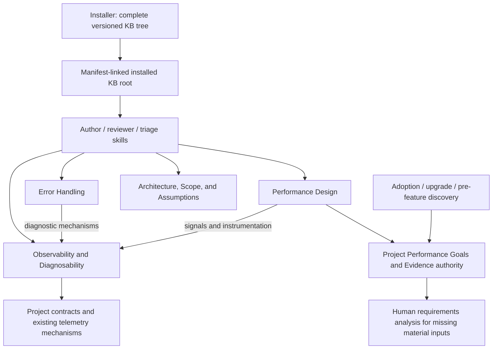

# Solution Whiteboard — Shared Observability and Diagnosability

<!-- sdd: whiteboard -->

| Field | Value |
| --- | --- |
| State | `OPEN` |
| Need / issue | [Issue #215](https://github.com/hhhhhusky777/spec-driven-delivery-playbook/issues/215) |
| Owner | Repository owner |
| Concluded design revision | `None` |
| Open owner decisions | Accept A03 design and revised task mapping before dependent implementation |

## Discussion draft

| ID | Agreed item, alternative, constraint, or gap | State / resolution |
| --- | --- | --- |
| DR01 | Preserve the true failure origin through shared handlers without logging every branch | Accepted |
| DR02 | Share suitable instrumentation and operation context for performance and error information | Accepted |
| DR03 | Distinguish required diagnostic evidence from optional detail and explain distributed traces | Accepted |
| DR04 | Keep an authorized triage repair together through relevant verification before review | Accepted |
| DR05 | Remove the standalone export example and performance discussion from the error KB | Accepted |
| DR06 | Give observability and diagnosability a separate KB; error handling and performance link to it | Accepted |
| DR07 | Fast Fix is insufficient; write whiteboard and plan | Accepted |
| DR08 | PR #217 comments request a shared framework when absent, existing framework options and explicit performance evidence | Accepted |
| DR09 | PR #217 comments request filenames that match the narrowed topics and removal of redundant scope introductions | Accepted |
| DR10 | Owner approved moving architectural conformance guidance, its ArchUnit example and supporting references into the existing Architecture, Scope, and Assumptions KB | Accepted |
| DR11 | Owner clarified Performance Design selects high-performance system structure; code-level engineering realizes it and reduces overhead; measurement methods belong to the shared topic | Accepted |
| DR12 | Owner approved a reusable project Performance Goals and Evidence authority, discovery/upgrade checks, human requirements analysis for material missing inputs and evidence acquisition definitions | Accepted |

## Current understanding

| Concern | Current understanding |
| --- | --- |
| Problem / observed need | General signal and diagnostic mechanisms are split between error and performance KBs, obscuring ownership and inviting duplication |
| Required outcome | One installed, directly readable Observability and Diagnosability topic; narrow error/performance topics; consistent skill routing and links |
| Actors and critical journeys | Author, independent reviewers and triage agent read version-matched guidance and select proportionate evidence within project authority |
| In scope | Existing Issue #215 work, shared-topic extraction, Performance Design boundary, reusable project performance-authority discovery contract, KB index, applicable skills/templates/links and existing tests |
| Out of scope / deferred | Runtime telemetry implementation, platform/SDK adoption, project-specific target selection or policy activation, new gates, live model evaluations, historical archive rewrites and unrelated KB cleanup |
| Confidence | Scope and content sources are known; implementation and installation proof remain future work |

## Authority and context

| Source | Authority or relevant content | Freshness / verification |
| --- | --- | --- |
| Owner discussion and [Issue #215](https://github.com/hhhhhusky777/spec-driven-delivery-playbook/issues/215) | Normal-delivery route and separate diagnostic KB | Current direction supersedes Fast Fix route and performance-owned shared guidance |
| [Contributing](../../CONTRIBUTING.md) | Branches, review, acceptance and final validation | Read; existing PR #216 remains the final integration candidate |
| [Manifest](project-adoption-manifest.md) | Installed revision and project authorities | Runtime validation reports CURRENT at accepted pin c27ab7e |
| [Error handling](../../docs/error-handling.md) | Recovery, escalation and issue authority | Unchanged; KB extraction creates no authority override |
| [Quality policy](../../docs/documentation-quality-policy.md) | Required review and validation boundaries | Unchanged |
| [Current PR](https://github.com/hhhhhusky777/spec-driven-delivery-playbook/pull/216) | Earlier candidates, research, comments and delivery evidence | Existing source candidate 5daaa69; final validation and merge remain pending |

## Facts, assumptions, and unknowns

| ID | Fact | Evidence |
| --- | --- | --- |
| F01 | The installer synchronizes the complete official KB tree | [KB installation contract](../../knowledge-base/README.md#installation-and-ownership); existing installer tests |
| F02 | Author/reviewer/triage skills currently reference error and performance topics by filename | [Workflow skill](../../skills/sdd-project-workflow/SKILL.md), [review skill](../../skills/sdd-feature-review/SKILL.md), [triage skill](../../skills/sdd-problem-triage/SKILL.md) |
| F03 | Existing routing tests verify installed topic content and supported runtime profiles | [Installer tests](../../tests/installer.test.mjs) |

### Assumptions

None. Installation and routing behavior must be verified by existing harnesses,
not assumed from Markdown links.

## Requirements and acceptance

| ID | Requirement | Acceptance signal |
| --- | --- | --- |
| R01 | A single shared KB owns observability/diagnosability | D01 responsibility boundaries match text, links and diagram |
| R02 | Preserve all approved diagnostic safeguards without a telemetry platform mandate | D02 content survives extraction without duplicate rule owners |
| R03 | Error handling and performance retain their distinct guidance | D03 retains recovery/retry and performance measurement/trade-offs respectively |
| R04 | All applicable agents can discover and read the new same-revision topic | D04 direct triggers and installed-content/routing tests |
| R05 | Preserve complete triage repair review units | D05 retains the existing scoped rule and escalation limits |
| R06 | Performance Design consumes explicit project goals and evidence authority | D03/D07 define design, code-level realization, measurement and project-authority boundaries; applicable discovery exposes gaps |

## Options and tradeoffs

| Option | Disposition | Rationale / consequence |
| --- | --- | --- |
| Keep shared mechanisms inside Performance | Rejected | General diagnostics would depend on a performance-owned responsibility |
| Repeat shared guidance in both KBs | Rejected | Creates competing owners and drift |
| Add one shared KB and link from both | Selected candidate | One source for reusable mechanisms; one additional packaged topic |
| Rename existing error/performance filenames | Selected by amendment A01 | Owner comments replace the filename-retention decision; update all active consumers atomically |

## Concluded design

While State is OPEN, this section is the conclusion candidate awaiting design
review and owner acceptance. State CONCLUDED records the accepted, frozen
conclusion. No new extraction implementation proceeds before design acceptance.

| Design point | Accepted outcome | Boundary or rationale | Validation signal |
| --- | --- | --- | --- |
| D01 | Add `observability-and-diagnosability.md`, Scope Architecture, Engineering | Own shared signals, framework/context, correlation, failure localization. Architectural conformance evidence belongs to D06, not this shared topic. Require one project-shared instrumentation/context capability for necessary performance and error evidence; reuse a suitable existing mechanism, or establish the missing capability by integrating a mature framework with only necessary glue. Explain performance evidence as well as error evidence and provide applicable OpenTelemetry, .NET and Micrometer reference options. No framework is implemented in this repository; no platform/vendor, every-signal or every-span mandate | Single ownership, complete migration and usable guidance for both performance and error evidence |
| D02 | Preserve required/optional evidence, cause preservation and tracing limits in D01 | Required for compromised data/business correctness or continuity, uncertain effects and existing audit duties; expected rejections or safely recovered transient detail remain optional unless required categories apply; no universal stack/span/alert requirement | Compare against current candidate, including original cause, operation/stage, correlation and privacy |
| D03 | Narrow and rename existing topics to `error-handling.md` and `performance-design.md` | Error owns failure semantics/handling, consistency, recovery and retry; Performance Design owns workload/requirements-led system structure, capacity/data/concurrency/resource choices and performance-specific trade-offs. Code-level performance engineering realizes that design and reduces overhead. Measurement mechanisms belong to D01, and project goals/evidence inputs to D07. Keep concise relevant links to D01; remove redundant ownership exclusions and unrelated introductions. Rename all active references together, including existing skill/test filename references; T02 still owns new shared-topic read triggers | Retained core content, accurate scopes/names and no stale active references; no export-example reintroduction |
| D04 | Route relevant author, reviewer and triage work directly to the new KB | Existing mandatory-read framework and same-revision guards apply; update the index and affected active links; installer continues complete-tree synchronization | Installation and skill-route tests prove shipped content resolves across supported profiles; old revisions without the topic stay valid |
| D05 | Keep authorized triage diagnosis, repair and relevant verification together before review | Preserve diagnosis-only authority, human escalation/time limits and deferred full validation; no new review gate | Existing candidate triage rule retained without review at intermediate progress |
| D06 | Move existing architectural conformance evidence into `architecture-scope-and-assumptions.md` | Reuse an existing metric, test or analysis only for an important accepted architecture property; move the ArchUnit example and its two references, without a new section, framework mandate, gate or stronger rule | Guidance and source support have one owner; shared observability topic retains only measurement, tracing and runtime failure diagnosis |
| D07 | Require a reusable project Performance Goals and Evidence authority, indexed by the manifest | Reuse an existing policy/SLO/architecture owner or establish a concise project policy if missing. Define workload, goals, concrete evidence sources/procedures, interpretation/acceptance and owner/update triggers. During adoption, upgrade and pre-feature authority reconciliation, identify missing applicable inputs as gaps. Discuss material missing workload/goal inputs with the human; obtain accepted requirements, ranges or bounded assumptions before dependent performance decisions. Distinguish observations, estimates and approved goals. A reasoned non-applicability disposition avoids invented targets or empty policy files | Manifest discovery and installed skill routing lead agents to one project authority; response table contains Known information/source, Missing/uncertain input, Design impact, Recommendation/human decision; existing focused/final test timing remains unchanged |

### Architecture and responsibility boundaries

The arrows express reading dependencies, not runtime service calls. D01 owns
what evidence to preserve and how to correlate it; D03 owns how the application
handles failure or judges performance. D04 makes all three topics reachable
through installed skills. No product business/data/error flow changes occur.

| Component | Owns | Must not own |
| --- | --- | --- |
| Shared KB, D01-D02 | Measurement/signals, shared instrumentation, required evidence, origin/correlation and tracing boundaries | Business recovery permission, performance targets or platform selection for a project |
| Error topic, D03 | Failure semantics, invariants, safe recovery/retry | Duplicate trace or diagnostic framework rules |
| Performance Design topic, D03 | Workload/requirements-led high-performance system design and performance-specific trade-offs; consume project evidence | Measurement/tracing mechanisms, general system trade-off authority or a low-level technique catalog |
| Project performance authority and discovery, D07 | Project-specific workload/goals, evidence acquisition/interpretation, ownership and approved gap dispositions | Per-run logs/results, feature status, invented requirements or duplicate policies |
| Architecture topic, D06 | Evidence of important accepted architecture properties, including the existing dependency-cycle example | Runtime signal collection, error tracing or a mandatory architecture-test framework |
| Skills and index, D04-D05 | Relevant read triggers, routing and concise contextual principles | A second copy of detailed KB guidance or a new gate |
| Installer and existing tests, D04 | Version-matched official-tree installation and verifiable routing | New installer mode or dependency |

## KB coverage

| KB topic | Design decision or work-method application / non-applicability reason | Coverage state / gap |
| --- | --- | --- |
| Solution research | D01-D03 reuse earlier research; A03 additionally uses Microsoft Performance Efficiency principles, AWS performance definition and Google Cloud workload/resource-allocation guidance; external practices do not establish project goals | Covered |
| Simple design and reuse | D01 extracts one shared owner rather than duplicate mechanisms or add a framework | Covered |
| Architecture, scope, and assumptions | D01/D03 separate responsibilities; D06 places existing conformance evidence and source support with architecture boundaries; D04 verifies installed routing | Covered |
| Contracts and compatibility | D03 atomically renames topics and active consumers; D04 retains version-matched routing and tests supported profiles. Older pins keep their own unchanged files and skills | Covered |
| Error handling and diagnosability | D02 preserves origin, consistency and honest failure meaning; D03 separates recovery from evidence; canonical error authority unchanged | Covered |
| Testing and reproduction | R04/D04 use existing installer fixtures to prove installed content and routes, with no live-subject campaign or wording-only assertions added | Covered |
| Security basics | D02 preserves redaction and existing audit obligations; no sensitive data or runtime permission changes | Covered |
| Proportional review | Exact design reviewed by the same retained pair; no repeated review for individual edits; preserve material boundaries without speculative scope | Covered |
| Efficiency and concurrency | Parent integrates coupled content extraction; retained reviewers independently review the candidate in parallel; no overlapping writers or unnecessary worker coordination | Covered |
| Experience and learning | Existing project Experience checked; no new reusable incident lesson is needed for this bounded ownership refactor | Covered |
| Performance and observability | D03 becomes performance design; D07 supplies accepted project goals/workload/evidence contracts; D01 owns measurement/diagnosis methods | Covered |

Engineering-only topics are consumed during planning and implementation, not
invented as architecture decisions. The proposed shared KB becomes an
Architecture-scoped coverage topic when shipped; it is not yet installed.

## Canonical authority updates

| Design ID | Durable decision | Canonical source | Required update and rationale |
| --- | --- | --- | --- |
| D01-D03 | One shared owner for observability/diagnosability | New shared KB; renamed error/performance KBs; KB README and active consumers | Extract content, narrow scopes, rename topics and synchronize active references; include shared capability and performance/error evidence guidance |
| D04 | Relevant agents read the shared topic | Workflow, review and triage skills | Add direct version-matched read routing without duplicating the topic |
| D05 | Complete triage repair units before review | Existing triage skill | Retain current candidate correction |
| D06 | Architectural conformance evidence belongs with architecture boundaries | Existing Architecture, Scope, and Assumptions KB | Move existing guidance, ArchUnit example and references; no new rule or separate section |
| D07 | Discover and maintain one project Performance Goals and Evidence authority | Performance Design KB for the domain contract; manifest template for indexing; adoption/upgrade/workflow skills for applicable reading and discovery | Add explicit authority discovery/indexing and source resolution without copying the domain contract into each skill; preserve existing human approval and test timing |
| D01-D05 | Project recovery, review, merge and installation authority remain unchanged | Manifest, CONTRIBUTING and project policies | No policy or manifest pin update; tests verify installation, not activation in this delivery |

## Risks and handling

| Risk | Prevention / detection | Recovery / boundary |
| --- | --- | --- |
| Lost rule or duplicated ownership during extraction | Compare moved sections, references, scope text and links; retained reviewers inspect the complete candidate | Correct within D01-D04; new behavior requires authorized design amendment |
| New topic omitted from installed agent context | D04 installed-content/routing evidence | Fix existing routes/packaging; do not hide missing evidence or invent a new installer |
| Old pin lacks the new topic | Existing revision-conditional read guards | Preserve supported older pins; do not force an unrelated upgrade |

## Draft-to-conclusion reconciliation

| Draft item | Concluded design point | Disposition | Rationale / evidence |
| --- | --- | --- | --- |
| DR01 | D02 | Accepted | True origin retained through propagation |
| DR02 | D01, D02 | Changed | Shared owner moves from Performance into the new KB |
| DR03 | D02 | Accepted | Required evidence and optional detail remain distinct |
| DR04 | D05 | Accepted | Relevant repair verification precedes review |
| DR05 | D03 | Accepted | Owner comment corrections remain effective |
| DR06 | D01, D03 | Accepted | Separate reusable topic with links from both consumers |
| DR07 | D01, D02, D03, D04, D05 | Accepted | Normal delivery with design acceptance before the implementation plan |
| DR08 | D01, D02 | Changed | Make shared-capability establishment and performance evidence explicit, retaining proportional tracing limits |
| DR09 | D03, D04 | Changed | Rename files and active references together; remove redundant descriptions without removing handling responsibilities |
| DR10 | D01, D06 | Changed | Owner approved the precise relocation; preserve substance and avoid broadening the runtime diagnostic KB |
| DR11 | D01, D03 | Changed | Separate performance design, code-level realization and measurement methods |
| DR12 | D07 | Accepted | Preserve reusable project facts and human-owned requirements without another results tracker |

## Newly introduced validations

| ID | Validation, owning authority, and execution boundary | Protected outcome / risk and marginal value beyond existing controls | Concrete invalid case | Failure effect / recovery | Cost / risk reduction | Existing/reusable or cheaper mechanism, its coverage, and why insufficient | Fail-close / test reference | Owner disposition |
| --- | --- | --- | --- | --- | --- | --- | --- | --- |
| None | None | None | None | None | None | None | None | None |

Existing source/installer tests and mandatory-read boundaries are reused; no
new acceptance checkpoint or runtime rejection is designed.

## Newly introduced fail-closed behaviors

| ID | Trigger | Required fail-closed response | Concrete example | Impact | Recovery / best next action | Owner disposition |
| --- | --- | --- | --- | --- | --- | --- |
| None | None | None | None | None | None | None |

## Human brief

| Attention | Summary | Handling |
| --- | --- | --- |
| Design decision | A03 narrows Performance Design and adds a reusable project goals/evidence authority plus applicable discovery | Accept after reviewer approval |
| Compatibility | A03 names the design-level topic performance-design.md and updates its active consumers atomically; accepted installed revision and older pinned trees remain unchanged | Attention |
| Existing work | D05 and previous PR #216 diagnostic changes are retained; unpublished extraction edits are saved as local drafts | Attention |
| Plan | Revised T01/T02/T03 mapping records the A03 domain and discovery work; task targets remain the feature branch | Owner acceptance after review |
| Remaining gaps | A03 design and revised task mapping require reviewed owner acceptance | Human decision |

## Design amendments

| Amendment | Changed design points | Reason and impact | Owner decision |
| --- | --- | --- | --- |
| A01 | D01, D03 and affected D04 consumers/coverage | Supersede filename retention with atomic topic/consumer rename; clarify shared capability establishment, mature options and performance/error evidence; trim redundant scope text. Baseline design b3e90bf and metadata-only freeze e760248 remain in Git | Prior edit authorization: owner PR #217 comments [shared framework](https://github.com/hhhhhusky777/spec-driven-delivery-playbook/pull/217#discussion_r4425483582), [performance filename](https://github.com/hhhhhusky777/spec-driven-delivery-playbook/pull/217#discussion_r4425487509), [error filename](https://github.com/hhhhhusky777/spec-driven-delivery-playbook/pull/217#discussion_r4425514292) and wording comments, followed by the request to address comments; reviewed amendment accepted by the owner in conversation |
| A02 | D01, D06 and affected coverage/diagram/plan mappings | Move architectural conformance guidance, its ArchUnit example and supporting references into the existing architecture topic; preserve meaning and add no section or rule | Owner explicitly approved the proposed destination and relocation in conversation after PR #217 comment r4426243796 |
| A03 | D03, D07 and affected naming, discovery, coverage and task mapping | Performance Design and code-level realization are separate from measurement mechanisms; require discoverable project goals/evidence authority with human requirements analysis for material gaps. Reuse existing owner and test gates; no automatic standalone policy or numeric target | Owner approved the proposed project authority and evidence model in conversation; exact design/plan candidate acceptance remains pending review |
