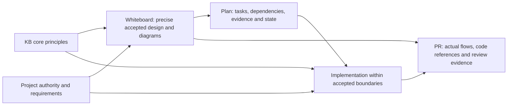

# Solution Whiteboard — Design and Implementation Planning

<!-- sdd: whiteboard -->

| Field | Value |
| --- | --- |
| State | `CONCLUDED` |
| Need / issue | [#187](https://github.com/hhhhhusky777/spec-driven-delivery-playbook/issues/187) |
| Owner | Repository owner |
| Concluded design revision | `4406e417cf7b96ed977a33ff04d4f1ed539c4335` |
| Open owner decisions | `None` |

This whiteboard records the solution for the owner-accepted G1–G9 change scope.
The fields above identify its conclusion state and revision; the PR owns review
and owner-acceptance evidence. It is not an implementation plan.

## Discussion draft

| ID | Agreed item, alternative, constraint, or gap | State / resolution |
| --- | --- | --- |
| DR01 | All 13 existing KB topics are referenced; strengthen mandatory application within both KB and project boundaries without repeating rules | accepted |
| DR02 | Whiteboard owns architecture and accepted behavior; plan owns engineering delivery, not another design decision | accepted |
| DR03 | Plan tasks follow actual dependencies and focus on one complete, verifiable outcome; task-planning methods belong in one new KB | accepted |
| DR04 | Accurate unambiguous text and corresponding diagrams are both needed; compare design with actual business, data and error-handling flows | accepted |
| DR05 | Keep necessary information, conditional detail, existing task fields and coverage inventory; consolidate generic execution prose | accepted |
| DR06 | No new gate, tracker, fixed task size, diagram quota or permission to change accepted scope; preserve current authority and delivery controls | accepted |

## Authority and context

| Source | Authority or relevant content | Freshness / verification |
| --- | --- | --- |
| [Issue #187](https://github.com/hhhhhusky777/spec-driven-delivery-playbook/issues/187) | Accepted need and G1–G9 scope from owner discussion | Recorded 2026-10-25 Asia/Shanghai |
| [Manifest](project-adoption-manifest.md) | Accepted pin and canonical project authorities | Design-review snapshot: accepted `1fff88498361cb1d18f62bcaab4b2f6893574bc9`; candidate `c2f83cb8868477a11415a83ea991459546a9f4c3` prepared. The manifest owns the current pin |
| [Contributing](../../CONTRIBUTING.md), [quality policy](../../docs/documentation-quality-policy.md), [template governance](../../docs/template-governance.md) | Branch/review authority, six goals, one responsibility per document | Source baseline `c2f83cb`; unchanged by this design candidate |
| [Error handling](../../docs/error-handling.md), [Experience](../../docs/experience.md) | Recovery, scope escalation and verified lessons | Preserve existing owners and controls |

## Current system and gaps

The source and installed workflow skills match. Topic-level read triggers exist,
and the global IMPORTANT requires reading, but the complete dual-boundary
application statement lives in the non-mandatory KB README. The plan contains
`Proposed design`, architecture decisions and an invitation to add feature
behavior; the whiteboard has no explicit architecture-view prompt. Task fields
already exist, but reusable decomposition guidance and design/code-view
traceability need clarification. These are the accepted gaps, not evidence
that all current delivery is invalid.

## Concluded design

The text below defines the design's semantics. Diagrams expose structure and
flows; they MUST NOT substitute for precise conditions or invite agents to
infer missing behavior. Implementation wording may be refined without changing
these semantics. Once concluded, existing amendment authority applies.

| Design point | Accepted outcome | Boundary or rationale | Validation signal |
| --- | --- | --- | --- |
| D01 | One common KB application contract in Solution Research requires solutions to satisfy applicable KB core principles and approved project scope, requirements, contracts and policies together | Existing topic-read triggers MUST require direct reading and application when the accepted pin ships the topic. Summaries or prior knowledge cannot replace reading. Genuine conflicts follow existing canonical decision/error authority, not silent relaxation | All existing topic routes remain; shared contract is reachable through workflow, review and triage; no competing normative copy in the KB index |
| D02 | Whiteboard owns the accepted solution: behavior, architecture, contracts, boundaries and material tradeoffs | It describes the chosen approach, responsibilities and relevant interactions, not just desired results; task execution/status and contract-equivalent engineering choices remain with the plan/agent | An engineer can implement without inventing architecture or externally visible behavior; plan references the same accepted IDs |
| D03 | Relevant architectural behavior has accurate, unambiguous text plus corresponding diagrams | State material inputs/preconditions, responsibilities, effects/postconditions, invariants, failure meaning and applicable quality/measurement requirements; link contracts already owned elsewhere rather than copy them. Use suitable UML/DFD-style views, combine views when clear, and explain genuine N/A. No universal diagram count or exhaustive case list | Text and diagram semantics agree; neither guesses nor an attractive diagram fill an unresolved contract |
| D04 | Plan translates the approved design into engineering implementation obligations, dependencies, evidence and delivery state | Move architecture ownership out of `Proposed design`/`Key decisions`; preserve useful content in its proper owner or link. Replace permission-like `add feature-specific behavior` with consumed approved contracts. Implementation choices may vary only within accepted boundaries | No duplicate architecture authority, lost necessary information or new business behavior; existing template completeness remains proportional |
| D05 | Add `knowledge-base/task-planning-and-decomposition.md` as the sole reusable task-planning method owner | Cover one coherent verifiable outcome, completeness, appropriate size, real acyclic dependencies, ready inputs, safe independent parallelism and acceptance evidence. No fixed file/line/time quota, mandatory worksheet or speculative prerequisite/framework | Published guidance is distilled with limits; workflow planning/replanning and reviewer plan assessment MUST read/apply the shipped topic |
| D06 | Existing task and detail fields clearly record the result of planning | Outcome names one complete observable result; dependencies name actual consumed prerequisites, not numbering or outputs required before their producing task starts; validation includes acceptance meaning and evidence. Keep existing fields and optional detail | A small plan identifies scope, dependencies and completion without extra status tables; large coherent work can be split without fragmentation |
| D07 | Existing design-to-task mapping connects approved points/diagrams to tasks and final implementation evidence | At the existing human implementation gate, compare actual code-grounded business, data and error-handling views with applicable approved text/diagrams. Compare semantics, not identical graph shapes; internal detail may differ without changing behavior | Missing or unauthorized behavior, ownership and failure changes are visible in the existing brief/findings; no new gate or comparison tracker |
| D08 | Generic execution rules have one owner instead of a second workflow in the plan | Keep task-specific obligations, coverage inventory, authorization and state; replace duplicated general execution sequence with references. Preserve existing branch-policy enforcement, freeze/amendment, reviewers/human gates, focused/final scheduling and per-task 90-minute rule | No mandatory control is weakened or moved into an optional document; no added approval boundary |
| D09 | Affected index, README, skills and tests agree, and adopting projects receive the complete new KB | Use existing installer distribution and manifest-linked resolution. Update affected diagrams/descriptions only; add meaningful structure/packaging evidence rather than exact-prose locks. Historical archives and unrelated #147/#142 work remain untouched | Relevant focused checks pass, later full source gate passes, and installed routing resolves without installing the source suite in adopters |

### Architecture and information ownership

Project authority and KB principles jointly bound the approved design. The plan
consumes that design; implementation consumes the approved plan and contracts.
The existing PR/human implementation brief compares actual results back to the
design. This describes ownership, not another prescribed execution sequence.

The distinction is decision impact, not whether a document mentions code.
Changing transaction ownership or retry meaning can require a design amendment
even for a tiny diff. Equivalent private helpers, file organization and fixtures
remain engineering choices. Text/diagram conflicts need correction under the
existing authority; neither representation licenses ignoring the other.

## Options, experiments, and tradeoffs

| Option | Disposition | Rationale |
| --- | --- | --- |
| Put planning methods into the plan template | rejected | Repeats reusable guidance in every delivery and mixes method with project facts |
| Diagrams alone or narrative alone | rejected | Neither alone provides the requested explicit contracts plus comparable structural views |
| One new planning KB with short required-read routes and bounded templates | accepted | Reuses existing roles, mapping, installer and review gates |
| Copy vendor templates, time targets, trunk policy or per-task design documents | rejected | Public examples do not override this project's approved boundaries or justify extra ceremony |

## Risks and consequences

| Risk | Handling and residual limit |
| --- | --- |
| Simplification removes a necessary contract/control | Preserve its information and authority; review before/after content ownership and affected regressions, not just deletion count |
| Structural checks are mistaken for proof of agent judgment | Combine structural/packaging checks with semantic author/reviewer checks of concrete situations; report that automated checks cannot guarantee future decisions |
| Readable figures conceal unresolved text or expand implementation scope | Require aligned precise text and diagram semantics; keep existing amendment/decision boundary, not an automatic stop for every harmless implementation detail |
| Source upgrade is confused with activating new feature guidance | Keep old pin until owner acceptance; prepared `c2f83cb` contains #186 testing KB, not this unimplemented planning feature |

## Draft-to-conclusion reconciliation

| Draft item | Concluded design point | Disposition | Rationale / evidence |
| --- | --- | --- | --- |
| DR01 | D01 | accepted | One common application owner and retained conditional read triggers |
| DR02 | D02, D04 | accepted | Architecture and engineering delivery have distinct authority |
| DR03 | D05, D06 | accepted | Reusable method is separate from concrete task facts |
| DR04 | D03, D07 | accepted | Accurate text, corresponding figures and code-grounded comparison |
| DR05 | D04, D08, D09 | accepted | Rehome necessary content and remove duplicate execution prose |
| DR06 | D01, D05, D08, D09 | accepted | Existing controls remain; methods and detail stay proportionate |

## Newly introduced validations

No new runtime/contract rejection or acceptance checkpoint is introduced.
Required reading, semantic review and design-conformance checks are clarified
within existing controls, not implemented as a new automated gate.

| ID | Validation, owning authority, and execution boundary | Protected outcome / risk and marginal value beyond existing controls | Concrete invalid case | Failure effect / recovery | Cost / risk reduction | Existing/reusable or cheaper mechanism, its coverage, and why insufficient | Fail-close / test reference | Owner disposition |
| --- | --- | --- | --- | --- | --- | --- | --- | --- |
| None | None | None | None | None | None | None | None | None |

## Newly introduced fail-closed behaviors

No new runtime fail-closed behavior. Material scope/authority conflicts still
use the existing framework; this design does not add new rejection machinery.

| ID | Trigger | Required fail-closed response | Concrete example | Impact | Recovery / best next action | Owner disposition |
| --- | --- | --- | --- | --- | --- | --- |
| None | None | None | None | None | None | None |

## Research basis and applicability

These primary sources were read during the owner discussion. The design is this
project's synthesis, not a vendor-mandated document taxonomy or universal size.

- [Google: Small CLs](https://google.github.io/eng-practices/review/developer/small-cls.html): cohesive self-contained changes, related evidence and meaningful decomposition, not a file/line quota.
- [Microsoft: Feature/story design](https://microsoft.github.io/code-with-engineering-playbook/design/design-reviews/recipes/templates/feature-story-design-review/): solution context, contracts, architecture and real dependency questions; do not copy the design into an execution plan.
- [Microsoft: Architecture specification](https://learn.microsoft.com/en-us/azure/well-architected/architect-role/architecture-design-specification): business-grounded decisions, interfaces, quality and operational requirements, then engineering work items.
- [Microsoft: Task dependencies](https://learn.microsoft.com/en-us/azure/devops/boards/queries/link-type-reference?view=azure-devops#work-link-type): actual directional prerequisites and cycle prevention, not a mandated project tool.
- [DORA: Small batches](https://dora.dev/capabilities/working-in-small-batches/): testable, valuable, appropriately sized work; its trunk/deployment practices do not override this repository's branch or final-validation policy.
- [AWS: Architecture decision records](https://docs.aws.amazon.com/prescriptive-guidance/latest/architectural-decision-records/faq.html): context, decisions and consequences; use existing whiteboard decision records, not new ADR files.

## Human brief

Acceptance of D01–D09 and the prepared upgrade from `1fff884` to `c2f83cb`
permits the metadata-only conclusion transition, reviewer verification and
subsequent implementation planning. It does not approve a later plan, enable
Autopilot, authorize template/skill implementation before readiness, or permit
merge. Review and acceptance evidence belongs in the PR.
