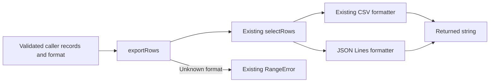

# Accepted JSON Lines export design

State: CONCLUDED
Owner acceptance: fixture owner, 2026-10-28
Design reviewers: both approved this supplied local snapshot before preparation.

| ID | Accepted design / boundary |
| --- | --- |
| D1 | Preserve CSV behavior and selectRows ownership, validation preconditions and row ordering from CONTRACT.md; no new dependency, network or storage |
| D2 | Add a JSON Lines formatter over the same selected records using JSON.stringify; output id/title only; empty selection returns an empty string |
| D3 | Extend exportRows to dispatch csv/jsonl after the existing selection; unknown formats keep RangeError; do not duplicate filtering or invent plugins |
| D4 | Prove CSV compatibility, JSONL special-character handling, empty selection and dispatch behavior with focused public-operation tests |
| D5 | Feature branch codex/export-jsonl integrates task PRs; only final feature PR targets main; retain human review before merge unless explicitly changed |

The diagram shows responsibilities and possible outcomes, not a demand to run
selection before rejecting an unsupported format. The text owns behavior.
No new fail-closed behavior, runtime validation or material assumption is
accepted. Tests implement D4; they do not add rejection policy. Live CONTRACT.md
already describes the intended format addition; update public usage guidance
with implementation. No authority amendment or product implementation is part
of this planning assignment.
