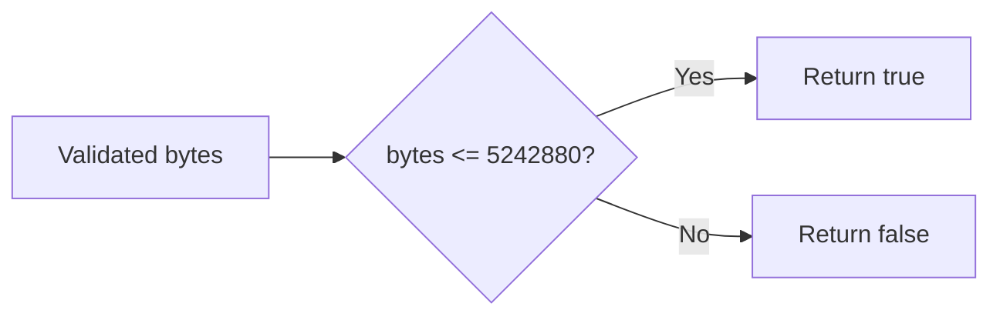

# Upload implementation plan

## Task state

| Task | Design consumed | Outcome | State |
| --- | --- | --- | --- |
| T01 | D01 | Inclusive 5 MiB admission | DONE |

## Implementation review

Reported outcome: admits exactly 5 MiB. Code: upload.mjs.

## Final-test inventory

Pending: add exact-limit and above-limit regression cases and run the complete
local upload suite after implementation audit and explicit human acceptance.

## Gate state

Author and reviewer audit: pending. Human implementation acceptance: pending.
No final-validation result or merge authority exists.
