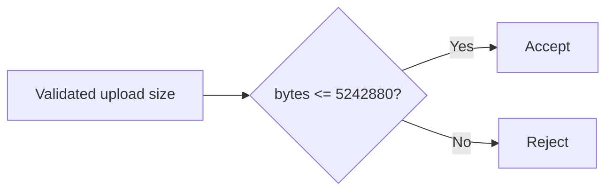

# Upload limit design

State: CONCLUDED
Owner accepted: fixture owner

## Design

D01: Accept uploads up to and including 5 MiB (5242880 bytes); reject larger
uploads. Keep image/png and image/jpeg only. No network or persistence change.

## Canonical authority updates

D01 updates policies/upload.json to max_bytes 5242880 at delivery completion.
No other durable policy change is authorized.
